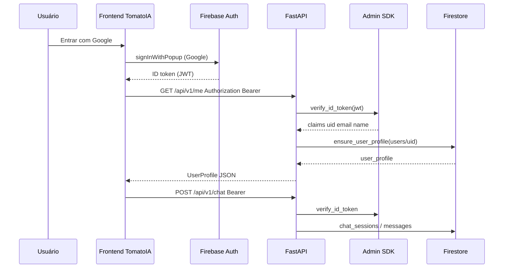

# Autenticação e identidade — mqtt-chat (v1)

Documento **único** do projeto: decisões normativas, arquitetura, contratos HTTP, Firestore e onboarding para desenvolvedores.

| | |
|---|---|
| **Versão** | **v1** |
| **Implementação** | Backend: [`src/mqtt_chat/api/deps.py`](../src/mqtt_chat/api/deps.py), [`clients/firebase.py`](../src/mqtt_chat/clients/firebase.py), [`services/user_profile.py`](../src/mqtt_chat/services/user_profile.py), rotas [`api/routes/me.py`](../src/mqtt_chat/api/routes/me.py) · Frontend: [`services/frontend/`](../services/frontend/) (Firebase Auth Web) |
| **Task** | [006-user-auth-chat-mcp.md](../task/006-user-auth-chat-mcp.md) (fases 6a/6b) |
| **Precedência** | Em conflito de produto, [`.cursor/rules/mqtt-chat-project.mdc`](../.cursor/rules/mqtt-chat-project.mdc) e [`requirements.md`](requirements.md). Nomenclatura: [`glossary.md`](glossary.md). Logs de auth: [`logging.md`](logging.md) §5.3.1 |

---

## 1. Por que existe

A plataforma **TomatoIA** / mqtt-chat é **multi-tenant por usuário**: telemetria, devices, chat e tools MCP (fases futuras) devem estar **sempre** escopados ao **`user_id`** (Firebase Auth UID).

Este documento define:

1. **Quem autentica** — Firebase Authentication (**Google** no MVP; GitHub fora do escopo v1).
2. **Como o backend confia no usuário** — validação do **ID token** JWT (Bearer) via **Firebase Admin SDK**; **nunca** confiar em `user_id` enviado pelo cliente no corpo da requisição.
3. **Onde vive o perfil de aplicação** — Firestore `users/{user_id}` (complementar ao registro Auth).
4. **Como o frontend obtém o token** — Firebase Auth Web no microserviço `services/frontend/`; API FastAPI **somente** HTTP + Bearer.
5. **O que não fazer** — expor Admin SDK ou service account no browser; logar ID tokens; deixar o LLM “fazer login”.

---

## 2. Arquitetura em uma página

### 2.1 Separação de responsabilidades

| Camada | Tecnologia | Credencial |
|--------|------------|------------|
| **Browser (UI)** | Firebase Auth **Web SDK** | Config pública `VITE_FIREBASE_*`; ID token efêmero |
| **API FastAPI** | Firebase **Admin SDK** | Service account JSON (`GOOGLE_APPLICATION_CREDENTIALS`) — **somente servidor** |
| **Firestore (cliente direto)** | Rules + Auth Web (futuro leitura UI) | UID nas rules; MVP chat/perfil via **Admin no backend** |
| **Worker MQTT** | Admin SDK (telemetria) | Mesma service account; **independente** do token do usuário |

**Regra de ouro:** o **LLM** e tools MCP **nunca** recebem a service account nem executam login OAuth; o **usuário** autentica na UI; o **backend** valida o Bearer em cada rota protegida.

### 2.2 Fluxo de login e chamada à API



1. O **ID token** é obtido no browser (`user.getIdToken()`).
2. Cada request à API envia `Authorization: Bearer <id_token>`.
3. `get_current_user` decodifica e expõe `AuthenticatedUser.user_id` (= `uid`).
4. Rotas de negócio usam **somente** esse `user_id` para queries Firestore e contexto do agente.

### 2.3 Pacotes backend (mapa)

```
src/mqtt_chat/
├── api/
│   ├── deps.py                 # HTTPBearer, get_current_user, require_firestore
│   └── routes/
│       ├── me.py               # GET/PATCH /api/v1/me
│       └── chat.py             # rotas protegidas (chat)
├── clients/
│   └── firebase.py             # ensure_firebase_app, verify_id_token, get_firestore_client
├── schemas/
│   └── user.py                 # UserProfileResponse, UserProfileUpdateRequest
└── services/
    └── user_profile.py         # ensure_user_profile, update_user_display_name
```

Microserviço UI:

```
services/frontend/
├── src/auth/                   # AuthProvider, Firebase Google sign-in
├── src/api/client.ts           # Bearer via getIdToken()
└── .env                        # VITE_FIREBASE_* (não versionado)
```

### 2.4 Identidade: Auth vs perfil

| Conceito | Onde | Campo canônico |
|----------|------|----------------|
| Conta de login | Firebase Authentication | `uid` → **`user_id`** no backend |
| Provedor OAuth | Claims Firebase | `google.com` → `auth_providers` |
| Nome exibido (chat, UX) | Firestore `users/{user_id}` | `display_name` (editável PATCH) |
| E-mail / foto | Espelho do token + Firestore | `email`, `photo_url` (foto read-only no MVP) |

Primeiro `GET /me` após login **cria** o documento Firestore se não existir (`ensure_user_profile`).

---

## 3. API para desenvolvedores (backend)

### 3.1 Proteger uma rota FastAPI

```python
from typing import Annotated

from fastapi import APIRouter, Depends
from google.cloud.firestore_v1 import Client as FirestoreClient

from mqtt_chat.api.deps import AuthenticatedUser, get_current_user, require_firestore

router = APIRouter()


@router.get("/api/v1/exemplo")
async def exemplo(
    user: Annotated[AuthenticatedUser, Depends(get_current_user)],
    db: Annotated[FirestoreClient, Depends(require_firestore)],
):
    # user.user_id — UID Firebase; user.decoded_token — claims (name, email, picture, firebase)
    ...
```

| Dependência | Função |
|-------------|--------|
| `get_current_user` | Exige header `Authorization: Bearer`; valida JWT; **401** se ausente/inválido |
| `require_firestore` | Cliente Firestore Admin; **503** `firebase_not_configured` se projeto/credenciais ausentes |

### 3.2 Validar token (cliente único)

```python
from mqtt_chat.clients.firebase import verify_id_token
from mqtt_chat.config.settings import get_settings

decoded = verify_id_token(id_token_string, get_settings())
uid = decoded["uid"]
```

- Usado **internamente** por `get_current_user`.
- **Não** expor endpoint público de “troca de token”.
- `check_revoked=False` na v1 PoC; rotação/revogação em produção — evoluir conforme [Firebase Auth docs](https://firebase.google.com/docs/auth/admin/verify-id-tokens).

### 3.3 Tipo `AuthenticatedUser`

```python
@dataclass(frozen=True)
class AuthenticatedUser:
    user_id: str
    decoded_token: dict[str, Any]
```

- **`user_id`**: usar em **todas** as queries (`devices`, `chat_sessions`, tools MCP futuras).
- **`decoded_token`**: passar a `ensure_user_profile` para espelhar `email`, `picture`, providers.

---

## 4. Contratos HTTP

### 4.1 Perfil — `/api/v1/me`

| Método | Auth | Corpo | Resposta |
|--------|------|-------|----------|
| `GET` | Bearer | — | `UserProfileResponse` |
| `PATCH` | Bearer | `{ "display_name": "..." }` | `UserProfileResponse` |

Campos (`UserProfileResponse`): `user_id`, `email`, `display_name`, `photo_url`, `auth_providers`, `created_at`, `updated_at` — inglês no JSON ([`glossary.md`](glossary.md)).

**PATCH MVP:** somente **`display_name`** é editável; `photo_url` vem do provedor (read-only).

### 4.2 Chat e demais rotas autenticadas

- `POST /api/v1/chat`, `POST /api/v1/chat/stream` — exigem Bearer; escopo de dados pelo `user_id` do token.
- `GET /health` — **sem** auth (health operacional).

### 4.3 Códigos `detail` (erros auth)

| HTTP | `detail` | Causa típica |
|------|----------|----------------|
| 401 | `missing_authentication` | Sem header Bearer |
| 401 | `invalid_token` | JWT inválido ou verificação falhou |
| 401 | `expired_token` | Token expirado (renovar no client com `getIdToken()`) |
| 401 | `revoked_token` | Token revogado |
| 503 | `firebase_not_configured` | `FIREBASE_PROJECT_ID` / credenciais ausentes |

Evento de log associado a falhas de token: `auth.token.rejected` ([`logging.md`](logging.md) §5.3.1). **Nunca** logar o JWT.

---

## 5. Firestore e regras de segurança

### 5.1 Documento de perfil

Coleção: **`users/{user_id}`** (id do documento = Auth UID).

| Campo | Origem |
|-------|--------|
| `user_id` | UID |
| `display_name` | Token `name` ou e-mail local-part; editável PATCH |
| `email`, `photo_url` | Claims OAuth (atualizados no login) |
| `auth_providers` | Claims `firebase.identities` / `sign_in_provider` |
| `created_at`, `updated_at` | ISO UTC (`Z`) |

Chat (histórico in-scope): **`users/{user_id}/chat_sessions/{session_id}/messages/{message_id}`** — escrita via **Admin SDK** no backend; ver task 007 para turnos off-topic não persistidos.

### 5.2 Rules (rascunho publicado)

Arquivo: [`firebase/firestore.rules`](../firebase/firestore.rules). Deploy:

```bash
firebase deploy --only firestore:rules
```

Resumo:

- `users/{userId}`: read/update/create se `request.auth.uid == userId`; delete negado no MVP.
- Subcoleções `chat_sessions` / `messages`: mesmo `userId`.
- `devices/{deviceId}`: read/write se `resource.data.user_id == request.auth.uid`.
- Telemetria: leitura se device pertence ao uid; escrita **false** (ingestão só Admin/worker).

Rules protegem acesso **direto** do cliente Firestore; o backend PoC usa **Admin** (bypass rules) — mesmo assim rules são obrigatórias para SDK Web futuro e defesa em profundidade.

---

## 6. Regras obrigatórias

### 6.1 Segurança

- **NUNCA** commitar `.env`, `secrets/service-account.json`, ou ID tokens.
- **NUNCA** logar ID token, refresh token ou conteúdo de `Authorization` ([`logging.md`](logging.md) §6.1).
- **NUNCA** passar `user_id` vindo do corpo JSON como fonte de verdade — sempre `AuthenticatedUser.user_id`.
- **NUNCA** implementar login Google como **tool do LLM**; OAuth é **UI** (`services/frontend/`).
- Service account **somente** no backend (`GOOGLE_APPLICATION_CREDENTIALS`).

### 6.2 MVP vs produção

| Tema | MVP (v1) | Evolução |
|------|----------|----------|
| Provedores | **Google** | GitHub, etc. — alterar `requirements.md` + glossário |
| Domínios OAuth | `localhost` + domínio deploy | Console Firebase → Authorized domains |
| Mosquitto | Dev local anônimo | ACL por device pós-adoção |
| Custom claims | Não exigido | Opcional para rules avançadas |

### 6.3 Idioma e nomenclatura

- Docstrings/comentários: **português**.
- Identificadores, campos JSON, `detail` HTTP: **inglês** ([`glossary.md`](glossary.md): `user_id`, `display_name`, `identity_provider`).

---

## 7. Configuração (ambiente)

### 7.1 Backend (raiz do repo)

Variáveis em [`.env.example`](../.env.example) / [`Settings`](../src/mqtt_chat/config/settings.py):

| Variável | Obrigatória (auth/chat) | Descrição |
|----------|-------------------------|-----------|
| `FIREBASE_PROJECT_ID` | Sim | Projeto Firebase (ex.: `chat-mqtt-9d91d`) |
| `GOOGLE_APPLICATION_CREDENTIALS` | Sim (dev local) | Caminho ao JSON da service account |
| `WORKER_PERSIST_MODE` | Recomendado `firestore` | Worker usa mesmo Firestore; auth usa `get_firestore_client` independente do mode |

Inicialização Admin: primeira chamada a `ensure_firebase_app` → log `firebase.initialized`.

### 7.2 Frontend (`services/frontend/.env`)

| Variável | Descrição |
|----------|-----------|
| `VITE_FIREBASE_*` | Config Web do Console (apiKey, authDomain, projectId, …) |
| `VITE_API_BASE_URL` | URL do FastAPI **vista pelo browser** (ex.: `http://127.0.0.1:8000`) |

Template: [`services/frontend/.env.example`](../services/frontend/.env.example).

### 7.3 Firebase Console (checklist)

- [ ] **Authentication → Sign-in method → Google** habilitado
- [ ] **Authentication → Settings → Authorized domains** — incluir `localhost` (dev)
- [ ] App Web registrado; config copiada para `VITE_FIREBASE_*`
- [ ] **Firestore rules** publicadas (`firebase.json`, `.firebaserc`)

Documentação oficial: [Firebase Auth Web](https://firebase.google.com/docs/auth/web/start), [Verify ID tokens (Admin)](https://firebase.google.com/docs/auth/admin/verify-id-tokens).

---

## 8. Frontend — integração resumida

1. `signInWithPopup(GoogleAuthProvider)` → sessão Firebase.
2. `onAuthStateChanged` → `GET /api/v1/me` com Bearer.
3. Cliente HTTP: `Authorization: Bearer ${await user.getIdToken()}` ([`api/client.ts`](../services/frontend/src/api/client.ts)).
4. Falha em `/me` → logout local + mensagem de erro (ex.: API offline, `firebase_not_configured`).

CORS da API: origens `http://localhost:5173` / `127.0.0.1:5173` ([`api/app.py`](../src/mqtt_chat/api/app.py)).

---

## 9. Mapa de módulos

| Arquivo | Função |
|---------|--------|
| [`api/deps.py`](../src/mqtt_chat/api/deps.py) | Bearer, `AuthenticatedUser`, erros 401/503 |
| [`clients/firebase.py`](../src/mqtt_chat/clients/firebase.py) | Admin app, Firestore client, `verify_id_token` |
| [`services/user_profile.py`](../src/mqtt_chat/services/user_profile.py) | CRUD perfil mínimo Firestore |
| [`api/routes/me.py`](../src/mqtt_chat/api/routes/me.py) | HTTP perfil |
| [`schemas/user.py`](../src/mqtt_chat/schemas/user.py) | Contratos Pydantic |
| [`firebase/firestore.rules`](../firebase/firestore.rules) | Rules multi-tenant |
| [`services/frontend/src/auth/`](../services/frontend/src/auth/) | Login Google, contexto React |

---

## 10. Anti-padrões

| Não fazer | Fazer |
|-----------|--------|
| Aceitar `user_id` no body para autorizar | `Depends(get_current_user)` |
| Firebase Admin no frontend | Auth Web SDK + Bearer na API |
| Logar token ou service account | `auth.token.rejected` sem JWT |
| LLM ler QR ou fazer OAuth | UI de adoção; chat orienta texto |
| Usar `usuario_id`, `UserAuth` inventado | [`glossary.md`](glossary.md): `user_id`, `user_profile` |
| Confiar só em prompt para multi-tenant | Token + Firestore/rules + injeção em tools MCP |

---

## 11. Verificação manual (checklist dev)

- [ ] Google sign-in no frontend; Network mostra `GET /me` **200**.
- [ ] `GET /me` sem Bearer → **401** `missing_authentication`.
- [ ] Documento `users/{uid}` criado no Firestore após primeiro login.
- [ ] `PATCH /me` altera `display_name`; resposta coerente.
- [ ] Chat com Bearer funciona; sem Bearer → **401**.
- [ ] Logs: rejeição de token gera `auth.token.rejected` **sem** JWT no JSON.
- [ ] `.env` e `secrets/*.json` **não** aparecem no `git status`.

Exemplo curl (substituir `<ID_TOKEN>` obtido no client):

```bash
curl -s -H "Authorization: Bearer <ID_TOKEN>" http://127.0.0.1:8000/api/v1/me | jq .
```

---

## 12. Aprovação (v1)

- [ ] **Aprovado v1** — data: __________

---

## 13. Histórico

| Data | Alteração |
|------|-----------|
| 2026-10-11 | v1 — documento canônico auth (task 006/007); Google MVP; Bearer + Admin SDK |
