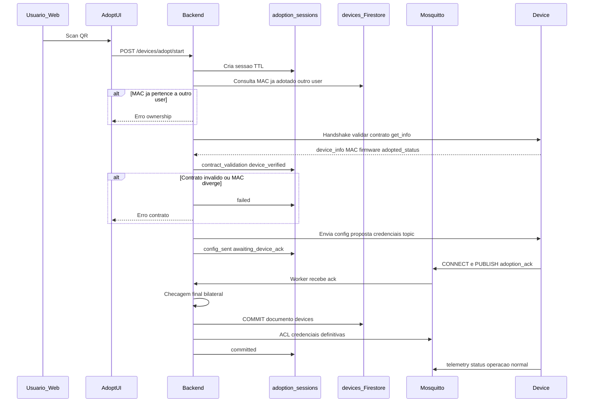

# Contrato — adoção, identidade e rede MQTT (v1.1)

| Campo | Valor |
|-------|--------|
| Versão | **v1.1** (+ **v1.2-dev** UC-A — ver §3.4, §4.2.1) |
| Status | **Rascunho normativo** — aguardando aprovação humana |
| Task | [003-adoption-network-contracts.md](../../task/003-adoption-network-contracts.md) · refinamento v1.2: [008-device-adoption-handshake-refinement.md](../../task/008-device-adoption-handshake-refinement.md) |
| Glossário | [`docs/glossary.md`](../glossary.md) |
| Requirements | [`docs/requirements.md`](../requirements.md) §4.2–4.3, §5 |

Este documento **prevalece** sobre rascunhos soltos em requirements para tópicos, payloads de adoção e identidade do `device`. Em conflito com [`docs/glossary.md`](../glossary.md), atualizar o glossário após decisão explícita.

---

## 1. Objetivo e princípios

1. **UX mínima:** usuário autenticado escaneia QR na web; o backend conduz pareamento até o device confirmar; só então o device aparece na conta do usuário. **Adoção = registro:** a **única** forma de **adicionar** um device à conta é este fluxo — **sem** tool MCP, **sem** API “cadastrar device” fora de `adopt/*` no MVP.
2. **Commit tardio na base:** o documento canônico em **`devices` (Firestore)** é criado **somente** quando, em conjunto:
   - o device **cumpre o contrato** (metadados, payloads, MAC coerente com o QR/sessão);
   - **não** existe registro adotado do mesmo `mac_address` para **outro** `user_id` (e o firmware não reporta adoção prévia a outro dono);
   - a **comunicação de adoção** terminou com **confirmação explícita do device** e validação final do backend (handshake completo).
3. **Separação de identidades:**
   - **`mac_address`** — hardware, único globalmente, imutável após cadastro factory.
   - **`device_id`** — UUID estável gerado na sessão de adoção e **persistido no commit**; aparece em tópicos e Firestore.
   - **`mqtt_topic_base`** — prefixo MQTT **único** persistido; usado por worker, ACL e firmware pós-adoção.
4. **QR não carrega senha MQTT** nem credenciais WiFi.
5. **Multi-tenant desde o desenho:** namespace `tenants/{user_id}/devices/{device_id}/...` (mantido da PoC).
6. **Transporte device ↔ plataforma (MVP):** handshake de adoção, config proposta, ack e tráfego operacional (telemetria, comandos, status) são **somente MQTT** via Mosquitto. A UI e a API usam **HTTP** para o usuário autenticado (`/devices/adopt/*`, etc.); o backend **orquestra** a sessão e publica/assina no broker — **sem** REST exposto ao firmware para adoção na v1. Serial USB (referência device_app) **não** faz parte do fluxo web MVP.
7. **WiFi provisioning (SSID/senha, SoftAP, BLE, serial):** **fora do escopo do backend mqtt-chat v1**. Será definido e implementado no **projeto firmware/device** quando o embarcado for desenvolvido. O handshake MQTT **não substitui** WiFi: o backend **assume** que o device já alcança o broker (ou que o firmware provisionou rede **antes** de participar do handshake). Payload `.../config` do backend envia **somente** parâmetros MQTT + identidade (§6.6), **sem** `wifi_ssid` / `wifi_password` na v1.

Durante o pareamento, estado fica em **`adoption_sessions`** (TTL). Inventário de fábrica (`factory_inventory`), se existir, **não** substitui `devices` nem implica proprietário.

---

## 2. Persistência Firestore

### 2.1 Coleção `devices` (documento por `device_id`) — **somente pós-commit**

Registro **definitivo** do device adotado. **Não** criar documento aqui no scan do QR nem no primeiro `POST` da UI.

| Campo | Tipo | Obrigatório | Descrição |
|-------|------|-------------|-----------|
| `device_id` | string (UUID) | sim | ID do documento e chave lógica pública |
| `user_id` | string \| null | pós-adoção | Firebase Auth UID do proprietário |
| `mac_address` | string | sim | MAC normalizado `AA:BB:CC:DD:EE:FF` (uppercase, `:`) |
| `mqtt_topic_base` | string | pós-adoção | Ex.: `tenants/{user_id}/devices/{device_id}` — **unique** |
| `device_type` | `"sensor"` \| `"actuator"` | sim | Ver glossário |
| `model` | string | sim | Ex.: board / SKU (`ESP32`, `ESP32-C3`) |
| `sensor_type` | string | se sensor | Ex.: `DHT22`, `BME280` |
| `actuator_type` | string | se actuator | Ex.: `relay` |
| `parameter_ranges` | object | recomendado sensor | Espelho device_app — §6 |
| `command_spec` | object | recomendado actuator | Espelho device_app — §6 |
| `firmware_version` | string | opcional | |
| `adoption_status` | enum | sim | Sempre `adopted` nesta coleção (registros só entram após commit) |
| `adopted_at` | timestamp | sim | Momento do commit |
| `created_at` | timestamp | sim | Igual ou próximo de `adopted_at` |
| `updated_at` | timestamp | sim | |
| `operation_status` | `"online"` \| `"offline"` \| omitido | opcional | Ingerido de `.../status` (LWT → offline); ausente = presença desconhecida no chat |
| `last_seen_at` | string ISO UTC | opcional | Atualizado em telemetria/status/state |
| `last_command` | object | opcional atuador | Espelho do último payload publicado em `.../commands` (≤ 1 KiB JSON) — ver [`actuator-binary-command.md`](actuator-binary-command.md) |
| `last_command_at` | string ISO UTC | opcional atuador | Momento do último `publish_command` / confirmação G10 |
| `last_reported_state` | object | opcional | Resumo do último MQTT `.../state` (≤ 2 KiB) — worker [011-i](../task/011-chat-session-context-policy.md) |
| `last_reported_state_at` | string ISO UTC | opcional | Timestamp da ingestão do state acima |

**Precedência (copy TomatoIA):** `last_command` descreve o que a **plataforma** enviou; `last_reported_state` reflete o que o **firmware** reportou. Em conflito, não assumir sucesso silencioso — citar ambos ou pedir nova leitura de state.

**Índices recomendados:** `mac_address` (unique entre `adopted`), `mqtt_topic_base` (unique), `user_id`.

### 2.2 Coleção `adoption_sessions` (transitória)

Estado **em andamento** entre scan do QR e commit. Tolerância de handshake configurável (§4.5, default **5 min**); documento **apagado ou arquivado** após sucesso, falha ou expiração.

| Campo | Tipo | Descrição |
|-------|------|-----------|
| `session_id` | string (UUID) | ID do documento |
| `user_id` | string | Usuário autenticado que iniciou |
| `claim_token` | string \| null | Do QR (QR-C) |
| `mac_address` | string \| null | Resolvido do token, QR-A ou `device_info` |
| `session_status` | enum | `started` \| `device_verified` \| `config_sent` \| `awaiting_device_ack` \| `committed` \| `failed` \| `expired` |
| `device_info_candidate` | object | Snapshot `get_info` / §6.5 validado |
| `contract_validation` | object | Resultado das checagens (schema, tipos, ranges) |
| `proposed_device_id` | string (UUID) | Gerado na sessão; usado no commit se ainda não existir em `devices` |
| `proposed_mqtt_topic_base` | string | Calculado antes do envio ao firmware |
| `expires_at` | timestamp | `started_at` + tolerância de handshake (§4.5) |
| `failure_reason` | string \| null | Código **interno** (logs, suporte) — ex.: `handshake_timeout`, `ownership_conflict` — **não** expor ao usuário |
| `user_message` | string \| null | Texto **PT**, curto, seguro para UI/chat se `failed` ou `expired` (§4.5) |

**Não** usar `adoption_sessions` para listagem de devices do usuário nem para ingestão de telemetria.

### 2.3 Coleção `factory_inventory` (opcional, pré-venda)

Vínculo fábrica **MAC ↔ `claim_token`** (e metadados estáticos: `model`, lote). **Sem** `user_id`. Não equivale a device adotado.

Estado sugerido do token (não confundir com “queimado para sempre”):

| `claim_token_status` | Significado |
|----------------------|-------------|
| `available` | Pode iniciar adoção (device não adotado ou elegível a re-adoção — §3.2) |
| `adoption_in_progress` | Sessão ativa; outro `adopt/start` com o mesmo token → rejeitar ou retomar política única |
| `bound` | Commit OK; device consta em `devices` — **não** iniciar nova adoção para outro `user_id` até **liberação** (remoção + reset, §3.2) |

O **mesmo** `claim_token` do sticker **pode** voltar a `available` após `remove_device` (conta anterior) **e** factory reset / firmware `adopted_status = 0`, para outro usuário adotar a **mesma placa**.

### 2.4 O que é “único no banco”

- **Negócio:** no máximo um registro **`devices` adotado** por placa (`mac_address` unique entre documentos com `adoption_status`: `adopted`).
- **MQTT ingestão:** worker resolve mensagens pelo prefixo **`mqtt_topic_base`** (unique), não pelo MAC no tópico pós-adoção.
- **`device_id`** é a chave estável para APIs, tools MCP e paths Firestore; **não** substituir por MAC em tópicos de produção.

### 2.5 Invariantes de identidade (não é chave composta)

A “chave lógica” **não** é a concatenação `device_id + mac_address`. São **dois identificadores** com relação **1:1** na coleção `devices`:

| Identificador | Papel | Unicidade |
|---------------|--------|-----------|
| `device_id` | ID do documento Firestore, tópicos MQTT, APIs | Um UUID por registro; document ID |
| `mac_address` | Identidade de hardware (placa) | **Unique** em toda a coleção `devices` |

**Regra:** para cada placa física existe **no máximo um** `device_id` adotado. O mesmo `mac_address` **não pode** aparecer em dois documentos com `device_id` diferentes. O commit **must** falhar (transação / regra de escrita) se já existir documento com aquele MAC.

```
mac_address  ──1:1──  device_id  ──1:1──  mqtt_topic_base
   (hardware)         (lógico)         (rede MQTT)
```

**Por que dois campos e não só MAC?**

- MAC identifica **hardware** (QR, anti-clonagem, fábrica).
- `device_id` identifica **entidade lógica** estável (tópico, histórico, ACL) mesmo se no futuro houver política de **substituir placa** ou rotacionar credenciais sem mudar o “device” na UX — nesse caso seria evolução explícita (v2), não dois IDs ativos para o mesmo MAC.

**Riscos que a spec evita**

| Cenário | Mitigação |
|---------|-----------|
| Duas sessões, mesmo MAC, `proposed_device_id` diferentes | Commit atômico; segundo commit falha no índice unique `mac_address` |
| Re-adoção após factory reset | Política MVP: **reutilizar** o mesmo documento `devices` (atualizar credenciais) **ou** arquivar o antigo e criar novo — **nunca** dois documentos ativos com o mesmo MAC |
| MAC spoofing | Fora do escopo v1; handshake + nonce reduz adoção remota fácil |

Durante `adoption_sessions`, `proposed_device_id` é provisório até o commit; só entra em `devices` se o MAC ainda não estiver adotado.

---

## 3. Conteúdo do QR code

### 3.1 Opções analisadas

| ID | Conteúdo | Uso | Veredito v1 |
|----|----------|-----|-------------|
| QR-A | Só `mac_address` (texto ou JSON `{ "v":1, "mac":"..." }`) | Sticker simples, dev, fábrica sem backend token | **Alternativa** (PoC/fábrica mínima) |
| QR-B | Tópico pré-adoção com MAC normalizado (`unclaimed/devices/3C71BF4DDB0C`) | Firmware publica antes do scan | **Opcional** fase transitória; **não** canônico no Firestore |
| QR-C | Deep link `https://<app>/adopt?t=<claim_token>` | Produto MVP | **Preferido** |
| QR-D | MAC + topic | — | **Rejeitado** (redundante, QR maior) |

### 3.2 Decisão MVP — fases

| Fase | QR / lookup | Prefixo handshake |
|------|-------------|-------------------|
| **v1.2-dev (implementação atual)** | **QR-A** — `mac_address` em `POST /devices/adopt/start` (ou simulador) | **UC-A:** `unclaimed/devices/{mac_normalized}` |
| **Produção (posterior)** | **QR-C** — deep link + `claim_token` + **`factory_inventory`** | **UC-B:** secret de fábrica (§3.1) |

#### QR-C (produto alvo)

- Sticker ou tela de pareamento expõe **URL com `claim_token` opaco**.
- Lookup do token em **`factory_inventory`** ou validação criptográfica — **sem** criar documento em `devices`.
- Scan inicia **`adoption_session`**; MAC vem do inventário ou do handshake com o device.
- **Commit** (documento em `devices` + ACL Mosquitto + credenciais definitivas) **somente** após §4.

**`claim_token` — ciclo de vida (não é uso único vitalício):**

- Enquanto o device **está adotado** em `devices`, o token fica **`bound`** — impede segunda conta adotar a mesma placa (RF-ADOPT-04).
- **Após commit bem-sucedido:** marcar token **`bound`** (invalida **nova** adoção paralela com aquele token até liberação); **não** apagar o token da fábrica como se o QR deixasse de existir.
- **Re-adoção (outro `user_id`):** permitida somente se o device **não** estiver adotado — ex.: proprietário anterior fez **`remove_device`**, firmware em fábrica/reset, documento `devices` removido ou arquivado conforme política MVP. Então o **mesmo** QR/`claim_token` **pode** iniciar nova sessão (`available`).
- **Falha / timeout / abort** (§4.5): token **não** passa a `bound`; permanece **`available`** (ou volta de `adoption_in_progress`).

### 3.3 Alternativa QR-A (dev / fábrica mínima)

- QR contém apenas MAC; sessão exige usuário autenticado + **ausência** de `devices` adotado com esse MAC para outro `user_id`.
- **Risco:** MAC enumerável — mitigar com rate limit, confirmação na UI e evolução para QR-C antes de produção.

### 3.4 Tópico pré-adoção — **UC-A (v1.2-dev)**

| Fase | Prefixo | Notas |
|------|---------|--------|
| Pré-adoção | `unclaimed/devices/{mac_normalized}` | `mac_normalized` = 12 hex **uppercase**, sem `:` (ex.: `3C71BF4DDB0C`) |
| Pós-adoção | `tenants/{user_id}/devices/{device_id}` | = `mqtt_topic_base`; firmware **must** migrar após ack (§4.4) |

**Anti-fake v1.2-dev (sem inventário):** **`factory_inventory` não é obrigatório.** Validações mínimas: usuário autenticado; `mac_address` na sessão; MAC em `.../info` **igual** ao da sessão; `session_id` / **nonce** em config/ack; TTL §4.5; firmware `adopted_status` coerente (RF-ADOPT-04/05). **RF-ADOPT-07 completo** (token ↔ fábrica) entra com **QR-C / UC-B**.

Telemetria operacional **não** persiste sob `unclaimed/`; worker usa `unclaimed/.../info` e `.../ack` só para handshake (§4.2.1).

---

## 4. Fluxo de adoção

Ordem lógica: **QR → sessão → validação contrato + posse → handshake com device → commit (Firestore + Mosquitto) → operação normal**.



### 4.1 Fases

| Fase | O que acontece | Persistência |
|------|----------------|--------------|
| **1 — Scan** | Usuário autenticado; `POST /devices/adopt/start` com `claim_token` ou `mac_address` | Cria `adoption_sessions`; **não** escreve `devices` |
| **2 — Elegibilidade** | Token válido; consulta `devices` por MAC — rejeita se já adotado por outro `user_id`; firmware `adopted_status` / `user_uuid` coerente | Atualiza sessão ou `failed` |
| **3 — Contrato** | Backend obtém `device_info` (MQTT canal §4.2, serial ou equivalente); valida `device_type`, `parameter_ranges` / `command_spec`, MAC | `device_verified` + `contract_validation` |
| **4 — Proposta** | Gera `proposed_device_id`, `proposed_mqtt_topic_base`, credenciais MQTT (temporárias ou já definitivas **sem** commit Firestore até ack) | `config_sent` |
| **5 — Confirmação device** | Device aplica config, conecta, publica **`adoption_ack`** (§6.7) | `awaiting_device_ack` |
| **6 — Commit** | Backend valida ack (session_id, MAC, nonce); **transação lógica:** insert `devices`, ACL Mosquitto, invalidar token/sessão | **Único momento** do registro canônico |

Se a sessão expirar ou o ack não chegar a tempo → **nenhum** documento novo em `devices`.

### 4.2 Canal MQTT de adoção (handshake)

#### 4.2.1 Canônico v1.2-dev — prefixo **UC-A**

Base: `{unclaimed_topic_base}` = `unclaimed/devices/{mac_normalized}`.

| Tópico completo | Direção | Uso |
|-----------------|---------|-----|
| `{base}/announce` | Device → broker | Presença opcional (retain); MAC, firmware |
| `{base}/challenge` | Backend → device | `session_id`, `nonce` |
| `{base}/info` | Device → backend | §6.5 + `session_id`; worker entrega ao serviço de adoção |
| `{base}/config` | Backend → device | §6.6 (proposta + nonce) |
| `{base}/ack` | Device → backend | §6.7 — dispara commit |

**Deprecated (não implementar v1.2-dev):** `adoption/sessions/{session_id}/...` (rascunho v1.1).

WiFi: §1 princípio 7 / §7.1 (firmware, não backend).

### 4.3 APIs (MVP)

| Método | Rota | Efeito |
|--------|------|--------|
| `POST` | `/devices/adopt/start` | Cria sessão; **sem** commit |
| `GET` | `/devices/adopt/sessions/{session_id}` | Status para UI (polling/SSE) |
| `POST` | `/devices/adopt/sessions/{session_id}/cancel` | Aborta sessão |

O **commit** é acionado pelo backend ao processar `adoption_ack` válido (não expor rota pública de commit sem ack).

**RF-ADOPT-03 (mantido):** o chat **orienta**; o scan é **somente** na UI (não tool LLM).

Respostas de `GET .../sessions/{session_id}` (e eventos SSE, se houver) **must** incluir `user_message` quando `session_status` ∈ `failed` | `expired` — ver §4.5.

### 4.5 Tolerância de tempo, abort e mensagens ao usuário

#### Tolerância (handshake)

- A janela única da sessão começa em **`POST /devices/adopt/start`** (`started_at`).
- **`expires_at`** = `started_at` + **`ADOPTION_HANDSHAKE_TIMEOUT_SEC`** (env backend; default **300** = 5 minutos).
- Se `now > expires_at` antes do commit → `session_status`: **`expired`**; tratar como falha (abort §4.5.2).
- Mensagens MQTT ou HTTP **após** expiração **must not** provocar commit; ignorar ou responder falha interna.

Configuração: [`Settings`](../src/mqtt_chat/config/settings.py) / [`.env.example`](../.env.example) — `ADOPTION_HANDSHAKE_TIMEOUT_SEC`.

#### Abort em qualquer erro (sem registro parcial)

Qualquer falha no fluxo §4.1 (elegibilidade, contrato, timeout, ack inválido, cancelamento, erro Mosquitto **antes** do commit) **must**:

1. **Não** criar nem atualizar documento em **`devices`** (commit tardio mantido).
2. Marcar `adoption_sessions` como **`failed`** ou **`expired`** com `failure_reason` interno (inglês, snake_case).
3. **Não** aplicar ACL/credenciais MQTT **definitivas** no Mosquitto se a política for “ACL só no commit”; se credencial temporária foi criada, **revogar** ou deixar expirar sem vincular a `devices`.
4. **Não** marcar `claim_token` como **`bound`** (falha/abort/timeout); token volta ou permanece **`available`** para nova tentativa (RF-ADOPT-02).
5. Parar publicação MQTT de `challenge`/`config` para aquela sessão.

**Nunca** deixar “meio device” na conta do usuário por falha intermediária.

#### Mensagens ao usuário (UI e TomatoIA)

Texto voltado ao usuário **must**:

- Ser **português**, **simples** e **ação clara** (o que fazer a seguir).
- **Não** incluir: `session_id`, `device_id`, `user_id`, `mac_address`, `claim_token`, nonces, senhas MQTT/WiFi, trechos de stack trace, `failure_reason` bruto.

O campo **`user_message`** na sessão (e equivalente em respostas HTTP) é a **fonte canônica** para:

- Banner/toast na **UI de adoção**;
- **TomatoIA** ao explicar falha (“não deu para adotar”) — o agente **repete ou resume** `user_message`, **sem** inventar IDs nem pedir secrets.

Catálogo mínimo (implementação pode mapear `failure_reason` → `user_message`):

| Situação | `user_message` (exemplo) |
|----------|---------------------------|
| Timeout / expirado | Não concluímos a adoção a tempo. Deixe o dispositivo ligado e conectado e escaneie o QR novamente. |
| Já adotado por outro | Este dispositivo já está vinculado a outra conta. |
| Contrato / device incompatível | Não foi possível validar este dispositivo. Confira o QR ou o manual do produto. |
| Device não respondeu | O dispositivo não respondeu no passo de pareamento. Verifique Wi‑Fi e energia e tente de novo. |
| Genérico | A adoção não foi concluída. Nada foi salvo na sua conta. Você pode tentar outra vez. |

Logs estruturados **podem** carregar `failure_reason`, `session_id`, `user_id` (campo log), `mac_address` — conforme [`logging.md`](../logging.md); isso **não** vai para `user_message`.

### 4.4 Encerramento dos tópicos de adoção (pós-commit)

Quando a fase **6 — Commit** termina com sucesso (`session_status`: `committed`), o namespace **`unclaimed/...`** e os sufixos de **handshake** deixam de fazer parte da operação daquele device. A partir daí vale **somente** `{mqtt_topic_base}` = `tenants/{user_id}/devices/{device_id}` (§5).

| Ator | Durante handshake | Após commit (operação normal) |
|------|-------------------|-------------------------------|
| **Device** | Publica/assina sob `unclaimed_topic_base` + sufixos §4.2 / task [008](../task/008-device-adoption-handshake-refinement.md) | **MUST NOT** publicar nem assinar em `unclaimed/...` nem reutilizar sufixos de handshake; **MUST** usar exclusivamente `{mqtt_topic_base}/telemetry`, `/commands`, `/state`, `/status` |
| **Worker MQTT** | Pode assinar tópicos de handshake (ex.: `unclaimed/devices/+/info`, `.../ack`) para entregar ack/info ao serviço de adoção; **não** persistir telemetria de `unclaimed/...` em `devices` | Assinaturas **permanentes** de ingestão: `tenants/+/devices/+/telemetry`, `.../status`, `.../state` ([task 004](../task/004-mqtt-worker.md)); mensagens tardias em `unclaimed/...` **must not** reabrir adoção nem gravar telemetria — registrar aviso operacional |
| **Backend (API)** | Orquestra sessão, publica `challenge`/`config` | Commit feito; sessão encerrada ou arquivada |

**Transição no firmware (obrigatória):** após aplicar config (§6.6), persistir `adopted_status = 1`, publicar `adoption_ack` válido (§6.7) e reconectar ao broker se necessário, o device **desativa** o prefixo não adotado: unsubscribe nos sufixos de handshake, deixa de publicar em `unclaimed/...` (incl. `/announce` retain, se usado) e passa a operar só em `{mqtt_topic_base}`.

**Worker — regra explícita:** o worker **não** mantém o canal `unclaimed` como paralelo à telemetria pós-adoção. Handshake é **fase transitória**; telemetria e presença **somente** sob `tenants/...` após commit. Implementação futura pode usar subscribe amplo `unclaimed/#` só para sessões ativas, com filtro por `session_id` / MAC, ou subscribe pontual por sessão — em todos os casos, após `committed`, tráfego `unclaimed` desse device é **ignorado** para ingestão (opcional: log `adoption.unclaimed_after_commit`).

**Mosquitto (produção):** ACL do credential do device **SHOULD** negar publish/subscribe sob `unclaimed/...` após provisionamento definitivo (defesa em profundidade).

---

## 5. Tópicos MQTT (pós-adoção)

Prefixo: `{mqtt_topic_base}` = `tenants/{user_id}/devices/{device_id}`.

| Finalidade | Tópico completo | Direção (device) | QoS | Retain | Notas |
|------------|-----------------|------------------|-----|--------|--------|
| Telemetria | `.../telemetry` | PUBLISH | 1 | não | Leituras sensor |
| Comandos | `.../commands` | SUBSCRIBE | 1 | — | Cloud/backend PUBLISH |
| Estado / ACK | `.../state` | PUBLISH | 1 | actuator: sim heartbeat | ACK comandos |
| Presença | `.../status` | PUBLISH + LWT | 1 | sim | `operation_status` |

**LWT:** publicar em `.../status` payload offline (mesmo schema §6.4) com retain.

### 5.1 Divergência device_app → mqtt-chat (decisão única)

| device_app | mqtt-chat v1 | Decisão |
|------------|--------------|---------|
| `{user_uuid}/{device_uuid}` | `tenants/{user_id}/devices/{device_id}` | **mqtt-chat** |
| Sufixo `/data` | `/telemetry` | **mqtt-chat** |
| Sufixo `/command` | `/commands` (plural) | **mqtt-chat** |
| `/status` | `/status` | igual |

Não manter duas convenções no mesmo ambiente.

---

## 6. Payloads JSON

Chaves em **inglês**. Timestamps **ISO-8601 UTC** com sufixo `Z` salvo indicação contrária.

### 6.1 Telemetria — sensor (uma ou várias métricas)

**Opção recomendada (uma mensagem, multi-métrica):**

```json
{
  "ts": "2026-10-10T18:00:00Z",
  "readings": [
    { "metric": "temperature", "value": 23.4, "unit": "C" },
    { "metric": "humidity", "value": 62.5, "unit": "%" }
  ]
}
```

**Opção compatível PoC (uma métrica por mensagem)** — permanece válida até simulador migrar:

```json
{
  "ts": "2026-10-10T18:00:00Z",
  "metric": "humidity",
  "value": 62.5,
  "unit": "%"
}
```

Worker **deve** aceitar ambos na v1 de ingestão (task 004).

### 6.2 Comando — actuator

```json
{
  "action": "set",
  "channel": 1,
  "value": true,
  "command_id": "550e8400-e29b-41d4-a716-446655440000"
}
```

### 6.3 Estado — actuator (retain) ou ACK

ACK:

```json
{
  "ts": "2026-10-10T18:00:01Z",
  "command_id": "550e8400-e29b-41d4-a716-446655440000",
  "status": "applied",
  "value": true
}
```

Heartbeat estado (retain):

```json
{
  "ts": "2026-10-10T18:00:00Z",
  "channel": 1,
  "value": false
}
```

Valores `status` sugeridos: `received`, `applied`, `rejected`, `ack` (sensor ACK legado PoC).

### 6.4 Presença — `status`

```json
{
  "ts": "2026-10-10T18:00:00Z",
  "operation_status": "online"
}
```

Offline (LWT): `"operation_status": "offline"`.

### 6.5 Metadados device (Firestore / serial `get_info`)

Alinhado a `DeviceInfo` do device_app (provisionamento serial); na adoção web os mesmos campos vêm de factory ou probe futuro:

| Campo | Descrição |
|-------|-----------|
| `device_type` | `sensor` \| `actuator` |
| `model` | board / SKU |
| `mac_address` | validação formato MAC |
| `sensor_type` | opcional |
| `actuator_type` | opcional |
| `parameter_ranges` | limites de leitura por métrica |
| `command_spec` | schema de comandos do actuator |
| `firmware_version` | opcional |

Exemplo `parameter_ranges` (sensor temp+umidade):

```json
{
  "temperature": { "unit": "C", "min_reading": -40, "max_reading": 85 },
  "humidity": { "unit": "%", "min_reading": 0, "max_reading": 100 }
}
```

### 6.6 Config pós-adoção (firmware)

Espelho conceitual `DeviceConfig` (device_app) — entrega via canal seguro (não QR):

| Campo | Descrição |
|-------|-----------|
| `user_id` | proprietário |
| `device_id` | UUID |
| `device_name` | nome amigável |
| `topic` | igual a `mqtt_topic_base` |
| `broker_url` | ex.: `mqtt://host:1883` ou `mqtts://...` |
| `mqtt_username` / `mqtt_password` | **Produção:** por device. **v1.2-dev:** omitir ou repetir credencial **compartilhada** do backend (§7.3) |
| `wifi_ssid` / `wifi_password` | **Não** enviados pelo backend na v1 (WiFi = firmware — §7.1). Referência device_app serial mantida só como legado |
| `adopted_status` | `1` = adotado |

### 6.7 Handshake de adoção

**Device → backend (`.../ack`):**

```json
{
  "ts": "2026-10-10T18:05:00Z",
  "session_id": "550e8400-e29b-41d4-a716-446655440000",
  "mac_address": "3C:71:BF:4D:DB:0C",
  "status": "adoption_complete",
  "nonce": "8f3a2b1c",
  "firmware_version": "1.0.0"
}
```

- `status` **must** ser `adoption_complete` para commit.
- `nonce` **must** corresponder ao enviado em `.../config` (anti-replay).
- Backend **rejeita** commit se `mac_address` ≠ sessão ou se `devices` já tem o MAC para outro `user_id`.

---

## 7. Provisionamento e rede (requisitos)

### 7.1 WiFi — escopo firmware (não backend v1)

| Responsável | Escopo |
|-------------|--------|
| **Firmware / device** | Como o usuário informa SSID/senha (SoftAP, BLE, serial USB, SmartConfig, etc.); quando conectar; persistência local — implementação mqtt-chat: [`embedded/`](../../embedded/) · [task 010](../../task/010-embedded-esp32c3-micropython.md) |
| **Backend mqtt-chat** | **Não** implementa provisioning WiFi; **não** expõe API para credenciais WiFi; **não** inclui WiFi no JSON MQTT `.../config` na v1 |

Canais **serial** ou **BLE** citados na referência device_app permanecem **evolução do embarcado**, não entregável deste repositório na v1.

### 7.2 Requisitos de rede

| RF | Descrição |
|----|-----------|
| RF-NET-01 | Device é responsável por conectividade IP até o broker; **stack WiFi = firmware** (§7.1) |
| RF-NET-02 | Backend envia `broker_url`, credenciais MQTT e `mqtt_topic_base` na fase de proposta; credenciais **definitivas** e ACL alinhadas ao **commit** |
| RF-NET-03 | Mosquitto ACL **must** restringir publish/subscribe ao prefixo do `device_id` — aplicada no **commit**, não no scan |
| RF-NET-04 | Rotação de credencial MQTT suportada no desenho (campo `mqtt_password_version` — opcional futuro) |

### 7.3 Mosquitto — **v1.2-dev** (credencial compartilhada)

Decisão de implementação inicial (**Opção A**):

| Ambiente | Broker | Credenciais no `.../config` |
|----------|--------|-----------------------------|
| **Dev local** | Mosquitto task 001 — `allow_anonymous true` ([`docker/mosquitto/mosquitto.conf`](../../docker/mosquitto/mosquitto.conf)) | **Compartilhadas:** worker, simulador e payload de adoção usam o mesmo `broker_url` (`MQTT_HOST`/`MQTT_PORT`) e, se configurado, **mesmo** par `MQTT_USERNAME` / `MQTT_PASSWORD` do backend (`.env`). **Não** gerar user/senha por device no commit v1.2-dev. |
| **Produção (futuro)** | Auth obrigatória; ACL por `device_id` | RF-NET-02/03 — credencial **por device** + automação Mosquitto |

**Implicações v1.2-dev:**

- Commit grava `devices` + `mqtt_topic_base` (+ campos opcionais em Firestore); **não** exige alterar `password_file` do broker.
- Isolamento entre tenants continua **lógico** (prefixo `tenants/{user_id}/devices/{device_id}`), não ACL física no broker até fase produção.
- Simulador e worker conectam como hoje; device em `unclaimed` e pós-adoção usam as mesmas credenciais de dev.

Ver §4.3. Resposta de `/adopt/start` retorna `session_id` e estado; metadados do device na UI vêm da sessão após `device_verified`. Senha MQTT **não** na resposta HTTP se entrega for só via MQTT/serial.

---

## 8. Requisitos funcionais (consolidados)

| ID | Requisito |
|----|-----------|
| RF-ID-01 | `mac_address` unique em `devices` |
| RF-ID-02 | `device_id` UUID estável; gerado na sessão (`proposed_device_id`) e persistido **no commit** |
| RF-ID-03 | `mqtt_topic_base` unique; derivado de `tenants/{user_id}/devices/{device_id}` após adoção |
| RF-QR-01 | QR MVP: deep link + `claim_token` opaco (QR-C) |
| RF-QR-02 | Alternativa dev: QR só MAC (QR-A) com restrições de status |
| RF-QR-03 | Rejeitar padrão MAC+topic redundante (QR-D) |
| RF-TOP-01 | Sufixos: `telemetry`, `commands`, `state`, `status` |
| RF-PAY-01 | Telemetria multi-métrica via array `readings` (recomendado) |
| RF-PAY-02 | Worker aceita payload legado PoC single-metric |
| RF-ADOPT-01 | Usuário autenticado inicia adoção via UI; **`devices` só após commit** |
| RF-ADOPT-02 | `claim_token`: **`bound`** após commit enquanto device adotado; **reutilizável** após `remove_device` + reset/eligibilidade (§3.2) — **não** uso único vitalício; falha de sessão **não** consome token |
| RF-ADOPT-03 | QR/câmera e progresso podem viver **no painel chat** (UI); **proibido** tool MCP/LLM decodificar QR ou executar handshake/commit. **Proibido** `register_device`. Ver [009-adoption-guided-chat-ux.md](../../task/009-adoption-guided-chat-ux.md) |
| RF-ADOPT-04 | Rejeitar commit se MAC já adotado por outro `user_id` ou firmware reporta outro dono |
| RF-ADOPT-05 | Validar contrato (§6.5) antes de enviar config; falha → sessão `failed`, sem `devices` |
| RF-ADOPT-06 | Commit **somente** após `adoption_ack` válido (§6.7) — confirmação backend **e** device |
| RF-ADOPT-07 | **v1.2-dev:** anti-fake sem inventário — MAC sessão = MAC `.../info` + handshake (§3.4). **Fase QR-C:** exigir `claim_token` ↔ `factory_inventory` |
| RF-ADOPT-08 | Anti-replay: **nonce** + TTL sessão (§4.5, §6.7) |
| RF-ADOPT-09 | Após commit, device e worker **somente** `{mqtt_topic_base}` (§5); tópicos `unclaimed` e handshake **deixam de ser ativados** para esse device (§4.4) |
| RF-ADOPT-10 | Handshake limitado por **`ADOPTION_HANDSHAKE_TIMEOUT_SEC`** (default 300 s); expirado → `expired`, sem commit |
| RF-ADOPT-11 | Qualquer erro ou cancelamento **aborta** sem registro em `devices` nem efeitos definitivos de ACL (§4.5.2) |
| RF-ADOPT-12 | Falha/expiração expõe **`user_message`** seguro (PT); **nunca** IDs, tokens ou senhas ao usuário (§4.5.3) |

---

## 9. Segurança (mínimo)

- QR / token não expõe senha MQTT.
- Sessão de adoção com TTL (§4.5); token **`bound`** só enquanto placa adotada; re-adoção após remoção/reset (§3.2).
- Adoção com MAC exige device não adotado e política anti-enumeração (rate limit).
- Factory reset no device regenera claim ou volta `adoption_status` — detalhe firmware (futuro).

---

## 10. Aprovação

- [ ] **Aprovado v1** — responsável: __________ — data: __________

---

## Histórico

| Data | Alteração |
|------|-----------|
| 2026-10-10 | v1 inicial — task 003 |
| 2026-10-10 | v1.1 — commit tardio: `adoption_sessions`, handshake, Firestore/Mosquitto após ack mútuo |
| 2026-10-11 | §4.4 + RF-ADOPT-09 — pós-commit: `unclaimed`/handshake desativados; worker só ingestão `tenants/...` |
| 2026-10-11 | §1 princípio 6 — adoção device↔backend **somente MQTT** (HTTP só browser↔API) |
| 2026-10-11 | §4.5 + RF-ADOPT-10..12 — timeout 5 min (env), abort sem parcial, `user_message` seguro |
| 2026-10-12 | RF-ADOPT-02 / §3.2 — `claim_token` reutilizável após remoção+reset; `bound` ≠ uso único forever |
| 2026-10-12 | §1.7 / §7.1 — WiFi provisioning fora do escopo backend v1; MQTT config sem WiFi |
| 2026-10-12 | §1 + RF-ADOPT-03 — adoção = único registro de device; sem MCP register |
| 2026-10-12 | v1.2-dev — **UC-A** + QR-A/simulador primeiro; §4.2.1; QR-C/UC-B fase fábrica |
| 2026-10-12 | RF-ADOPT-07/08 — anti-fake dev sem `factory_inventory`; inventário na fase QR-C |
| 2026-10-12 | §7.3 — Mosquitto dev: credencial **compartilhada** / anonymous; ACL por device fase produção |
