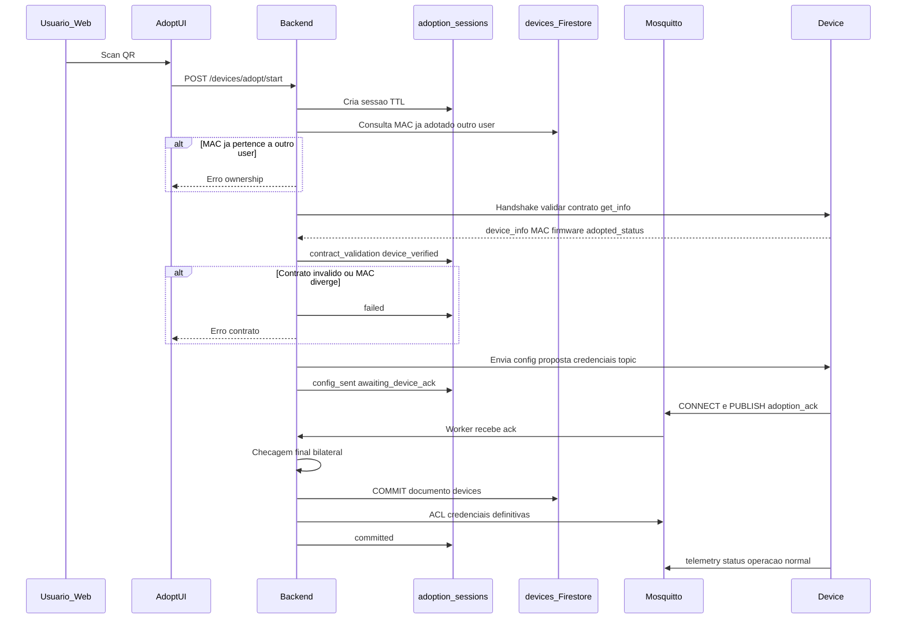

# Contrato — adoção, identidade e rede MQTT (v1.1)

| Campo | Valor |
|-------|--------|
| Versão | **v1.1** |
| Status | **Rascunho normativo** — aguardando aprovação humana |
| Task | [003-adoption-network-contracts.md](../../task/003-adoption-network-contracts.md) |
| Glossário | [`docs/glossary.md`](../glossary.md) |
| Requirements | [`docs/requirements.md`](../requirements.md) §4.2–4.3, §5 |

Este documento **prevalece** sobre rascunhos soltos em requirements para tópicos, payloads de adoção e identidade do `device`. Em conflito com [`docs/glossary.md`](../glossary.md), atualizar o glossário após decisão explícita.

---

## 1. Objetivo e princípios

1. **UX mínima:** usuário autenticado escaneia QR na web; o backend conduz pareamento até o device confirmar; só então o device aparece na conta do usuário.
2. **Commit tardio na base:** o documento canônico em **`devices` (Firestore)** é criado **somente** quando, em conjunto:
   - o device **cumpre o contrato** (metadados, payloads, MAC coerente com o QR/sessão);
   - **não** existe registro adotado do mesmo `mac_address` para **outro** `user_id` (e o firmware não reporta adoção prévia a outro dono);
   - a **comunicação de adoção** terminou com **confirmação explícita do device** e validação final do backend (handshake completo).
3. **Separação de identidades:**
   - **`mac_address`** — hardware, único globalmente, imutável após cadastro factory.
   - **`device_id`** — UUID estável gerado na sessão de adoção e **persistido no commit**; aparece em tópicos e Firestore.
   - **`mqtt_topic_base`** — prefixo MQTT **único** persistido; usado por worker, ACL e firmware pós-adoção.
4. **QR não carrega senha MQTT** nem credenciais WiFi.
5. **Multi-tenant desde o desenho:** namespace `tenants/{user_id}/devices/{device_id}/...` (mantido da PoC).

Durante o pareamento, estado fica em **`adoption_sessions`** (TTL). Inventário de fábrica (`factory_inventory`), se existir, **não** substitui `devices` nem implica proprietário.

---

## 2. Persistência Firestore

### 2.1 Coleção `devices` (documento por `device_id`) — **somente pós-commit**

Registro **definitivo** do device adotado. **Não** criar documento aqui no scan do QR nem no primeiro `POST` da UI.

| Campo | Tipo | Obrigatório | Descrição |
|-------|------|-------------|-----------|
| `device_id` | string (UUID) | sim | ID do documento e chave lógica pública |
| `user_id` | string \| null | pós-adoção | Firebase Auth UID do proprietário |
| `mac_address` | string | sim | MAC normalizado `AA:BB:CC:DD:EE:FF` (uppercase, `:`) |
| `mqtt_topic_base` | string | pós-adoção | Ex.: `tenants/{user_id}/devices/{device_id}` — **unique** |
| `device_type` | `"sensor"` \| `"actuator"` | sim | Ver glossário |
| `model` | string | sim | Ex.: board / SKU (`ESP32`, `ESP32-C3`) |
| `sensor_type` | string | se sensor | Ex.: `DHT22`, `BME280` |
| `actuator_type` | string | se actuator | Ex.: `relay` |
| `parameter_ranges` | object | recomendado sensor | Espelho device_app — §6 |
| `command_spec` | object | recomendado actuator | Espelho device_app — §6 |
| `firmware_version` | string | opcional | |
| `adoption_status` | enum | sim | Sempre `adopted` nesta coleção (registros só entram após commit) |
| `adopted_at` | timestamp | sim | Momento do commit |
| `created_at` | timestamp | sim | Igual ou próximo de `adopted_at` |
| `updated_at` | timestamp | sim | |

**Índices recomendados:** `mac_address` (unique entre `adopted`), `mqtt_topic_base` (unique), `user_id`.

### 2.2 Coleção `adoption_sessions` (transitória)

Estado **em andamento** entre scan do QR e commit. TTL curto (ex.: 15–30 min); documento **apagado ou arquivado** após sucesso ou expiração.

| Campo | Tipo | Descrição |
|-------|------|-----------|
| `session_id` | string (UUID) | ID do documento |
| `user_id` | string | Usuário autenticado que iniciou |
| `claim_token` | string \| null | Do QR (QR-C) |
| `mac_address` | string \| null | Resolvido do token, QR-A ou `device_info` |
| `session_status` | enum | `started` \| `device_verified` \| `config_sent` \| `awaiting_device_ack` \| `committed` \| `failed` \| `expired` |
| `device_info_candidate` | object | Snapshot `get_info` / §6.5 validado |
| `contract_validation` | object | Resultado das checagens (schema, tipos, ranges) |
| `proposed_device_id` | string (UUID) | Gerado na sessão; usado no commit se ainda não existir em `devices` |
| `proposed_mqtt_topic_base` | string | Calculado antes do envio ao firmware |
| `expires_at` | timestamp | |
| `failure_reason` | string \| null | Código/mensagem se `failed` |

**Não** usar `adoption_sessions` para listagem de devices do usuário nem para ingestão de telemetria.

### 2.3 Coleção `factory_inventory` (opcional, pré-venda)

Vínculo fábrica **MAC ↔ `claim_token`** (e metadados estáticos: `model`, lote). **Sem** `user_id`. Não equivale a device adotado.

### 2.4 O que é “único no banco”

- **Negócio:** no máximo um registro **`devices` adotado** por placa (`mac_address` unique entre documentos com `adoption_status`: `adopted`).
- **MQTT ingestão:** worker resolve mensagens pelo prefixo **`mqtt_topic_base`** (unique), não pelo MAC no tópico pós-adoção.
- **`device_id`** é a chave estável para APIs, tools MCP e paths Firestore; **não** substituir por MAC em tópicos de produção.

### 2.5 Invariantes de identidade (não é chave composta)

A “chave lógica” **não** é a concatenação `device_id + mac_address`. São **dois identificadores** com relação **1:1** na coleção `devices`:

| Identificador | Papel | Unicidade |
|---------------|--------|-----------|
| `device_id` | ID do documento Firestore, tópicos MQTT, APIs | Um UUID por registro; document ID |
| `mac_address` | Identidade de hardware (placa) | **Unique** em toda a coleção `devices` |

**Regra:** para cada placa física existe **no máximo um** `device_id` adotado. O mesmo `mac_address` **não pode** aparecer em dois documentos com `device_id` diferentes. O commit **must** falhar (transação / regra de escrita) se já existir documento com aquele MAC.

```
mac_address  ──1:1──  device_id  ──1:1──  mqtt_topic_base
   (hardware)         (lógico)         (rede MQTT)
```

**Por que dois campos e não só MAC?**

- MAC identifica **hardware** (QR, anti-clonagem, fábrica).
- `device_id` identifica **entidade lógica** estável (tópico, histórico, ACL) mesmo se no futuro houver política de **substituir placa** ou rotacionar credenciais sem mudar o “device” na UX — nesse caso seria evolução explícita (v2), não dois IDs ativos para o mesmo MAC.

**Riscos que a spec evita**

| Cenário | Mitigação |
|---------|-----------|
| Duas sessões, mesmo MAC, `proposed_device_id` diferentes | Commit atômico; segundo commit falha no índice unique `mac_address` |
| Re-adoção após factory reset | Política MVP: **reutilizar** o mesmo documento `devices` (atualizar credenciais) **ou** arquivar o antigo e criar novo — **nunca** dois documentos ativos com o mesmo MAC |
| MAC spoofing | Fora do escopo v1; handshake + nonce reduz adoção remota fácil |

Durante `adoption_sessions`, `proposed_device_id` é provisório até o commit; só entra em `devices` se o MAC ainda não estiver adotado.

---

## 3. Conteúdo do QR code

### 3.1 Opções analisadas

| ID | Conteúdo | Uso | Veredito v1 |
|----|----------|-----|-------------|
| QR-A | Só `mac_address` (texto ou JSON `{ "v":1, "mac":"..." }`) | Sticker simples, dev, fábrica sem backend token | **Alternativa** (PoC/fábrica mínima) |
| QR-B | Tópico pré-adoção com MAC normalizado (`unclaimed/devices/3C71BF4DDB0C`) | Firmware publica antes do scan | **Opcional** fase transitória; **não** canônico no Firestore |
| QR-C | Deep link `https://<app>/adopt?t=<claim_token>` | Produto MVP | **Preferido** |
| QR-D | MAC + topic | — | **Rejeitado** (redundante, QR maior) |

### 3.2 Decisão MVP (QR-C)

- Sticker ou tela de pareamento expõe **URL com `claim_token` opaco**.
- Lookup do token em **`factory_inventory`** ou validação criptográfica — **sem** criar documento em `devices`.
- Scan inicia **`adoption_session`**; MAC vem do inventário ou do handshake com o device.
- **Commit** (documento em `devices` + ACL Mosquitto + credenciais definitivas) **somente** após §4.

### 3.3 Alternativa QR-A (dev / fábrica mínima)

- QR contém apenas MAC; sessão exige usuário autenticado + **ausência** de `devices` adotado com esse MAC para outro `user_id`.
- **Risco:** MAC enumerável — mitigar com rate limit, confirmação na UI e evolução para QR-C antes de produção.

### 3.4 Tópico pré-adoção (QR-B, opcional)

Se o firmware publicar **antes** da adoção:

| Fase | `mqtt_topic_base` / prefixo | Notas |
|------|------------------------------|--------|
| Pré-adoção | `unclaimed/devices/{mac_normalized}` | `mac_normalized` = 12 hex uppercase, sem `:` |
| Pós-adoção | `tenants/{user_id}/devices/{device_id}` | Firmware **must** reprovisionar via `set_config` ou equivalente |

Sufixos pré-adoção podem ser os mesmos (`telemetry`, `status`, …) sob o prefixo `unclaimed/...`. Worker MVP pode **ignorar** `unclaimed/` até política de ingestão pré-adoção ser definida.

---

## 4. Fluxo de adoção

Ordem lógica: **QR → sessão → validação contrato + posse → handshake com device → commit (Firestore + Mosquitto) → operação normal**.



### 4.1 Fases

| Fase | O que acontece | Persistência |
|------|----------------|--------------|
| **1 — Scan** | Usuário autenticado; `POST /devices/adopt/start` com `claim_token` ou `mac_address` | Cria `adoption_sessions`; **não** escreve `devices` |
| **2 — Elegibilidade** | Token válido; consulta `devices` por MAC — rejeita se já adotado por outro `user_id`; firmware `adopted_status` / `user_uuid` coerente | Atualiza sessão ou `failed` |
| **3 — Contrato** | Backend obtém `device_info` (MQTT canal §4.2, serial ou equivalente); valida `device_type`, `parameter_ranges` / `command_spec`, MAC | `device_verified` + `contract_validation` |
| **4 — Proposta** | Gera `proposed_device_id`, `proposed_mqtt_topic_base`, credenciais MQTT (temporárias ou já definitivas **sem** commit Firestore até ack) | `config_sent` |
| **5 — Confirmação device** | Device aplica config, conecta, publica **`adoption_ack`** (§6.7) | `awaiting_device_ack` |
| **6 — Commit** | Backend valida ack (session_id, MAC, nonce); **transação lógica:** insert `devices`, ACL Mosquitto, invalidar token/sessão | **Único momento** do registro canônico |

Se a sessão expirar ou o ack não chegar a tempo → **nenhum** documento novo em `devices`.

### 4.2 Canal MQTT de adoção (handshake)

Prefixo transitório (exemplo): `adoption/sessions/{session_id}/`.

| Tópico | Direção | Uso |
|--------|---------|-----|
| `.../challenge` | Backend → device | Solicita `device_info` / nonce |
| `.../info` | Device → backend | Payload §6.5 + `session_id` |
| `.../config` | Backend → device | §6.6 (proposta) |
| `.../ack` | Device → backend | §6.7 confirmação |

Alternativa equivalente: tópico `unclaimed/devices/{mac_normalized}/adoption/...` **desde que** o commit em `devices` continue **após** o ack. Detalhe de transporte WiFi permanece task futura.

### 4.3 APIs (MVP)

| Método | Rota | Efeito |
|--------|------|--------|
| `POST` | `/devices/adopt/start` | Cria sessão; **sem** commit |
| `GET` | `/devices/adopt/sessions/{session_id}` | Status para UI (polling/SSE) |
| `POST` | `/devices/adopt/sessions/{session_id}/cancel` | Aborta sessão |

O **commit** é acionado pelo backend ao processar `adoption_ack` válido (não expor rota pública de commit sem ack).

**RF-ADOPT-03 (mantido):** o chat **orienta**; o scan é **somente** na UI (não tool LLM).

---

## 5. Tópicos MQTT (pós-adoção)

Prefixo: `{mqtt_topic_base}` = `tenants/{user_id}/devices/{device_id}`.

| Finalidade | Tópico completo | Direção (device) | QoS | Retain | Notas |
|------------|-----------------|------------------|-----|--------|--------|
| Telemetria | `.../telemetry` | PUBLISH | 1 | não | Leituras sensor |
| Comandos | `.../commands` | SUBSCRIBE | 1 | — | Cloud/backend PUBLISH |
| Estado / ACK | `.../state` | PUBLISH | 1 | actuator: sim heartbeat | ACK comandos |
| Presença | `.../status` | PUBLISH + LWT | 1 | sim | `operation_status` |

**LWT:** publicar em `.../status` payload offline (mesmo schema §6.4) com retain.

### 5.1 Divergência device_app → mqtt-chat (decisão única)

| device_app | mqtt-chat v1 | Decisão |
|------------|--------------|---------|
| `{user_uuid}/{device_uuid}` | `tenants/{user_id}/devices/{device_id}` | **mqtt-chat** |
| Sufixo `/data` | `/telemetry` | **mqtt-chat** |
| Sufixo `/command` | `/commands` (plural) | **mqtt-chat** |
| `/status` | `/status` | igual |

Não manter duas convenções no mesmo ambiente.

---

## 6. Payloads JSON

Chaves em **inglês**. Timestamps **ISO-8601 UTC** com sufixo `Z` salvo indicação contrária.

### 6.1 Telemetria — sensor (uma ou várias métricas)

**Opção recomendada (uma mensagem, multi-métrica):**

```json
{
  "ts": "2026-10-10T18:00:00Z",
  "readings": [
    { "metric": "temperature", "value": 23.4, "unit": "C" },
    { "metric": "humidity", "value": 62.5, "unit": "%" }
  ]
}
```

**Opção compatível PoC (uma métrica por mensagem)** — permanece válida até simulador migrar:

```json
{
  "ts": "2026-10-10T18:00:00Z",
  "metric": "humidity",
  "value": 62.5,
  "unit": "%"
}
```

Worker **deve** aceitar ambos na v1 de ingestão (task 004).

### 6.2 Comando — actuator

```json
{
  "action": "set",
  "channel": 1,
  "value": true,
  "command_id": "550e8400-e29b-41d4-a716-446655440000"
}
```

### 6.3 Estado — actuator (retain) ou ACK

ACK:

```json
{
  "ts": "2026-10-10T18:00:01Z",
  "command_id": "550e8400-e29b-41d4-a716-446655440000",
  "status": "applied",
  "value": true
}
```

Heartbeat estado (retain):

```json
{
  "ts": "2026-10-10T18:00:00Z",
  "channel": 1,
  "value": false
}
```

Valores `status` sugeridos: `received`, `applied`, `rejected`, `ack` (sensor ACK legado PoC).

### 6.4 Presença — `status`

```json
{
  "ts": "2026-10-10T18:00:00Z",
  "operation_status": "online"
}
```

Offline (LWT): `"operation_status": "offline"`.

### 6.5 Metadados device (Firestore / serial `get_info`)

Alinhado a `DeviceInfo` do device_app (provisionamento serial); na adoção web os mesmos campos vêm de factory ou probe futuro:

| Campo | Descrição |
|-------|-----------|
| `device_type` | `sensor` \| `actuator` |
| `model` | board / SKU |
| `mac_address` | validação formato MAC |
| `sensor_type` | opcional |
| `actuator_type` | opcional |
| `parameter_ranges` | limites de leitura por métrica |
| `command_spec` | schema de comandos do actuator |
| `firmware_version` | opcional |

Exemplo `parameter_ranges` (sensor temp+umidade):

```json
{
  "temperature": { "unit": "C", "min_reading": -40, "max_reading": 85 },
  "humidity": { "unit": "%", "min_reading": 0, "max_reading": 100 }
}
```

### 6.6 Config pós-adoção (firmware)

Espelho conceitual `DeviceConfig` (device_app) — entrega via canal seguro (não QR):

| Campo | Descrição |
|-------|-----------|
| `user_id` | proprietário |
| `device_id` | UUID |
| `device_name` | nome amigável |
| `topic` | igual a `mqtt_topic_base` |
| `broker_url` | ex.: `mqtt://host:1883` ou `mqtts://...` |
| `mqtt_username` / `mqtt_password` | por device (provisionamento) |
| `wifi_ssid` / `wifi_password` | se aplicável |
| `adopted_status` | `1` = adotado |

### 6.7 Handshake de adoção

**Device → backend (`.../ack`):**

```json
{
  "ts": "2026-10-10T18:05:00Z",
  "session_id": "550e8400-e29b-41d4-a716-446655440000",
  "mac_address": "3C:71:BF:4D:DB:0C",
  "status": "adoption_complete",
  "nonce": "8f3a2b1c",
  "firmware_version": "1.0.0"
}
```

- `status` **must** ser `adoption_complete` para commit.
- `nonce` **must** corresponder ao enviado em `.../config` (anti-replay).
- Backend **rejeita** commit se `mac_address` ≠ sessão ou se `devices` já tem o MAC para outro `user_id`.

---

## 7. Provisionamento e rede (requisitos)

| RF | Descrição |
|----|-----------|
| RF-NET-01 | Device é responsável por conectividade IP (WiFi/celular); fora de escopo v1 definir stack WiFi |
| RF-NET-02 | Backend envia `broker_url`, credenciais e `mqtt_topic_base` na fase de proposta; credenciais **definitivas** e ACL alinhadas ao **commit** |
| RF-NET-03 | Mosquitto ACL **must** restringir publish/subscribe ao prefixo do `device_id` — aplicada no **commit**, não no scan |
| RF-NET-04 | Rotação de credencial MQTT suportada no desenho (campo `mqtt_password_version` — opcional futuro) |

Ver §4.3. Resposta de `/adopt/start` retorna `session_id` e estado; metadados do device na UI vêm da sessão após `device_verified`. Senha MQTT **não** na resposta HTTP se entrega for só via MQTT/serial.

---

## 8. Requisitos funcionais (consolidados)

| ID | Requisito |
|----|-----------|
| RF-ID-01 | `mac_address` unique em `devices` |
| RF-ID-02 | `device_id` UUID estável; gerado na sessão (`proposed_device_id`) e persistido **no commit** |
| RF-ID-03 | `mqtt_topic_base` unique; derivado de `tenants/{user_id}/devices/{device_id}` após adoção |
| RF-QR-01 | QR MVP: deep link + `claim_token` opaco (QR-C) |
| RF-QR-02 | Alternativa dev: QR só MAC (QR-A) com restrições de status |
| RF-QR-03 | Rejeitar padrão MAC+topic redundante (QR-D) |
| RF-TOP-01 | Sufixos: `telemetry`, `commands`, `state`, `status` |
| RF-PAY-01 | Telemetria multi-métrica via array `readings` (recomendado) |
| RF-PAY-02 | Worker aceita payload legado PoC single-metric |
| RF-ADOPT-01 | Usuário autenticado inicia adoção via UI; **`devices` só após commit** |
| RF-ADOPT-02 | `claim_token` uso único + TTL; invalidar após commit bem-sucedido |
| RF-ADOPT-03 | Scan fora do LLM; chat apenas orienta |
| RF-ADOPT-04 | Rejeitar commit se MAC já adotado por outro `user_id` ou firmware reporta outro dono |
| RF-ADOPT-05 | Validar contrato (§6.5) antes de enviar config; falha → sessão `failed`, sem `devices` |
| RF-ADOPT-06 | Commit **somente** após `adoption_ack` válido (§6.7) — confirmação backend **e** device |

---

## 9. Segurança (mínimo)

- QR / token não expõe senha MQTT.
- Token factory ou pareamento com TTL; invalidar após adoção.
- Adoção com MAC exige device não adotado e política anti-enumeração (rate limit).
- Factory reset no device regenera claim ou volta `adoption_status` — detalhe firmware (futuro).

---

## 10. Aprovação

- [ ] **Aprovado v1** — responsável: __________ — data: __________

---

## Histórico

| Data | Alteração |
|------|-----------|
| 2026-10-10 | v1 inicial — task 003 |
| 2026-10-10 | v1.1 — commit tardio: `adoption_sessions`, handshake, Firestore/Mosquitto após ack mútuo |
