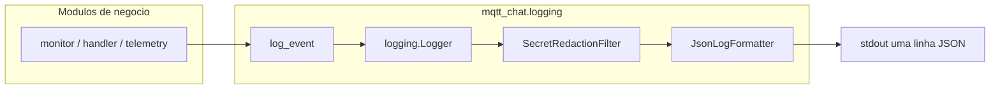

# Logging estruturado — mqtt-chat (v1)

Documento **único** do projeto: regras normativas, arquitetura, API e onboarding para desenvolvedores.

| | |
|---|---|
| **Versão** | **v1** |
| **Implementação** | Pacote [`src/mqtt_chat/logging/`](../src/mqtt_chat/logging/) |
| **Task** | [005-structured-logging.md](../task/005-structured-logging.md) |
| **Precedência** | Em conflito de produto, [`.cursor/rules/mqtt-chat-project.mdc`](../.cursor/rules/mqtt-chat-project.mdc) e [`requirements.md`](requirements.md) |

---

## 1. Por que existe

O backend mqtt-chat precisa de logs que:

1. Mostrem o **pipeline de ingestão IoT**: entrada MQTT → transformação (parse/validação) → persistência Firestore.
2. Permitem **diagnóstico** com módulo, função, linha e stack em erros.
3. Saem em **JSON (ndjson)** no stdout para Cloud Logging, Loki, Datadog, etc.
4. **Não** vazam senhas, tokens ou conteúdo de `secrets/`.

**Logs não são métricas de desempenho** (`duration_ms`, p95, throughput). Métricas OTel ficam para uma fase futura, em camada separada.

---

## 2. Arquitetura em uma página

### 2.1 Pacote `mqtt_chat.logging`

```
src/mqtt_chat/logging/              ← único pacote de logging da aplicação
├── __init__.py                     # API pública: setup_logging, log_event, events
├── bootstrap.py                    # Settings (.env) → setup_logging
├── setup.py                        # root logger + handler stdout + nível
├── emit.py                         # log_event() — atributos + event no LogRecord
├── events.py                       # nomes estáveis do campo JSON `event`
├── formatters.py                   # JsonLogFormatter | TextLogFormatter
└── filters.py                      # SecretRedactionFilter (attributes + message)
```

Entrypoints (`worker`, `api`) chamam só `bootstrap.setup_logging_from_settings()`; módulos de negócio importam `log_event` / `events` e usam `logging.getLogger(__name__)`.

**Regra de ouro:** código de negócio **nunca** chama `logging.basicConfig()`, não define formatador próprio e **não** usa `print()` para eventos operacionais.

### 2.2 Fluxo de uma linha de log



1. O módulo chama `log_event(logger, level, events.ALGUMA_COISA, "mensagem curta", **attrs)`.
2. O stdlib cria um `LogRecord` (com `funcName`, `lineno` do **caller** — `stacklevel=2` em `emit.py`).
3. O filtro redige chaves sensíveis na mensagem e em `attributes`.
4. O formatador serializa JSON e escreve em **stdout** (uma linha = um evento).

### 2.3 Quem inicializa o logging

| Processo | Onde | Ordem |
|----------|------|--------|
| Worker | [`worker/__main__.py`](../src/mqtt_chat/worker/__main__.py) | `get_settings()` → `setup_logging_from_settings()` → loop MQTT |
| API + worker | [`api/app.py`](../src/mqtt_chat/api/app.py) lifespan e `run()` | idem |

Função preferida em runtime com `.env`:

```python
from mqtt_chat.config.settings import get_settings
from mqtt_chat.logging.bootstrap import setup_logging_from_settings

setup_logging_from_settings(get_settings())
```

---

## 3. API para desenvolvedores

### 3.1 Imports

```python
import logging

from mqtt_chat.logging import events, log_event
from mqtt_chat.logging.bootstrap import setup_logging_from_settings
# ou, em testes/scripts isolados:
from mqtt_chat.logging import setup_logging

logger = logging.getLogger(__name__)
```

### 3.2 Emitir um evento estruturado

```python
log_event(
    logger,
    logging.INFO,
    events.TELEMETRY_PERSIST_COMPLETED,
    "Telemetry persisted",
    user_id="dev-user",
    device_id="sim-1",
    readings_count=2,
    persist_mode="firestore",
)
```

| Parâmetro | Regra |
|-----------|--------|
| `event` | **Sempre** constante de [`events.py`](../src/mqtt_chat/logging/events.py). Não inventar string solta. |
| `message` | Frase curta (diagnóstico humano). |
| `**attributes` | Campos de domínio em **inglês** ([`glossary.md`](glossary.md): `device_id`, `user_id`, …). |
| `exc_info=True` | Em erros; preenche `exception.*` no JSON. |

### 3.3 Adicionar um evento novo

1. Adicionar constante em [`events.py`](../src/mqtt_chat/logging/events.py) (prefixo lógico: `mqtt.`, `telemetry.`, `adoption.`, `mcp.tool.`, …).
2. Documentar na tabela §5 deste guia.
3. Usar só via `log_event` no módulo de negócio.

### 3.4 Quando usar `logger.debug` sem `log_event`

Permitido para ruído local **sem** contrato de observabilidade (ex.: “ignoring topic”). Preferir `log_event` em qualquer passo do pipeline ingestão, conexão MQTT, Firebase ou API.

---

## 4. Formato JSON (contrato de linha)

Modo padrão: `LOG_FORMAT=json`. Exemplo real simplificado:

```json
{
  "timestamp": "2026-10-11T00:01:01.162567Z",
  "severity": "INFO",
  "logger": "mqtt_chat.services.telemetry",
  "message": "Telemetry persisted",
  "service": { "name": "mqtt-chat" },
  "event": "telemetry.persist.completed",
  "code": {
    "module": "telemetry",
    "function": "persist_telemetry",
    "line": 98,
    "file": "telemetry.py"
  },
  "attributes": {
    "user_id": "dev-user",
    "device_id": "sim-1",
    "readings_count": 1,
    "persist_mode": "firestore"
  }
}
```

Com exceção:

```json
"exception": {
  "type": "ValueError",
  "message": "...",
  "stacktrace": "..."
}
```

### 4.1 Campos fixos

| Campo | Descrição |
|-------|-----------|
| `timestamp` | UTC ISO-8601 com `Z` |
| `severity` | DEBUG \| INFO \| WARNING \| ERROR \| CRITICAL |
| `logger` | Nome do logger (`mqtt_chat....`) |
| `message` | Texto curto |
| `service.name` | `LOG_SERVICE_NAME` (default `mqtt-chat`) |
| `event` | Identificador estável para queries e alertas |
| `code.*` | Origem do **caller** de `log_event` |
| `attributes` | Contexto de negócio opcional |

### 4.2 Atributos de domínio (`attributes`)

Objeto `attributes` — chaves em **inglês** ([`glossary.md`](glossary.md)):

| Campo | Quando |
|-------|--------|
| `user_id`, `device_id`, `mqtt_topic_base` | Após parse do tópico |
| `topic_suffix` | `telemetry` \| `status` \| `state` |
| `topic`, `qos`, `payload_bytes` | Entrada MQTT (sem payload bruto em INFO) |
| `metric`, `value`, `unit` | Telemetria single-metric (evitar payload JSON inteiro) |
| `readings_count` | Telemetria multi-métrica |
| `persist_mode` | `log` \| `firestore` |
| `firestore_path` | Ex.: `devices/{device_id}/telemetry/{doc_id}` (preferir DEBUG) |
| `mqtt_connected`, `backoff_sec` | Conexão / reconexão |

**Não** incluir: `mqtt_password`, `wifi_password`, `claim_token` integral, corpo de QR, conteúdo de arquivos em `secrets/`.

Saída: **uma linha = um JSON** (ndjson) em **stdout**; stderr reservado para falhas de bootstrap se necessário.

### 4.3 Modo texto

`LOG_FORMAT=text` — legível no terminal; **somente dev**. Mesma pipeline de filtro de secrets.

### 4.4 Fontes oficiais (decisão de formato)

| Fonte | Uso |
|-------|-----|
| [Python `logging`](https://docs.python.org/3/library/logging.html) | `LogRecord`: `name`, `funcName`, `lineno`; `exc_info` para stack |
| [Google Cloud structured logging](https://cloud.google.com/logging/docs/structured-logging) | JSON → `jsonPayload`; campos indexáveis (projeto Firebase/GCP) |
| [OpenTelemetry Logs data model](https://opentelemetry.io/docs/specs/otel/logs/data-model/) | `severity`, `message`, `attributes`, `event`; compatível com ingestão futura |
| [FastAPI](https://fastapi.tiangolo.com/) | Logging stdlib; setup no lifespan (não `print`) |

v1 **não** inclui OpenTelemetry SDK completo; o JSON deve permanecer compatível com Cloud Logging / OTel posterior.

---

## 5. Taxonomia de eventos (implementada)

Constantes em [`events.py`](../src/mqtt_chat/logging/events.py).

### 5.1 Pipeline ingestão (entrada → transformação → persistência)

| Fase | Constante | Valor `event` | Onde é emitido |
|------|-----------|---------------|----------------|
| Entrada | `MQTT_MESSAGE_RECEIVED` | `mqtt.message.received` | `worker/handler.py` |
| Entrada | `MQTT_SUBSCRIBED` | `mqtt.subscribed` | `clients/mqtt.py` |
| Entrada | `MQTT_CONNECTED` | `mqtt.connected` | `worker/monitor.py` |
| Transformação | `DEVICE_TOPIC_PARSED` | `device.topic.parsed` | `worker/handler.py` |
| Transformação | `TELEMETRY_PARSE_COMPLETED` | `telemetry.parse.completed` | `services/telemetry.py` |
| Transformação | `TELEMETRY_PARSE_FAILED` | `telemetry.parse.failed` | `services/telemetry.py` |
| Persistência | `TELEMETRY_PERSIST_COMPLETED` | `telemetry.persist.completed` | `services/telemetry.py` |
| Persistência | `TELEMETRY_PERSIST_FAILED` | `telemetry.persist.failed` | `services/telemetry.py` |
| Persistência | `DEVICE_METADATA_UPDATED` | `device.metadata.updated` | (reservado: `last_seen_at`, `operation_status`) |

Sequência típica (simulador → worker → Firestore), com `LOG_LEVEL=DEBUG`:

`mqtt.message.received` → `device.topic.parsed` → `telemetry.parse.completed` → `telemetry.persist.completed`

### 5.2 Conexão MQTT (resiliência)

| Constante | `event` |
|-----------|---------|
| `MQTT_CONNECTION_LOST` | `mqtt.connection.lost` |
| `MQTT_CONNECTION_RESTORED` | `mqtt.connection.restored` |
| `MQTT_BACKOFF` | `mqtt.backoff` |
| `MQTT_WORKER_STOPPED` | `mqtt.worker.stopped` |
| `MQTT_PUBLISH_FAILED` | `mqtt.publish.failed` |

### 5.3 Firebase e API

| Constante | `event` |
|-----------|---------|
| `FIREBASE_INITIALIZED` | `firebase.initialized` |
| `FIREBASE_UNAVAILABLE` | `firebase.unavailable` |
| `API_STARTED` | `api.started` |
| `API_SHUTDOWN` | `api.shutdown` |

### 5.3.1 Auth / perfil (task 006)

| Constante | `event` |
|-----------|---------|
| `AUTH_TOKEN_REJECTED` | `auth.token.rejected` |
| `USER_PROFILE_CREATED` | `user.profile.created` |
| `USER_PROFILE_UPDATED` | `user.profile.updated` |

### 5.4 Erros genéricos

| Constante | `event` |
|-----------|---------|
| `HANDLER_FAILED` | `handler.failed` |
| `UNEXPECTED_ERROR` | `unexpected.error` (reservado) |

---

## 6. Regras obrigatórias

### 6.1 Segurança (secrets)

Implementado em [`filters.py`](../src/mqtt_chat/logging/filters.py):

- Chaves cujo nome contém (case-insensitive): `password`, `secret`, `token`, `private_key`, `authorization`, `api_key`, `credential` → valor `[REDACTED]` em `attributes` e padrões `password=` na mensagem.
- **Nunca** logar: conteúdo de `secrets/service-account.json`, `mqtt_password`, `claim_token` completo, payload MQTT bruto com credenciais em INFO.
- **Pode** logar: `firebase_project_id`, `topic`, `device_id`, `payload_bytes` (tamanho), `readings_count`.

### 6.2 Desempenho

- **Proibido** campos de timing de código: `duration_ms`, `elapsed_ms`, `latency_ms`.
- Timestamps de **domínio** (`device_ts`, `received_at` no Firestore) não são “métricas de log” — vêm do contrato MQTT.

### 6.3 Níveis e volume

| Ambiente | Default |
|----------|---------|
| Dev local | INFO (`LOG_LEVEL=DEBUG` quando necessário) |
| Produção | INFO |

| Nível | Uso |
|-------|-----|
| DEBUG | Tamanhos de payload, paths Firestore, `mqtt.message.received`, parse detalhado |
| INFO | `telemetry.persist.completed`, connect/restored, subscribe, `firebase.initialized` |
| WARNING | `telemetry.parse.failed`, connection lost, config ausente |
| ERROR / CRITICAL | Exceções, falha persist, falha crítica de bootstrap |

- `telemetry.persist.completed` em **INFO** com `readings_count` — não um log INFO por leitura de sensor em alto volume.

### 6.4 Idioma

- Docstrings/comentários do pacote: **português**.
- `event`, chaves em `attributes`, identificadores: **inglês** ([`glossary.md`](glossary.md)).

---

## 7. Configuração (ambiente)

Variáveis em [`.env.example`](../.env.example) / [`Settings`](../src/mqtt_chat/config/settings.py):

| Variável | Default | Descrição |
|----------|---------|-----------|
| `LOG_LEVEL` | `INFO` | DEBUG, INFO, WARNING, ERROR, CRITICAL |
| `LOG_FORMAT` | `json` | `json` (observabilidade) ou `text` (dev) |
| `LOG_SERVICE_NAME` | `mqtt-chat` | Campo `service.name` no JSON |

Exemplo dev legível:

```bash
LOG_FORMAT=text LOG_LEVEL=DEBUG uv run python -m mqtt_chat.worker
```

Validar JSON:

```bash
uv run python -m mqtt_chat.worker 2>&1 | head -1 | jq .
```

---

## 8. Consumo em ferramentas de observabilidade

- **Google Cloud Logging:** JSON em stdout → `jsonPayload`; filtrar `jsonPayload.event="telemetry.persist.failed"`.
- **Campos úteis para índice:** `event`, `severity`, `attributes.device_id`, `attributes.user_id`, `logger`, `code.function`.
- **Futuro:** `trace_id` / `span_id` em `attributes` quando existir OpenTelemetry Traces; pacote `logging` permanece.

Referências: [Structured logging (Google Cloud)](https://cloud.google.com/logging/docs/structured-logging), [OTel Logs data model](https://opentelemetry.io/docs/specs/otel/logs/data-model/).

---

## 9. Mapa módulo interno do pacote

| Arquivo | Função |
|---------|--------|
| [`setup.py`](../src/mqtt_chat/logging/setup.py) | Configura root logger, handler stdout, nível, suprime ruído `urllib3`/`grpc` |
| [`bootstrap.py`](../src/mqtt_chat/logging/bootstrap.py) | Ponte `Settings` → `setup_logging` |
| [`emit.py`](../src/mqtt_chat/logging/emit.py) | `log_event()` + `stacklevel=2` |
| [`events.py`](../src/mqtt_chat/logging/events.py) | Catálogo de `event` |
| [`formatters.py`](../src/mqtt_chat/logging/formatters.py) | `JsonLogFormatter`, `TextLogFormatter` |
| [`filters.py`](../src/mqtt_chat/logging/filters.py) | `SecretRedactionFilter`, `redact_mapping`, `redact_text` |

---

## 10. Anti-padrões

| Não fazer | Fazer |
|-----------|--------|
| `logging.basicConfig` em `services/` ou `worker/` | `setup_logging_from_settings` só no entrypoint |
| `print(f"telemetry {data}")` | `log_event(..., events.TELEMETRY_...)` |
| Novo pacote `utils/log_helpers.py` | Estender `mqtt_chat.logging` |
| Logar JSON MQTT inteiro em INFO | Metadados: `topic`, `payload_bytes`, `readings_count` |
| Medir latência no log | Métricas OTel (futuro) |

---

## 11. Verificação manual (checklist dev)

- [ ] `LOG_FORMAT=json` → cada linha é JSON válido com `event` e `severity`.
- [ ] Erro forçado → JSON com `exception.stacktrace` e `code.line` do módulo de negócio.
- [ ] Atributo `password="test"` → `[REDACTED]` na saída.
- [ ] Simulador + worker Firestore → sequência §5.1 visível com `LOG_LEVEL=DEBUG`.

---

## 12. Aprovação (v1)

- [ ] **Aprovado v1** — data: __________

---

## 13. Histórico

| Data | Alteração |
|------|-----------|
| 2026-10-10 | v1 — policy + arquitetura + guia dev unificados em `docs/logging.md` |
| 2026-10-10 | Decisão: logs ≠ performance; métricas OTel em fase futura |
