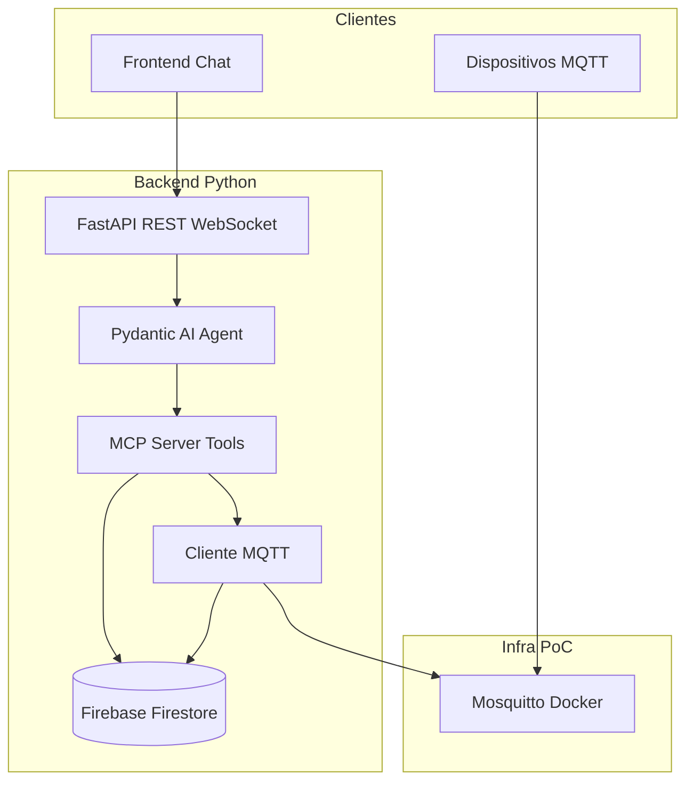
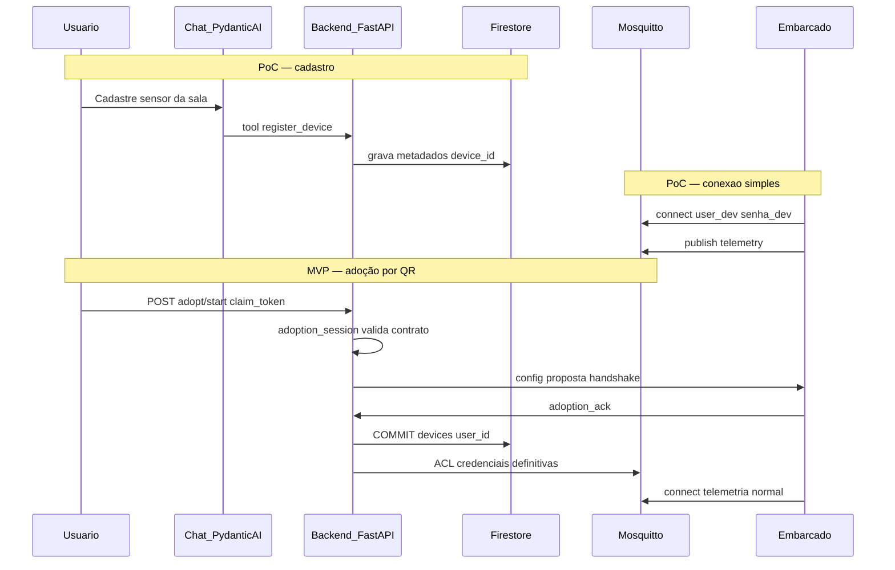
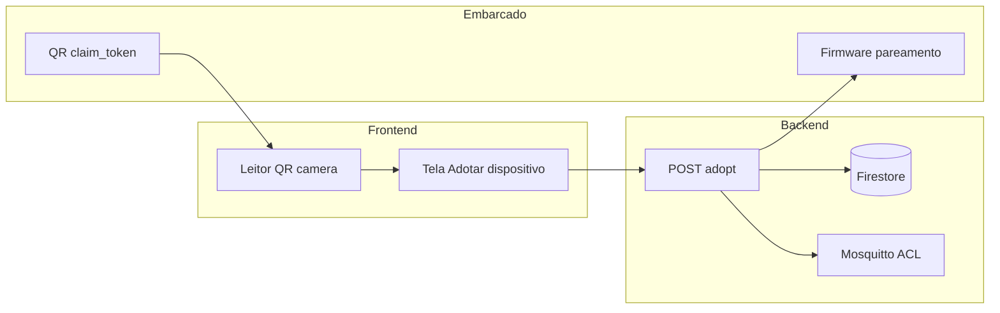

# Requisitos e análise — mqtt-chat

Documento vivo para consolidar visão, decisões e requisitos. Atualize a seção [Contexto adicional](#contexto-adicional) conforme novas definições forem surgindo.

Regra Cursor (agente): [`.cursor/rules/mqtt-chat-project.mdc`](../.cursor/rules/mqtt-chat-project.mdc) — stack e arquitetura imperativas; em dúvida de produto/requisito, este arquivo prevalece sobre a regra.

Glossário normativo (PT docs ↔ EN código): [`docs/glossary.md`](glossary.md).

Contratos normativos (payloads MQTT, adoção, identidade): [`docs/contracts/device-adoption.md`](contracts/device-adoption.md) **v1.1** — prevalece sobre rascunhos abaixo em §4–5 quando houver conflito.

Logging estruturado: [`docs/logging.md`](logging.md) · task [005](../task/005-structured-logging.md).  
Autenticação e identidade: [`docs/auth.md`](auth.md) · task [006](../task/006-user-auth-chat-mcp.md).

Agent Skills (Cursor, citadas na regra): [`docs/skills.md`](skills.md) — pasta [`.agents/skills/`](../.agents/skills/).

Tasks (planejamento): pasta [`task/`](../task/) — `NNN-<slug>.md` (ex.: [`001-docker.md`](../task/001-docker.md), [`002-device-simulator.md`](../task/002-device-simulator.md)); subtasks `NNN-SS-…` só se necessário; versões Docker/imagens obrigatórias na task (ver regra Cursor).

| Campo | Valor |
|-------|--------|
| Última atualização | 2026-10-10 |
| Fase alvo inicial | PoC |
| Linguagem | Python |
| Gerenciador de pacotes | [uv](https://docs.astral.sh/uv/) |
| Frameworks backend | [FastAPI](https://fastapi.tiangolo.com/), [FastMCP](https://gofastmcp.com/getting-started/welcome) |
| Orquestração de agente / RAG | [Pydantic AI](https://pydantic.dev/docs/ai/overview/) |
| Banco de dados / backend-as-a-service | Firebase |
| Broker MQTT | **Eclipse Mosquitto** (Docker) |

---

## 0. Fontes oficiais (decisões técnicas)

Em caso de dúvida sobre protocolo, API ou ferramentas, estas documentações **prevalecem** sobre tutoriais genéricos ou preferência pessoal. Conflitos entre projetos de referência e fontes oficiais são resolvidos pelas fontes oficiais.

| Tema | Documentação oficial |
|------|----------------------|
| Protocolo MQTT (versão, QoS, tópicos, LWT) | [MQTT Specification — OASIS](https://mqtt.org/mqtt-specification/) (preferir **MQTT 5** para recursos novos; **3.1.1** para compatibilidade com firmware legado) |
| Broker (implementação) | [Eclipse Mosquitto](https://mosquitto.org/) — imagem oficial no Docker; configuração via `mosquitto.conf` + plugins ACL em produção |
| API HTTP / backend web | [FastAPI](https://fastapi.tiangolo.com/) |
| Projeto Python, dependências, lockfile | [uv](https://docs.astral.sh/uv/) |
| Servidor MCP, tools, schemas, transportes | [FastMCP](https://gofastmcp.com/getting-started/welcome) — índice LLM: [llms.txt](https://gofastmcp.com/llms.txt) |
| Agente no chat, tools, embeddings, grafos | [Pydantic AI](https://pydantic.dev/docs/ai/overview/) — índice: [llms.txt](https://pydantic.dev/llms.txt); [tools](https://pydantic.dev/docs/ai/tools-toolsets/tools/), [MCP capability](https://pydantic.dev/docs/ai/capabilities/mcp/), [embeddings/RAG](https://pydantic.dev/docs/ai/guides/embeddings/), [Pydantic Graph](https://pydantic.dev/docs/ai/graph/graph/) para fluxos multi-step |
| Persistência, auth (quando detalhar Firebase) | [Firebase Documentation](https://firebase.google.com/docs) _(complementar; definir subprodutos na seção 6)_ |

### Projetos de referência (padrões internos)

Não substituem as fontes oficiais; guiam **estrutura de código**, separação de camadas e domínio IoT.

| Projeto | Local / remoto | Uso para mqtt-chat |
|---------|----------------|---------------------|
| **MCP Sport** | [GitHub](https://github.com/andrequeiroz2/mcp-sport), `~/DEV/mcp/mcp-sport` | Layout **FastMCP + uv + Pydantic**: tools finas, `services/`, `schemas/`, `validators/`, `clients/` único por integração, `docs/Architectural_Design.md` e `docs/Technical_Reference.md` como modelo de documentação canônica |
| **device_app** (Tauri/Rust) | `~/DEV/Tauri/device_app` | Modelo de **domínio IoT** e **collector MQTT** (reconexão): dispositivos, LWT, QoS, specs JSON — espelhar conceitos no **Firestore**; **não** copiar SQLite (`mqtt_messages`, etc.) nem stack Rust/Tauri |

> **Nota:** o repositório [mcp-sport](https://github.com/andrequeiroz2/mcp-sport) é **Python** (FastMCP 4.x, uv, Python 3.13+). Se existir variante em Rust em outro path, tratar como referência secundária; o alinhamento de MCP segue **FastMCP** neste projeto.

---

## 1. Visão do produto

Aplicação web em que:

- O **backend** se comporta como **cliente MQTT**, conectado a um broker, gerenciando dispositivos embarcados (sensores, atuadores como relés, etc.).
- O **usuário** se registra na plataforma, **cadastra dispositivos** dos quais passa a ser **proprietário**.
- O **frontend** é um **chatbot** (**TomatoIA** — nome do assistente e marca futura do produto) que usa **MCP** (Model Context Protocol) para executar ações estruturadas e **RAG** para conhecimento documental (manuais, troubleshooting).
- O assistente **TomatoIA** responde **somente** sobre a plataforma IoT e **devices do usuário autenticado**; perguntas fora desse escopo recebem recusa padrão e **não** entram no histórico persistido (task 007).
- Exemplos de intenções no chat: cadastrar/remover/atualizar dispositivo, ler telemetria, acionar atuador, pedir **gráfico** dos registros da última semana.

---

## 2. Veredito de viabilidade

A proposta é **viável e coerente** do ponto de vista técnico.

- **MQTT** é adequado para telemetria e comandos com dispositivos embarcados.
- O **backend** deve concentrar regra de negócio, persistência e ponte com o broker — não o LLM.
- **MCP (tools)** deve cobrir ações transacionais e dados em tempo real/histórico (CRUD, leitura, comandos, relatórios temporais).
- **RAG** deve cobrir conhecimento **não estruturado** (manuais, FAQs); não substitui tools para números ao vivo ou histórico armazenado.

Para **PoC Python (MQTT + chat, auth e RAG completos fora do escopo inicial)**, a viabilidade é **alta** em cerca de **1–2 semanas** de trabalho focado, com broker local e um dispositivo ou simulador.

Auth multi-tenant, ACLs no broker e RAG entram como **fase 2**, sem invalidar a PoC.

---

## 3. Arquitetura alvo (conceitual)



### 3.1 Fluxo — gráfico da última semana

1. Usuário pede no chat → LLM invoca tool `get_telemetry_history(device_id, period)`.
2. Tool consulta série temporal no banco (`timestamp`, `device_id`, métrica/valor).
3. Backend envia mensagem estruturada ao frontend → componente de gráfico (ex.: Recharts) na interface do chat.

### 3.2 Fluxo — leitura e atuador

1. **Leitura**: último valor persistido **ou** publicação em tópico de comando com **timeout** explícito (ex.: 3–5 s).
2. **Atuador**: tool publica em tópico de comandos; worker grava ACK/estado quando o dispositivo publicar em `state`.

### 3.3 Separação MCP vs RAG

| Camada | Responsabilidade |
|--------|------------------|
| MCP tools | CRUD dispositivos, telemetria, comandos, histórico para gráficos |
| RAG | Manuais, calibração, troubleshooting, especificações estáticas |

Regra de ouro: **valores numéricos e estado ao vivo** vêm sempre de tools IoT, nunca só do RAG.

### 3.4 Pydantic AI vs FastMCP (papéis)

| Peça | Responsabilidade |
|------|------------------|
| **FastMCP** | Define e expõe **tools IoT** (contrato MCP, schemas Pydantic v2, testes no Cursor/MCP Inspector). Implementação delega a `services/` — mesma lógica de negócio. |
| **Pydantic AI** | **Orquestra o chat** no FastAPI: `Agent` tipado, tool calling, streaming, [output types](https://pydantic.dev/docs/ai/core-concepts/output/) (ex.: payload de gráfico validado). Pode registrar tools Python que chamam `services/` **ou** consumir o servidor FastMCP via [capability MCP](https://pydantic.dev/docs/ai/capabilities/mcp/). **RAG fase 2:** [embeddings](https://pydantic.dev/docs/ai/guides/embeddings/) + tool de documentação. Fluxos com confirmação/desambiguação: [Pydantic Graph](https://pydantic.dev/docs/ai/graph/graph/). |

O LLM **nunca** acessa Firestore ou MQTT diretamente — apenas tools do agente Pydantic AI, alinhadas às tools FastMCP (mesmos schemas de entrada/saída quando possível).

---

## 4. PoC vs MVP / produção

| Capacidade | PoC (escopo inicial) | MVP / produção |
|------------|----------------------|----------------|
| Broker MQTT | **Mosquitto** no Docker (free, PoC) | Mesmo **Mosquitto** + **TLS** + **ACL** por `user_id` / `device_id` (sem EMQX — evitar custo/licenciamento) |
| Usuários / proprietário | Usuário fixo ou token simples | Registro, JWT, `user_id` em todas as queries |
| Cadastro / adoção | **Cadastro lógico** (CRUD + tools MCP); sem QR na PoC | **Adoção por QR code** + provisionamento MQTT (ACL Mosquitto) — §4.2 e §4.3 |
| Histórico / gráficos | Firestore (amostras recentes) ou agregação simples | Retenção, agregação e export (ex.: BigQuery / bucket) conforme volume |
| Chat + MCP | Subconjunto de tools | Schemas rígidos + confirmação para ações destrutivas |
| RAG | Opcional (ex.: um PDF local) | Vector store + ingestão por modelo de device |
| Dispositivo offline | Resposta “sem dado recente” | LWT MQTT + campo `last_seen` |

A PoC deve manter **contratos estáveis** (nomes de tools, JSON de telemetria, convenção de tópicos) para evitar reescrita na fase MVP.

### 4.1 Broker Mosquitto (decisão)

- **Escolha:** [Eclipse Mosquitto](https://mosquitto.org/) em **Docker** (`docker-compose`) — open source, sem custo de licença (EMQX fica fora do escopo salvo requisito futuro explícito).
- **PoC:** broker exposto na rede interna do compose (ex.: porta `1883`); autenticação simples ou anônima **apenas em dev**; backend Python como cliente assinante/publicador.
- **MVP/produção:** manter Mosquitto; adicionar **TLS**, usuários/senhas ou certificados por dispositivo, e **ACL** alinhadas aos tópicos `tenants/{user_id}/devices/{device_id}/...`.
- **Artefatos previstos:** `docker/mosquitto/mosquitto.conf`, `docker/mosquitto/acl` (ou `password_file`), volume para persistência opcional de mensagens retain.

### 4.2 Cadastro de dispositivo vs provisionamento MQTT

Não é uma “dúvida aberta” — são **duas etapas** do ciclo de vida do hardware. A tabela PoC/MVP só diz *quanto* de cada etapa entra em cada fase.

#### Cadastro (registro lógico)

O usuário (ou o chat via tool) **declara** que existe um dispositivo e que ele é dono dele. Isso grava **metadados** no Firestore, por exemplo:

- `device_id`, nome, tipo (`sensor` / `actuator`), modelo, local
- prefixo de tópicos MQTT (`tenants/{user_id}/devices/{device_id}/...`)
- specs (`parameter_ranges`, `command_spec`) — alinhado ao `device_app`

**Na PoC isso basta** para listar devices no chat, associar telemetria ao `device_id` e mandar comandos — usando um **único usuário/senha MQTT compartilhado** no Mosquitto de dev (ou broker aberto só local).

Tools típicas (nomes em inglês — ver glossário): `register_device`, `list_devices`, `update_device`, `remove_device`.

#### Provisionamento (identidade no broker)

É o passo em que o **firmware/embarcado** passa a se conectar ao Mosquitto **com credenciais próprias** e só pode publicar/assinar **os tópicos daquele** `device_id` (ACL).

Exemplo MVP:

1. Backend gera `mqtt_username` / `mqtt_password` (ou certificado) **por dispositivo**.
2. Registra entrada no `password_file` / ACL do Mosquitto (ou API de admin que você automatizar).
3. **Adoção pelo usuário** via **leitura de QR code** na web (câmera do navegador ou app) — ver §4.3.
4. O ESP32 recebe credenciais (WiFi provisioning / MQTT config) após adoção bem-sucedida; conecta ao Mosquitto e publica em `.../telemetry`; outro device **não** consegue publicar no tópico alheio.

**Por que não na PoC?** Dá para validar MQTT + chat + Firestore com simulador e login compartilhado; provisionamento exige fluxo de pareamento, rotação de senha e automação no Mosquitto — escopo maior, mas **obrigatório** antes de produção real.



**Resumo:** cadastro = “este sensor existe e é meu”; provisionamento = “este chip **é** aquele sensor no broker, com senha e ACL”. **Adoção preferida:** usuário escaneia **QR code** (§4.3). PoC começa sem QR (cadastro manual/simulador); MVP inclui fluxo de scan.

### 4.3 Adoção por QR code (decisão de produto)

O **proprietário** passa a ser dono do dispositivo escaneando um **QR code** impresso na placa, na embalagem ou exibido pelo firmware em modo fábrica/pareamento.

| Aspecto | Definição |
|---------|-----------|
| Quem lê o QR | **Usuário autenticado** no frontend web (não o LLM — a câmera é UI; o chat pode orientar: “Abra Adotar dispositivo e escaneie o QR”) |
| Conteúdo do QR | **MVP:** deep link `https://<app>/adopt?t=<claim_token>` (QR-C). **Alternativa dev/fábrica:** só `mac_address`. Detalhes: [`docs/contracts/device-adoption.md`](contracts/device-adoption.md) §3. |
| `claim_token` | Uso **único**, TTL curto (ex.: 15–30 min); gerado no factory ou quando o device entra em modo pareamento |
| Backend | Sessão de adoção → valida contrato e posse → handshake até `adoption_ack` → **só então** grava `devices`, ACL Mosquitto e credenciais (§4.2; contrato §4) |
| Pós-scan | Opções a detalhar no firmware: **WiFi provisioning** (SoftAP / SmartConfig / BLE) + envio das cred MQTT; ou device já online e recebe credenciais em tópico `.../provision` assinado após adoção |



**PoC vs MVP**

- **PoC:** sem QR; cadastro via tool/API ou simulador fixo.
- **MVP:** fluxo completo **scan → adopt → credenciais MQTT**; QR não contém senha MQTT em texto claro — só token de claim trocado por credenciais no servidor.

**Segurança mínima**

- Token assinado (HMAC/JWT) ou lookup opaco no Firestore.
- Após adoção, invalidar `claim_token`; rotacionar credencial MQTT se vazamento suspeito.
- QR de fábrica pode ser reimpresso só com reset físico no device (botão factory reset).

---

## 5. Convenção MQTT (multi-tenant desde o desenho)

Mesmo com um único usuário na PoC, usar tópicos namespaced:

| Finalidade | Tópico |
|------------|--------|
| Telemetria | `tenants/{tenant_or_user_id}/devices/{device_id}/telemetry` |
| Comandos | `tenants/{tenant_or_user_id}/devices/{device_id}/commands` |
| Estado / ACK | `tenants/{tenant_or_user_id}/devices/{device_id}/state` |
| Presença (produção) | `.../status` (`online` / `offline` via LWT) |

**Payloads (JSON)**

- Especificação completa (telemetria multi-métrica, commands, state, status): [`docs/contracts/device-adoption.md`](contracts/device-adoption.md) §6.
- PoC legado (simulador): uma métrica por mensagem — `{ "ts", "metric", "value", "unit" }`.

---

## 6. Stack técnica (decisões registradas)

| Camada | Tecnologia | Observação |
|--------|------------|------------|
| Linguagem | Python 3.13+ (alinhar a mcp-sport) | `uv python pin` + `pyproject.toml` + `uv.lock` |
| Gerenciador de pacotes | **uv** | `uv sync`, `uv run`; ver [guia de projetos](https://docs.astral.sh/uv/concepts/projects/) |
| API / chat | **FastAPI** | REST, WebSocket ou SSE para streaming do assistente |
| MCP | **FastMCP** | Tools IoT; transporte stdio para Cursor; HTTP/streamable para chat web (padrão mcp-sport) |
| Cliente MQTT | aiomqtt ou paho-mqtt | Conforme [MQTT spec](https://mqtt.org/mqtt-specification/); worker assíncrono no mesmo processo ou task dedicada |
| Persistência | **Firebase** | Ver mapeamento abaixo |
| Agente / LLM | **Pydantic AI** (`pydantic-ai`) + provedor via env | `Agent` + tools; MCP capability opcional apontando ao FastMCP; Graph para multi-step |
| Frontend PoC | A definir | Chat + `message.kind === "timeseries"` para gráficos |
| Broker MQTT | **Mosquitto** (container) | Ver §4.1; não usar EMQX na stack planejada |
| Infra local | docker-compose | Mosquitto + backend + simulador de device |

### 6.1 Firebase — uso previsto (rascunho)

Produtos Firebase a confirmar na PoC; proposta inicial alinhada ao domínio de `device_app`:

| Dado | Produto Firebase sugerido | Espelho em device_app |
|------|---------------------------|------------------------|
| Registro / login | **Authentication** | tabela `users` |
| Metadados de dispositivo, broker, local | **Firestore** | `devices`, `mqtt_brokers`, `locations` |
| Telemetria e histórico para gráficos | **Firestore** — subcoleção `telemetry` (ou equivalente) por `device_id`; leituras normalizadas, **sem** log bruto estilo `mqtt_messages` | `device_app`: SQLite `mqtt_messages` + `sensor_readings` → **somente Firestore** no mqtt-chat |
| Regras de acesso por proprietário | **Firestore Security Rules** (+ Custom Claims no Auth) | `user_id` em todas as entidades |

**Pontos de atenção Firebase + MQTT:**

- **Decisão:** persistência de ingestão MQTT é **exclusivamente Firestore** (Admin SDK no backend). Não há camada SQLite/PostgreSQL para espelhar mensagens MQTT.
- Firestore não é banco de séries temporais otimizado; para PoC, gravar amostras com `received_at` indexado e limitar janelas de consulta (ex.: última semana); planejar agregação ou export se o volume crescer.
- Credenciais Firebase Admin SDK ficam **somente no backend** (FastAPI); embarcados continuam no broker MQTT, não no SDK Firebase.
- Campos de dispositivo inspirados em `device_app`: `device_type` (`sensor` \| `actuator`), `model`, `sensor_type` / `actuator_type`, `parameter_ranges`, `command_spec`, `operation_status`, `last_seen_at`, QoS/LWT.

### 6.2 Estrutura de pacotes alvo (espelho mcp-sport)

**Monorepo:** o **frontend** é microserviço em [`services/frontend/`](../services/frontend/) (React/Vite, Firebase Auth Web, `.env` próprio). Comunicação com o backend **somente HTTP** (`/api/v1/*`); sem importar código Python.

```
services/
└── frontend/              # UI chat (deploy independente)

src/mqtt_chat/
├── server.py              # FastMCP + registro de tools (e/ou mount FastAPI)
├── api/                   # Rotas FastAPI (chat, health, webhook auth)
├── agent/                 # Pydantic AI: Agent, deps, tools, Graph (fase 2), integração UI/streaming
├── clients/
│   ├── mqtt.py            # Cliente MQTT único
│   └── firebase.py        # Admin SDK / Firestore único
├── schemas/               # Pydantic entrada/saída
├── validators/
├── services/              # Orquestração; regras de negócio (fonte única para MCP + Pydantic AI)
├── tools/                 # Tools MCP finas + register(mcp)
└── worker/                # Ingest MQTT → Firestore
```

Padrões detalhados: copiar/adaptar de `~/DEV/mcp/mcp-sport/docs/Architectural_Design.md`.

---

## 7. Tools MCP mínimas (PoC)

Todas com validação Pydantic e erros tipados (`device_not_found`, `timeout`, `no_data`).

1. `list_devices`
2. `register_device(name, device_type, topic_prefix?)` — `device_type`: `sensor` \| `actuator`
3. `remove_device(device_id)`
4. `update_device(device_id, ...)`
5. `read_latest_telemetry(device_id, metric?)`
6. `publish_command(device_id, command)` — exige `device_type == actuator`
7. `get_telemetry_history(device_id, metric, start, end)` — alimenta gráfico

**Isolamento (MVP):** injetar contexto do usuário autenticado em toda chamada MCP; o agente só acessa dispositivos do proprietário.

---

## 8. RAG — quando incluir

- **PoC:** dispensável se o objetivo for provar MQTT + tools + gráfico.
- **Fase 2:** RAG com **Pydantic AI** ([embeddings](https://pydantic.dev/docs/ai/guides/embeddings/), retriever externo ou vector store); tool `buscar_documentacao(query, device_type)` separada das tools IoT.
- **Mitigação:** citar fontes no RAG; para métricas, obrigar tools de leitura/histórico.

---

## 9. Pontos de atenção

1. **Latência:** leitura ao vivo via MQTT com timeout e mensagem clara no chat.
2. **Idempotência:** `command_id` ou versionamento de estado para atuadores.
3. **Segurança (pós-PoC):** ACL no broker; credenciais por dispositivo; backend como único publicador em `commands` (modelo opcional mais fechado).
4. **Custo LLM:** cache de listagem; confirmação explícita para `remover_dispositivo`.
5. **Gráficos:** schema de mensagem rica, ex.: `{ "kind": "timeseries", "series": [...], "unit": "%" }` — o LLM não gera SVG.
6. **Simulador:** script que publica telemetria periódica e responde comandos — essencial sem hardware.

---

## 10. Riscos e mitigação

| Risco | Impacto | Mitigação |
|-------|---------|-----------|
| LLM usa `device_id` errado | Médio (baixo na PoC) | Listar devices; desambiguar por nome; ACL no MVP |
| Broker indisponível | Alto | Health check; fila (pós-MVP) |
| Volume de telemetria | Médio | Agregação no ingest; downsampling em gráficos longos |
| Escopo PoC inflado | Atraso | Congelar 7 tools + 1 gráfico + 1 simulador |

---

## 11. Cronograma indicativo (PoC)

1. **Dias 1–2:** Mosquitto + simulador + worker MQTT → Firestore (telemetria + metadados).
2. **Dias 3–4:** FastAPI + FastMCP (uv); testes via Cursor MCP / MCP Inspector.
3. **Dias 5–6:** Chat web + agente **Pydantic AI** + output tipado para gráfico.
4. **Dia 7+:** polish, README operacional, stub de usuário se necessário.

---

## 12. Conclusão

Arquitetura **MQTT no backend + MCP para ações + RAG para conhecimento** é sólida e escalável. PoC Python focada em MQTT e chat tem **excelente** relação esforço/prova de valor; auth, ACLs e RAG são evoluções naturais.

---

## Contexto adicional

_Use esta seção para ir refinando requisitos, restrições de negócio, modelos de dispositivo, integrações e decisões que ainda não estão formalizadas._

### Histórico de decisões

| Data | Decisão |
|------|---------|
| 2026-10-09 | Backend Python; primeira entrega como PoC (MQTT + chat; auth/RAG completos depois) |
| 2026-10-09 | **uv** + **FastAPI** + **FastMCP**; persistência **Firebase**; fontes oficiais MQTT/FastAPI/uv/FastMCP |
| 2026-10-09 | Referências: mcp-sport (estrutura MCP), device_app (domínio IoT/MQTT) |
| 2026-10-09 | ~~LangChain~~ → **Pydantic AI** para orquestração do chatbot, tools, embeddings/RAG ([overview](https://pydantic.dev/docs/ai/overview/)) |
| 2026-10-09 | Broker **Mosquitto em Docker** (free); MVP evolui com TLS/ACL no mesmo Mosquitto (sem EMQX) |
| 2026-10-09 | **Adoção de dispositivo** via leitura de **QR code** no frontend (claim token → Firestore + credenciais MQTT) |
| 2026-10-09 | Idioma: docs/docstrings/comentários **PT**; código e identificadores **EN** |
| 2026-10-09 | Glossário [`docs/glossary.md`](glossary.md): `device`, `user`, `broker`, `device_type` ∈ {`sensor`, `actuator`} |
| 2026-10-09 | Projeto Python inicializado com **uv** (`pyproject.toml`, `uv.lock`, `src/mqtt_chat/`, Python 3.13) |
| 2026-10-10 | Contrato v1 [`docs/contracts/device-adoption.md`](contracts/device-adoption.md); task [003](../task/003-adoption-network-contracts.md) |
| 2026-10-10 | Contrato v1.1 — registro Firestore/Mosquitto após confirmação bilateral na adoção |
| 2026-10-10 | Ingestão MQTT: Firestore only; não replicar SQLite `mqtt_messages` do device_app |
| 2026-10-10 | Task [004](../task/004-mqtt-worker.md) worker MQTT **aprovada** para implementação |
| 2026-10-10 | Task [005](../task/005-structured-logging.md) política de logging JSON / OTel-friendly |
| 2026-10-10 | Logs ≠ métricas de desempenho; latência/throughput → OTel Metrics (futuro) |

### Notas e pendências

- ~~Definir quais produtos Firebase na PoC (Auth + Firestore mínimo?)~~ → **Auth Google (MVP) + Firestore `users`**; GitHub depois — ver [task 006](../task/006-user-auth-chat-mcp.md).
- Versão MQTT do broker/firmware: 3.1.1 vs 5.0 (Mosquitto suporta ambos conforme config).
- Frontend do chat (stack) ainda não definido.

### Requisitos funcionais (rascunho)

- Adoção, identidade (`device_id`, `mac_address`, `mqtt_topic_base`) e payloads: ver RF-* em [`docs/contracts/device-adoption.md`](contracts/device-adoption.md) §8 (inclui RF-ADOPT-01…03, RF-QR-*, RF-ID-*, RF-TOP-*, RF-PAY-*).

### Requisitos não funcionais (rascunho)

- RNF-I18N-01: documentação (`docs/`, README), **docstrings** e **comentários** no código em **português**.
- RNF-I18N-02: **código**, nomes de **classes**, **funções**, variáveis, módulos e campos de contrato (JSON/Firestore/MQTT) em **inglês** (PEP 8).
- Regra Cursor: [`.cursor/rules/mqtt-chat-project.mdc`](../.cursor/rules/mqtt-chat-project.mdc) § Idioma e nomenclatura.
