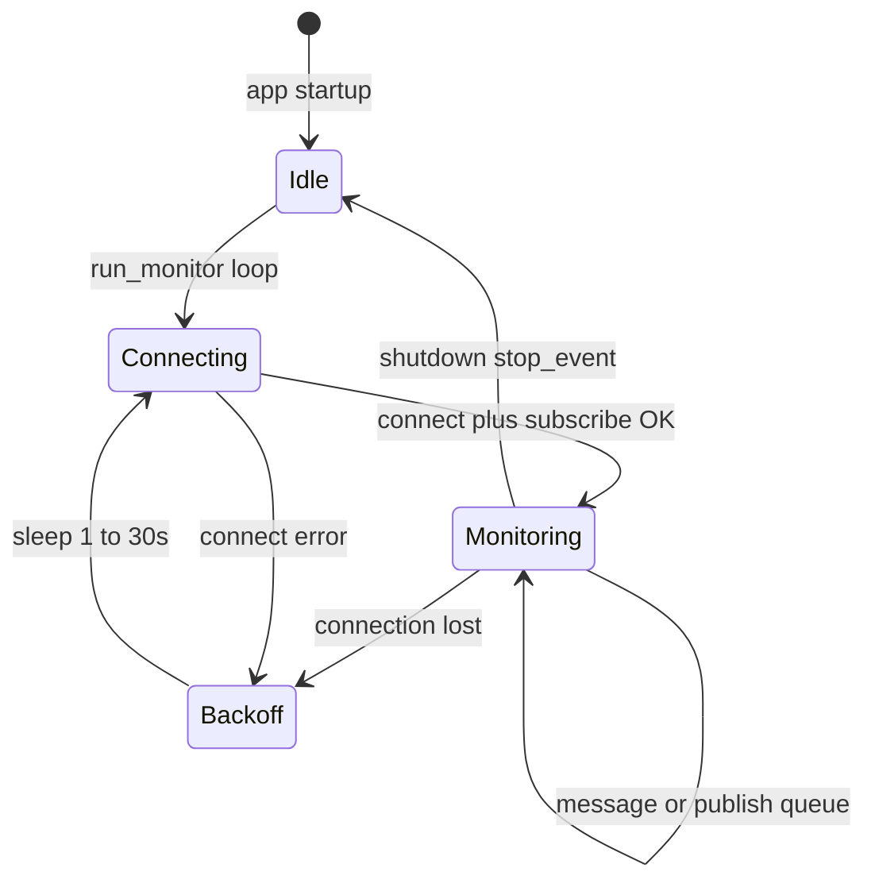

# Task 004 — Worker MQTT (ingestão telemetria)

> **Status:** Concluída (PoC — persistência `log` ou Firestore)  
> **Aprovação:** 2026-10-10  
> **Fase:** PoC  
> **Depende de:** [001-docker.md](001-docker.md), [002-device-simulator.md](002-device-simulator.md), [003-adoption-network-contracts.md](003-adoption-network-contracts.md)  
> **Contrato normativo:** [`docs/contracts/device-adoption.md`](../docs/contracts/device-adoption.md) **v1.1** (tópicos/payloads telemetria §5–§6)

## Objetivo

Implementar **worker backend** assíncrono que mantém conexão resiliente com o Mosquitto, assina tópicos do contrato mqtt-chat, processa mensagens e persiste telemetria no Firestore.

**Referência principal (reconexão e ciclo de vida):** collector MQTT do **device_app** (Rust), não o firmware embarcado.

| Referência | Path local | O que espelhar em Python |
|------------|------------|---------------------------|
| Loop reconexão + backoff | [`device_app/src-tauri/src/collector/service.rs`](file:///home/andre/DEV/Tauri/device_app/src-tauri/src/collector/service.rs) — `run_monitor_with_reconnect`, `try_connect_and_monitor` | `worker/monitor.py` (ou equivalente) |
| Wrapper broker (connect, subscribe, publish) | [`device_app/src-tauri/src/collector/mqtt/client.rs`](file:///home/andre/DEV/Tauri/device_app/src-tauri/src/collector/mqtt/client.rs) | [`src/mqtt_chat/clients/mqtt.py`](../src/mqtt_chat/clients/mqtt.py) |
| Roteamento por sufixo de tópico | [`device_app/src-tauri/src/collector/mqtt/handler.rs`](file:///home/andre/DEV/Tauri/device_app/src-tauri/src/collector/mqtt/handler.rs) | `worker/handler.py` → `services/` |
| Comandos start/stop + publish outbound | [`device_app/src-tauri/src/collector/state.rs`](file:///home/andre/DEV/Tauri/device_app/src-tauri/src/collector/state.rs) | Estado no lifespan FastAPI + fila async publish (PoC) |
| Modelo de parâmetros de conexão | [`device_app/src-tauri/src/collector/model.rs`](file:///home/andre/DEV/Tauri/device_app/src-tauri/src/collector/model.rs) — `MqttBroker` | Settings Pydantic / env (host, port, auth, keepalive) |

**Referência secundária (device):** [`device_app/embedded/esp/mqtt/mqtt_client.py`](file:///home/andre/DEV/Tauri/device_app/embedded/esp/mqtt/mqtt_client.py) — LWT, keepalive, flag `_reconnect` após config; **não** copiar loop de reconexão do embarcado para o backend (lógica do collector Rust prevalece).

Spec desta task **aprovada** para implementação. Fluxo de adoção (§4 do contrato) pode evoluir em paralelo; ingestão PoC usa tópicos `tenants/.../telemetry|status|state` já definidos.

---

## Matriz de versões

| Componente | Versão / pin | Notas |
|------------|--------------|--------|
| **Python** | `>=3.13` | Projeto uv |
| **aiomqtt** | via `uv add` | Cliente async preferido (regra projeto); alternativa paho só se aiomqtt bloquear |
| **Broker** | `eclipse-mosquitto:2.0.21` | Task 001 |
| **MQTT protocolo PoC** | 3.1.1 | Alinhado simulador |
| **Firebase Admin** | via `uv add` | Firestore ingestão |

---

## Comportamento de referência (device_app → mqtt-chat)

### Padrão `run_monitor_with_reconnect` (Rust)

1. Loop externo até `stop_requested`:
   - Abre sessão: connect → subscribe → consome mensagens.
   - Canal auxiliar para **publish** outbound (comandos) enquanto conectado.
   - Loop interno: poll mensagens com timeout (~500 ms), drena fila de publish, verifica `stop_requested` e `is_connected()`.
2. Saída **graceful** (`stop_requested`) → disconnect limpo → `Ok(true)` → termina loop externo.
3. Saída **queda** (stream fechado / não conectado) → disconnect best-effort → notificação “connection lost” → **backoff exponencial** (1 s inicial, ×2, teto **30 s**) → reconecta.
4. Após reconexão bem-sucedida → notificação “connection restored” (no app desktop); no mqtt-chat: log estruturado + métrica/health opcional.
5. Erro na **primeira** conexão pode gerar alerta crítico; erros em reconexões subsequentes **não** devem spammar o mesmo alerta (só “lost/restored”).

### Adaptações obrigatórias mqtt-chat

| device_app | mqtt-chat PoC worker |
|------------|----------------------|
| Subscribe `{broker_uuid}/+/data` e `.../status` | Subscribe `tenants/+/devices/+/telemetry`, `.../status`, `.../state` (adoption/handshake em task futura) |
| Persistência SQLite `mqtt_messages` + `sensor_readings` | **Firestore only** — subcoleção `telemetry` (contrato §6.1); atualizar `devices` (`last_seen_at`, `operation_status`); **proibido** SQLite/SQL local |
| Multi-broker por usuário desktop | **Um** broker plataforma (env / docker-compose); multi-tenant só nos tópicos |
| Tauri commands Connect/Disconnect | FastAPI **lifespan**: start worker on startup, cancel on shutdown |
| Notificações tray | Logs + endpoint health `mqtt_connected` (recomendado) |

### Reconexão — requisitos de implementação (RF-WORKER-*)

| ID | Requisito |
|----|-----------|
| RF-WORKER-01 | Worker roda em task asyncio dedicada; shutdown cancela loop e desconecta |
| RF-WORKER-02 | Backoff exponencial: início **1 s**, multiplicador **2**, máximo **30 s** (parâmetros configuráveis env) |
| RF-WORKER-03 | Após cada reconexão, **re-subscribe** todos os tópicos (MQTT 3.1.1 clean session PoC: `clean_session=true` aceitável; documentar perda de QoS1 inflight) |
| RF-WORKER-04 | Tratar queda de conexão sem derrubar processo FastAPI |
| RF-WORKER-05 | `clients/mqtt.py` — **único** ponto de conexão MQTT no backend |
| RF-WORKER-06 | Handler idempotente onde possível; falha Firestore logada, mensagem não trava loop MQTT |
| RF-WORKER-07 | Publish outbound (ex.: `publish_command` futuro) via fila async alimentada pelo monitor conectado (espelho `PublishRequest`) |
| RF-WORKER-08 | Persistir ingestão **somente** no **Firestore** (`clients/firebase.py`); **proibido** SQLite/`mqtt_messages`/`.db` local |

### Parâmetros de conexão (espelho `MqttClient` Rust)

Configurar via env / settings (defaults PoC dev):

| Parâmetro | Default PoC | Notas |
|-----------|-------------|--------|
| `host` / `port` | `127.0.0.1` / `1883` | `.env.example` |
| `username` / `password` | opcional | Dev anônimo task 001 |
| `client_id` | `mqtt-chat-worker` + sufixo único | Evitar colisão se múltiplas instâncias |
| `keep_alive` | 60 s | Alinhado firmware ref. |
| `clean_session` | `true` PoC | Revisitar com MQTT 5 / persistência |
| `connect_timeout` | 30 s | |

---

## Arquitetura alvo (Python)

```
FastAPI lifespan
    └── asyncio.create_task(worker_run_with_reconnect(settings, stop_event))
            └── clients/mqtt.py  (connect | subscribe | iter messages | publish)
            └── worker/handler.py  (parse topic → device_id → services/telemetry.py)
            └── clients/firebase.py  (persist)
```



---

## Entregáveis (checklist)

- [x] Dependência `aiomqtt` no `pyproject.toml` / `uv.lock`
- [x] [`src/mqtt_chat/clients/mqtt.py`](../src/mqtt_chat/clients/mqtt.py)
- [x] `src/mqtt_chat/worker/` — `run_with_reconnect`, `stop_event`
- [x] `src/mqtt_chat/worker/handler.py`
- [x] `src/mqtt_chat/services/telemetry.py` + `clients/firebase.py`
- [x] FastAPI lifespan [`src/mqtt_chat/api/app.py`](../src/mqtt_chat/api/app.py); CLI `mqtt-chat-worker` / `python -m mqtt_chat.worker`
- [x] `.env.example`
- [x] README
- [ ] Teste manual reconexão Mosquitto (parar/subir broker) — recomendado antes de fechar release

---

## Fora de escopo (task 004)

- ACL Mosquitto por device, adoção handshake (`adoption/sessions/...`)
- Publicar comandos a actuators (só preparar fila publish se custo baixo)
- TLS produção
- Duplicar notificações desktop (tray) do device_app

---

## Verificação

1. `docker compose up -d` + simulador task 002.
2. Worker conectado; telemetria aparece no Firestore ou log de persistência mock.
3. `docker compose stop mosquitto` → worker loga perda + backoff crescente (cap 30 s).
4. `docker compose start mosquitto` → log “restored” / reconectado; nova telemetria ingestada.
5. `SIGTERM`/shutdown API → disconnect sem task zombie.

---

## Aprovação

- [x] **Task 004 aprovada** — responsável: Andre — data: **2026-10-10**

---

## Histórico

| Data | Alteração |
|------|-----------|
| 2026-10-10 | Placeholder criado; sequência após task 003 |
| 2026-10-10 | Análise device_app collector (reconnect/backoff); RF-WORKER, arquitetura e entregáveis |
| 2026-10-10 | Persistência ingestão: Firestore exclusivo; regra explícita vs SQLite `mqtt_messages` |
| 2026-10-10 | Task **aprovada**; liberada para implementação |
| 2026-10-10 | Implementação PoC entregue (aiomqtt, worker, API /health, Firestore opcional) |
