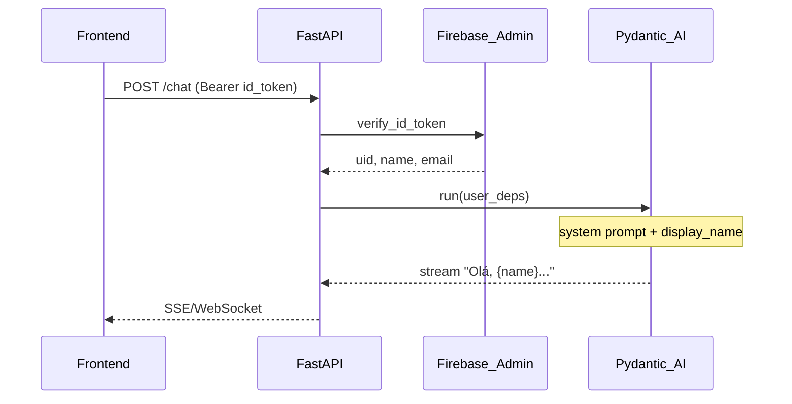
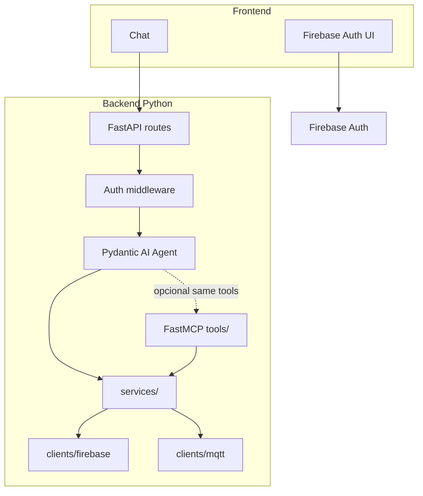

# Task 006 — Autenticação, perfil do usuário, chat e MCP

> **Status:** Em execução — **6a/6b** validados em dev (2026-10-11); **6c** pendente  
> **Fase:** Pós-PoC IoT (001–005)  
> **Depende de:** [005-structured-logging.md](005-structured-logging.md) (recomendado), [004-mqtt-worker.md](004-mqtt-worker.md)  
> **Bloqueia:** FastMCP IoT completo no chat, adoção QR com usuário real, multi-tenant produção

## Objetivo

Levantar e implementar **identidade do usuário** (**Google** via Firebase Auth no MVP), **perfil mínimo**, **chat Pydantic AI** com saudação personalizada e definir **o que entra no FastMCP** (CRUD user vs CRUD device).

Análise e requisitos: seção **Análise e levantamento** abaixo.

## Decisões já registradas (v0.1)

1. **Auth:** Firebase Authentication — **Google** no MVP; `user_id` = Auth UID.
2. **Saudação:** `display_name` via **deps do agente**, não tool MCP na abertura.
3. **MCP v1:** foco **IoT** (`list_devices`, telemetria, comandos); perfil no máximo read/update opcional.
4. **Orquestração:** **Pydantic AI** → **MCP capability** → **FastMCP HTTP** no mesmo processo (opção **B**); **`services/`** fonte única.

## Ordem de execução (obrigatória)

**6a → 6b → 6c → 6d.** Não iniciar fase seguinte antes de fechar o **gate** da fase atual.

| Fase | Gate (considerar fase fechada quando…) |
|------|----------------------------------------|
| **6a** | Google **Enabled** no Console + `GET/PATCH /me` com token OK + rules publicadas |
| **6b** | React login + chat contra API + `GOOGLE_API_KEY` + histórico Firestore (`CHAT_MAX_TURNS`) |
| **6c** | FastMCP + tools IoT + mount HTTP + teste Inspector/Cursor |
| **6d** | Chat usa MCP in-process; `user_id` nas tools |

**Agora:** **[008-device-adoption-handshake-refinement.md](008-device-adoption-handshake-refinement.md)** (contrato device ↔ backend, tópico não adotado + handshake MQTT) → **6c** → **6d**. Guardrails: [007](007-tomatoia-chat-guardrails.md).

## Entregáveis (fases)

### Fase 6a — Auth + perfil

- [x] Firebase Console: **Google** habilitado (GitHub — fora do MVP)
- [x] Firestore rules publicadas (`firebase deploy --only firestore:rules`)
- [x] Dependência FastAPI: validação ID token — `api/deps.py`
- [x] Firestore `users/{user_id}` + `ensure_user_profile`
- [x] `GET /api/v1/me`, `PATCH /api/v1/me` (PATCH só `display_name`)
- [x] [`docs/auth.md`](../docs/auth.md) v1 (documento canônico)
- [x] `firebase/firestore.rules` (+ redeploy se alterou `chat_sessions`)

### Fase 6b — Chat mínimo

- [x] Frontend **React** em [`services/frontend/`](../services/frontend/) (microserviço) + Firebase Auth (**Google**)
- [x] Pacote `agent/` — `UserDeps`, system prompt com nome
- [x] `POST /api/v1/chat`, `POST /api/v1/chat/stream` (SSE)
- [x] RF-CHAT-01: saudação via `display_name`
- [x] Histórico Firestore; limite **`CHAT_MAX_TURNS`** (default 15)
- [x] `GOOGLE_API_KEY` no `.env` backend

### Fase 6c — FastMCP IoT

> **Pré-requisito:** contrato adoção **v1.2** aprovado — [008-device-adoption-handshake-refinement.md](008-device-adoption-handshake-refinement.md).

> **Decisão (2026-10-12):** fatia 6c = **somente** `list_devices`; auth **Bearer Firebase** no HTTP MCP; stdio (`mqtt-chat-mcp`) sem auth (dev); chat web integra tools na **6d**.

- [x] `server.py` + `tools/list_devices.py` — contrato [`mcp-list-devices.md`](../docs/contracts/mcp-list-devices.md)
- [x] **Mount HTTP** streamable em `/api/v1/mcp` (`FirebaseTokenVerifier`)
- [x] `user_id` via `CurrentAccessToken` / claims Firebase (nunca parâmetro da tool)
- [ ] Teste manual Cursor / MCP Inspector com Bearer

### Fase 6d — Integração agente ↔ MCP (opção B)

> **Decisão (2026-10-13):** v1 = tools Python no agente → mesmo `services/devices.list_devices` que o MCP (sem hop HTTP MCP no chat).

- [x] Tool `list_devices` no Pydantic AI (`agent/device_tools.py`) + `UserDeps.db` / `user_id`
- [x] System prompt atualizado (listar via tool; adoção só UI)
- [ ] MCP capability HTTP opcional (mesmo processo) — fase 2 se necessário
- [ ] (Opcional) `get_user_profile` / `update_user_profile`

## Fora de escopo (task 006)

- RAG / embeddings
- Adoção QR end-to-end (task 003 spec separada)
- MCP gateway multi-tenant externo
- Delete account LGPD completo (só desenho na análise)

## Matriz de versões

| Componente | Versão | Notas |
|------------|--------|--------|
| Python | ≥3.13 | uv lock |
| Firebase Admin SDK | lock atual | já usado no worker |
| firebase-auth (web) | a pinar no frontend | quando stack UI definida |
| FastMCP | lock atual | transporte stdio + HTTP |
| pydantic-ai | lock atual | MCP capability opcional |

## Verificação

1. Login **Google** em dev; token válido em `GET /me`.
2. Chat sem token → 401.
3. Primeira mensagem do assistente cita `display_name` correto.
4. `list_devices` (quando existir) só retorna devices do `user_id` do token.
5. Logs sem ID token ([`docs/logging.md`](../docs/logging.md); checklist auth: [`docs/auth.md`](../docs/auth.md) §11).

---

## Análise e levantamento de requisitos (v0.1)

Rascunho para a fase pós-PoC IoT. Decisões marcadas **DECISÃO** / **ABERTO**.

| Referência | Documento |
|------------|-----------|
| Normativo | [`docs/requirements.md`](../docs/requirements.md) §3–§7 |
| Auth (canônico) | [`docs/auth.md`](../docs/auth.md) **v1** |
| Nomenclatura | [`docs/glossary.md`](../docs/glossary.md) |
| Regra projeto | [`.cursor/rules/mqtt-chat-project.mdc`](../.cursor/rules/mqtt-chat-project.mdc) |

### 1. Objetivo de produto

A aplicação web tem como eixo o **chatbot** assistente IoT. Após o usuário se identificar, a primeira interação deve refletir identidade conhecida, por exemplo:

> Olá, Andre Queiroz — no que posso ajudar?

Requisitos derivados:

1. **Autenticação** confiável (OAuth social no MVP).
2. **Perfil** mínimo (`display_name` ou equivalente) disponível ao backend e ao agente.
3. **Chat** com **Pydantic AI** usando tools para domínio IoT (e eventualmente perfil).
4. **Isolamento multi-tenant:** todo dado e tool escopados por `user_id` (Firebase Auth UID).

### 2. Autenticação — Google e GitHub

#### 2.1 Decisão de stack

| **DECISÃO** | Usar **Firebase Authentication** no MVP, com provedores **Google** e **GitHub** (OAuth 2.0 / OpenID). |
|-------------|--------------------------------------------------------------------------------------------------------|
| **Identificador canônico** | `user_id` = **UID** do Firebase Auth (string estável). |
| **Backend** | Valida **ID token** JWT (Bearer) via Firebase Admin SDK; **nunca** confiar em `user_id` enviado pelo cliente no body. |
| **Frontend** | Firebase Web SDK (sign-in popup/redirect); envia token nas chamadas REST/WebSocket/SSE do chat. |

Justificativa alinhada a [`requirements.md`](../docs/requirements.md) §6.1: Auth + Firestore já são a stack obrigatória; Google/GitHub são [provedores nativos](https://firebase.google.com/docs/auth/web/federated-auth) sem implementar OAuth manual no FastAPI.

#### 2.2 O que Auth cobre vs o que não cobre

| Responsabilidade | Firebase Auth | Backend FastAPI | Firestore |
|------------------|---------------|-----------------|-----------|
| Login / logout / refresh | Sim (SDK cliente) | Valida token | — |
| E-mail verificado, foto URL OAuth | Claims no token / `UserRecord` | Leitura Admin opcional | Espelho opcional |
| Nome exibido no chat | `displayName` do provedor | Injeta em deps do agente | Doc `users/{user_id}` se precisar editar |
| Senha local | Fora do escopo MVP social-only | — | — |
| ACL MQTT / devices | — | Serviços + rules | `devices.user_id` |

#### 2.3 Configuração operacional (checklist)

- [ ] Projeto Firebase: habilitar **Google** e **GitHub** no console Auth.
- [ ] GitHub OAuth App: callback URL do Firebase (documentar no README interno, sem secrets no repo).
- [ ] Domínios autorizados (localhost + produção).
- [ ] Custom claims (opcional MVP): role `admin` — **ABERTO** para fase posterior.

#### 2.4 Fora de escopo imediato

- Login anônimo permanente como “usuário PoC” (substituir `dev-user` do simulador apenas no **chat/API**, não no MQTT worker de ingestão global).
- SAML / enterprise IdP.
- MFA obrigatório (pode entrar via Firebase depois).

### 3. “CRUD do user” — decomposição

“CRUD” em usuário mistura **identidade** (Auth) e **perfil de aplicação** (Firestore). Separar evita expor operações perigosas ao LLM.

#### 3.1 Matriz operação × canal

| Operação | Descrição | Canal recomendado | Tool MCP? |
|----------|-----------|-------------------|-----------|
| **Create** | Primeiro login OAuth | Firebase Auth (automático) | **Não** |
| **Read (sessão)** | Quem está logado, token válido | Middleware FastAPI + `GET /api/v1/me` | **Não** — deps / REST |
| **Read (perfil app)** | Nome preferido, locale, timezone | `GET /api/v1/me` ou Firestore via service | **Opcional** `get_user_profile` |
| **Update** | Alterar nome exibido, preferências | `PATCH /api/v1/me` | **Opcional** `update_user_profile` se o usuário pedir no chat |
| **Delete** | Excluir conta (LGPD) | Fluxo dedicado + confirmação UI | **Não** via chat autônomo no MVP |

| **DECISÃO** | **Autenticação e sessão não passam por MCP.** MCP é para capacidades que o **modelo** invoca durante o diálogo, não para estabelecer identidade. |
| **DECISÃO** | **Saudação personalizada** usa contexto injetado (`UserDeps.display_name`), **sem** tool call na abertura. |

Fluxo da saudação:

#### 3.2 Modelo de dados proposto — coleção `users`

Documento **`users/{user_id}`** (id = Auth UID), campos iniciais:

| Campo | Tipo | Origem |
|-------|------|--------|
| `user_id` | string | = document id |
| `email` | string | Auth (espelho) |
| `display_name` | string | OAuth ou editável |
| `photo_url` | string \| null | OAuth |
| `created_at` | timestamp | server |
| `updated_at` | timestamp | server |
| `auth_providers` | array | ex.: `["google.com"]`, `["github.com"]` |

**Create:** hook pós-primeiro-login (Cloud Function **ou** `ensure_user_profile` no backend no primeiro `GET /me` / primeira mensagem de chat).

**Regras Firestore:** usuário só lê/escreve **próprio** doc; backend Admin bypassa rules para worker e tools.

### 4. Chatbot e orquestração — o que é “servidor orquestrador MCP”?

#### 4.1 Terminologia no mqtt-chat

| Termo coloquial | Papel real neste projeto |
|-----------------|---------------------------|
| “Servidor MCP” | **`mqtt_chat.server` (FastMCP)** — expõe **tools IoT** (+ perfil opcional). |
| “Orquestrador” | **Pydantic AI `Agent`** no FastAPI — decide quando chamar tools, streaming, confirmações. |
| “Orquestrador de vários MCPs” | **Opcional fase 2:** agente com [MCP capability](https://pydantic.dev/docs/ai/capabilities/mcp/) apontando para 1+ servidores (IoT, docs RAG). **Não** é obrigatório um produto/gateway MCP separado na v1. |

| **DECISÃO (v1)** | **Um processo FastAPI** monta ou invoca **um FastMCP** (mesmo repo, `services/` compartilhados). Pydantic AI registra tools Python que delegam aos mesmos `services/` **ou** consome o FastMCP via capability — preferir **uma fonte de verdade** (`services/`) como em mcp-sport. |
| **DECISÃO** | Transporte MCP para **Cursor/dev:** stdio. Para **chat web:** HTTP streamable (FastMCP) **ou** tools nativas no agente sem hop MCP extra — **ABERTO** (ver §4.3). |

#### 4.2 Arquitetura alvo (v1)

- **Worker MQTT** continua ingestão assíncrona; não participa do chat.
- Toda tool recebe `user_id` via **deps** (injetado após validação do token), nunca via argumento livre do modelo.

#### 4.3 CRUD user via MCP — veredito

| Cenário | Veredito |
|---------|----------|
| Login, logout, refresh token | **Não MCP** — SDK + rotas HTTP |
| “Como me chamo?” / listar e-mail | **Deps + prompt** ou `get_user_profile` se quiser simetria com MCP Inspector |
| “Mude meu nome para X” | **REST preferível**; tool `update_user_profile` aceitável com validação Pydantic |
| Excluir conta | **UI + API** com confirmação explícita; **sem** tool no MVP |

| **DECISÃO** | **Prioridade MCP v1:** tools IoT do [`glossary.md`](../docs/glossary.md) (`list_devices`, telemetria, comandos). **Inclusão de device:** **somente adoção** (UI/QR) — **sem** `register_device`. **Perfil:** read/update finos; create/delete de identidade fora do MCP. |

Motivos (mcp-builder / segurança):

- Tools devem ser **acionáveis pelo modelo** com valor claro; auth é pré-condição HTTP.
- Menos superfície de ataque (modelo não “cria usuário” nem apaga conta).
- CRUD de **devices** permanece o core do MCP; perfil é auxiliar.

### 5. Requisitos funcionais (RF)

#### 5.1 Autenticação e sessão

| ID | Requisito |
|----|-----------|
| RF-AUTH-01 | Usuário pode entrar com **Google**. |
| RF-AUTH-02 | Usuário pode entrar com **GitHub**. |
| RF-AUTH-03 | Backend rejeita chat e APIs de negócio sem token válido (401). |
| RF-AUTH-04 | `user_id` em Firestore/MQTT tenant path = UID Auth. |
| RF-AUTH-05 | Documento `users/{user_id}` criado/atualizado no primeiro acesso autenticado. |

#### 5.2 Chat e personalização

| ID | Requisito |
|----|-----------|
| RF-CHAT-01 | Primeira resposta (ou mensagem de boas-vindas) usa `display_name` quando disponível. |
| RF-CHAT-02 | Agente responde em português (UX); tools/contratos em inglês. |
| RF-CHAT-03 | Streaming de resposta (SSE ou WebSocket) — **ABERTO** transporte exato. |
| RF-CHAT-04 | Histórico de conversa por `user_id` — **ABERTO** (Firestore subcoleção vs memória PoC). |

#### 5.3 Perfil (CRUD mínimo)

| ID | Requisito |
|----|-----------|
| RF-USER-01 | `GET /api/v1/me` retorna perfil + claims essenciais. |
| RF-USER-02 | `PATCH /api/v1/me` atualiza campos permitidos (`display_name`, …). |
| RF-USER-03 | Usuário A não acessa perfil de B (rules + backend). |

#### 5.4 MCP / agente

| ID | Requisito |
|----|-----------|
| RF-MCP-01 | Tools IoT §7 de `requirements.md` escopadas ao `user_id` autenticado. |
| RF-MCP-02 | FastMCP registrado conforme layout mcp-sport (`tools/` → `services/`). |
| RF-MCP-03 | Pydantic AI Agent com `deps` tipadas (`UserDeps`, `AppDeps`). |
| RF-MCP-04 | Ações destrutivas (`remove_device`) exigem confirmação (Graph ou tool pattern) — fase chat. |

### 6. Requisitos não funcionais (RNF)

| ID | Requisito |
|----|-----------|
| RNF-SEC-01 | ID token só trafega HTTPS; não logar token ([`logging.md`](../docs/logging.md)). |
| RNF-SEC-02 | Firestore Security Rules alinhadas a `user_id` em `devices` e `users`. |
| RNF-OBS-01 | Eventos `api.started`, futuros `auth.*` / `chat.*` na taxonomia de logs. |

### 7. Fases sugeridas

| Fase | Entregas | MCP |
|------|----------|-----|
| **6a — Auth + perfil** | Firebase Google/GitHub, middleware, `users` doc, `GET/PATCH /me` | Nenhuma tool de auth |
| **6b — Chat mínimo** | Agent + saudação com deps, endpoint chat autenticado | Tools Python → `services/` (pode espelhar MCP depois) |
| **6c — FastMCP IoT** | `server.py`, tools glossary, teste Cursor | CRUD **device**, telemetria, comandos |
| **6d — Integração** | Agent consome mesmo contrato que MCP; isolamento tenant | Opcional `get_user_profile` / `update_user_profile` |

Ordem recomendada: **6a → 6b → 6c → 6d** (auth antes de expor tools; chat antes de amarrar transporte MCP remoto).

### 8. Perguntas abertas (produto / tech)

1. **Frontend stack** (React, Vue, …) e uso do Firebase UI — **ABERTO**.
2. **Histórico de chat** persistido ou só sessão browser na PoC? — **ABERTO**.
3. **Um FastMCP in-process** vs **HTTP separado** para o chat web — trade-off ops vs pureza MCP; recomendação: in-process v1, HTTP quando precisar escalar MCP isolado.
4. **Vincular devices existentes** criados com `dev-user` na PoC à conta real — migração one-off? — **ABERTO**.
5. **GitHub:** exigir e-mail público no GitHub ou tratar conta sem e-mail? — **ABERTO**.

### 9. Glossário / tools

Atualizado em [`docs/glossary.md`](../docs/glossary.md): `identity_provider`, `user_profile`; tools opcionais `get_user_profile`, `update_user_profile`.

### 10. Critérios de aceite do levantamento

- [ ] Stakeholder confirma Firebase Auth Google + GitHub.
- [ ] Confirma: saudação via deps, não MCP login.
- [ ] Confirma escopo MCP v1 (IoT first; perfil opcional).
- [ ] Prioriza ordem 6a–6d.
- [ ] Aprova rascunho v0.1 → v1 em `requirements.md` § complementar ou merge seção Auth.

---

## Histórico

| Data | Alteração |
|------|-----------|
| 2026-10-10 | Task criada; levantamento v0.1 neste arquivo |
| 2026-10-10 | Análise consolidada em `task/` (removido `docs/analysis/`) |
