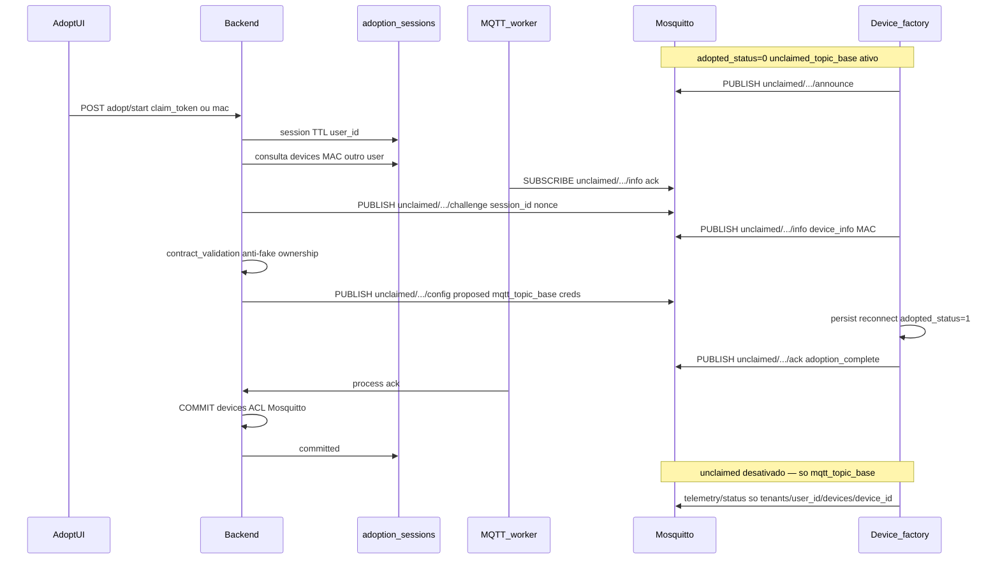

# Task 008 — Contrato device ↔ backend: tópico não adotado e handshake MQTT

> **Status:** Em execução — backend v1.2-dev (UC-A) implementado; simulador; UI 009 pendente  
> **Fase:** Ponte adoção → **6c FastMCP IoT** ([006](006-user-auth-chat-mcp.md))  
> **Depende de:** [003-adoption-network-contracts.md](003-adoption-network-contracts.md) (spec v1.1), [004-mqtt-worker.md](004-mqtt-worker.md), [006-user-auth-chat-mcp.md](006-user-auth-chat-mcp.md) (6a auth)  
> **Bloqueia:** Implementação `POST /devices/adopt/*`, firmware ESP “fábrica”, tools MCP `list_devices` (devices adotados), ACL Mosquitto pós-adoção

## Objetivo

**Analisar em profundidade** o contrato entre **device embarcado de fábrica** (não adotado) e **backend mqtt-chat**, usando o repositório de referência **`~/DEV/Tauri/device_app`** (domínio + firmware ESP), e **fechar decisões** que a spec [003](003-adoption-network-contracts.md) deixou em alternativa — em especial:

1. Device **novo de fábrica** publica/assina sob **um único prefixo MQTT “não adotado”**, **fornecido ou derivado no firmware** (não o namespace `tenants/{user_id}/devices/{device_id}`).
2. Adoção web (QR + usuário autenticado) conduz **handshake bilateral** nesse prefixo (e/ou canal derivado), com **identificação**, **anti-fake**, **anti-replay** e **garantia de posse única** (MAC / `device_id` não adotado por outro `user_id`).
3. **Commit tardio** em Firestore `devices` + credenciais/ACL Mosquitto **somente** após ack válido do device — mantendo v1.1, refinando **tópicos e payloads** alinhados ao que o firmware já faz ou fará.

**Entregável normativo alvo:** [`docs/contracts/device-adoption.md`](../docs/contracts/device-adoption.md) **v1.2** (ou v2 se quebra compatibilidade explícita), mais checklist de RFs novos/alterados para [`docs/requirements.md`](../docs/requirements.md).

**Não implementar** nesta task: FastMCP, rotas FastAPI completas, firmware ESP — apenas **contrato + matriz de garantias + gaps**.

## Decisões registradas (v0.1)

| Tema | Decisão |
|------|---------|
| **Device ↔ backend (adoção + operação)** | **Somente MQTT** — handshake em `unclaimed/...`, depois `tenants/{user_id}/devices/{device_id}/...` |
| **Usuário ↔ backend** | HTTP (FastAPI) — sessão de adoção, QR, auth Bearer |
| **HTTP device → API** | **Fora do MVP** — não expor endpoints de adoção para o firmware |
| **Serial USB** | Referência device_app; **não** fluxo web TomatoIA |
| **Timeout handshake** | **`ADOPTION_HANDSHAKE_TIMEOUT_SEC`** — default **300** (5 min); ver contrato §4.5 |
| **Falha na adoção** | Abort total: **sem** documento em `devices`; `user_message` PT seguro (UI + TomatoIA), sem IDs/secrets |
| **`claim_token`** | **`bound`** só com device adotado; mesmo QR válido de novo após remoção + reset — **não** “uso único forever” |
| **WiFi provisioning** | **Fora do escopo backend v1** — serial/BLE/SoftAP no **projeto firmware**; handshake MQTT **não** substitui WiFi; backend só MQTT (§6.6 sem WiFi) |
| **Registro de device** | **Somente adoção** (QR + handshake); **sem** `register_device` MCP/API paralela |
| **`unclaimed_topic_base` (implementação)** | **UC-A** primeiro: `unclaimed/devices/{mac_normalized}` + simulador; **UC-B** (`factory_device_secret` + `factory_inventory`) quando houver inventário fábrica / QR-C produção |
| **Anti-fake v1.2-dev** | **Sem** `factory_inventory` obrigatório — MAC sessão = MAC em `.../info` + handshake (nonce, TTL, ack); inventário na fase QR-C / UC-B |
| **Mosquitto dev** | **Opção A** — credencial **compartilhada** (ou `allow_anonymous` local); **sem** user/senha por device no commit v1.2-dev — contrato §7.3 |

---

## Contexto de produto (resumo)

| Ator | Papel |
|------|--------|
| Usuário | Autenticado (Firebase); escaneia QR na UI — **não** via LLM |
| Backend | Cria `adoption_session`, orquestra handshake MQTT, valida contrato, **commit** atômico |
| Device fábrica | `adopted_status` = não adotado; expõe metadados (`get_info` equivalente via MQTT); aceita `set_config` equivalente via MQTT |
| Worker MQTT | **Durante** sessão ativa: assina tópicos de handshake (`unclaimed/...`) para rotear ack/info. **Após commit:** handshake/`unclaimed` **deixam de ser canal operacional** para aquele device; ingestão **somente** `tenants/+/devices/+/...` ([contrato §4.4](../docs/contracts/device-adoption.md)) |

Referência UX alvo: [003 § objetivo](003-adoption-network-contracts.md) — sensor temp+umidade, QR, associação ao `user_id`.

---

## Referência device_app — o que extrair (sem copiar stack Tauri)

### A. Persistência embarcada — `embedded/esp/config/config.py`

| Campo device_app (`config.json`) | Papel | Mapeamento mqtt-chat (contrato) | Notas |
|----------------------------------|-------|----------------------------------|--------|
| `mac_address` | Identidade hardware (MAC real) | `mac_address` | Unique em `devices`; normalização `AA:BB:…` |
| `adopted_status` / `adopted_status_desc` | 0 = fábrica, 1 = adotado | Firmware: `0/1`; Firestore `devices`: só entradas adotadas | `get_info` expõe status |
| `device_type` | `Sensor` / `Actuator` (Pascal no firmware) | **`device_type`**: `sensor` \| `actuator` (lowercase JSON) | Normalizar na validação backend |
| `boarder_type` | Modelo placa | `model` | Typo histórico “boarder” só no firmware legado |
| `sensor_type`, `actuator_type` | Subtipo | Igual | |
| `device_scale` | Pares métrica/unidade | Opcional UI; telemetria usa `readings[].metric` + `unit` | |
| `parameter_ranges` | Obrigatório se sensor | §6.5 contrato | Validação de contrato pré-commit |
| `command_spec` | Obrigatório se actuator | §6.5 contrato | |
| `user_uuid` | Dono pós-adoção | **`user_id`** (Firebase UID) | **NUNCA** aceitar do body HTTP sem token |
| `device_uuid` | UUID lógico pós-adoção | **`device_id`** | Gerado na sessão backend; gravado no commit |
| `topic` | Prefixo MQTT operação | **`mqtt_topic_base`** pós-adoção: `tenants/{user_id}/devices/{device_id}` | Path **diferente** do device_app (`{user}/{device}`) — decisão já em v1.1 |
| `broker_url` | URL broker | `broker_url` + credenciais MQTT por device | |
| `device_name` | Nome amigável | `device_name` / campo UI | |

**Regra embarcada já implementada (replicar no desenho MQTT):** `adopt_device()` **rejeita** payload se `adopted_status == 1` e `incoming user_uuid != current user_uuid` — espelho de **RF-ADOPT-04**.

**Estado de fábrica (`_build_init_config`):** `topic`, `broker_url`, `user_uuid`, `device_uuid`, `device_name` **vazios**; MAC preenchido; `adopted_status = 0`.

**O que o firmware de referência faz hoje (importante):** em `main.py`, com `adopted_status == 0` o ESP entra em **modo configuração** — escuta **apenas serial USB** (`ping`, `get_info`, `set_config`). **Não** conecta WiFi nem MQTT. Só depois de um `set_config` bem-sucedido (via cabo, pelo app Tauri) o firmware passa ao **modo operação** (`adopted_status == 1`), aí sim preenche `topic`/`broker_url`, conecta ao broker e publica telemetria.

**Lacuna para o mqtt-chat:** handshake MQTT em `unclaimed/...` *antes* do commit (backend ↔ device **pela rede**). O firmware de referência **não** implementa isso hoje. **Como o device obtém WiFi e IP** (SoftAP, BLE, serial, etc.) é **escopo do desenvolvimento do embarcado**, **não** deste backend — ver contrato §7.1. A task 008 especifica **contrato MQTT + backend**; prefixo `unclaimed`, broker de fábrica e boot ficam no repo firmware quando existir.

### B. Validação — `embedded/esp/tool/validate.py`

| device_app | mqtt-chat |
|------------|-----------|
| `REQUIRED_ADOPTION_KEYS`: … `wifi_ssid` (serial device_app) | MQTT `.../config` v1 backend: `user_id`, `device_id`, `mqtt_topic_base`, `broker_url`, credenciais MQTT — **sem** WiFi (§7.1) |
| `adopted_status ∈ {0,1}` | Proposta de adoção envia `adopted_status: 1` + desc |
| `wifi_password` opcional string | Idem se provisioning WiFi mantido |

### C. Comandos serial — `embedded/esp/protocol/commands.py`

| Comando serial | Equivalente MQTT (a definir v1.2) | Conteúdo |
|----------------|-----------------------------------|----------|
| `get_info` | Publicação `.../info` ou resposta a `.../challenge` | Metadados §6.5 + `adopted_status`; se adotado, incluir `user_id` para checagem de posse |
| `set_config` | Mensagem `.../config` (proposta) | Campos MQTT/identidade (§6.6); WiFi permanece **no firmware**, não no payload backend v1 |
| — | `.../ack` | Já esboçado v1.1 §6.7 — **obrigatório** para commit |

Fluxo atômico serial (WiFi → `adopt_device` → rollback): **DEVE** virar sequência de estados na `adoption_session` (`device_verified` → `config_sent` → `awaiting_device_ack`).

### D. MQTT pós-adoção — `embedded/esp/mqtt/mqtt_client.py`

| device_app (prefixo `{topic}`) | mqtt-chat v1.1 | Decisão |
|--------------------------------|----------------|---------|
| `{topic}/data` | `.../telemetry` | **mqtt-chat** (worker já PoC) |
| `{topic}/command` | `.../commands` | Plural |
| `{topic}/config` | Handshake + `RECONNECT` operacional | Separar **config de adoção** vs `action=RECONNECT` pós-operação |
| `{topic}/status` + LWT | `.../status` | Igual |

Handshake de adoção **não** deve reutilizar `{mqtt_topic_base}/config` de produção sem namespace claro (risco de colisão com comando operacional).

---

## Modelo alvo: device de fábrica e tópico único não adotado

### Princípio (DECISÃO v1.2-dev)

Enquanto `adopted_status == 0`, o device **DEVE** usar exatamente **um prefixo MQTT estável** `unclaimed_topic_base`.

| Fase | Escolha | Notas |
|------|---------|--------|
| **Implementação atual (dev / 1º slice)** | **UC-A** | `unclaimed/devices/{mac_normalized}` — MAC 12 hex uppercase sem `:`; QR-A ou MAC na sessão; **simulador** emula handshake |
| **Produção (posterior)** | **UC-B** | `unclaimed/devices/{factory_device_secret}` + `factory_inventory` + QR-C `claim_token` |

| ID | `unclaimed_topic_base` | Status |
|----|------------------------|--------|
| **UC-A** | `unclaimed/devices/{mac_normalized}` | **Canônico dev v1.2-dev** |
| **UC-B** | `unclaimed/devices/{factory_device_secret}` | Fase fábrica / inventário |
| **UC-C** | `unclaimed/devices/{device_id}` pré-provisionado | Fora do MVP |

**Sufixos sob o prefixo não adotado** (espelho lógico do handshake v1.1 §4.2, **relocado** para o prefixo do device):

| Sufixo | Direção | Função |
|--------|---------|--------|
| `/announce` | Device → broker (retain opcional) | Presença + `mac_address` + versão firmware + capacidades |
| `/info` | Device → backend | Resposta a challenge ou espontânea pós-subscribe worker |
| `/challenge` | Backend → device | Nonce + `session_id` |
| `/config` | Backend → device | Proposta pós-validação (inclui `mqtt_topic_base` definitivo, credenciais, nonce) |
| `/ack` | Device → backend | `adoption_complete` + nonce |

Canal de handshake: **somente** sufixos sob `unclaimed_topic_base` (UC-A/B). Prefixo `adoption/sessions/{session_id}/...` da v1.1 — **deprecated**; não implementar no backend v1.2-dev.

### Diagrama alvo (handshake no prefixo não adotado)

---

## Garantias de segurança e integridade (levantamento)

Cada linha: **mecanismo proposto** | **RF candidato** | **Status v1.1**

| Garantia | Mecanismo | RF | v1.1 |
|----------|-----------|-----|------|
| Device identificado | `mac_address` em `device_info` + formato validado (como `DeviceInfo.validate` Rust) | RF-ID-01 | Parcial |
| Device não é “fake” genérico | **v1.2-dev:** MAC sessão = MAC `info`; **fase fábrica:** + `factory_inventory` / QR-C | **RF-ADOPT-07** | Parcial (UC-A) |
| Não adotado por outro usuário | Query Firestore `devices` por MAC; firmware `adopted_status==1` + `user_id` ≠ solicitante → falha | RF-ADOPT-04 | Sim |
| Não clonar sessão | `session_id` + **nonce** em config/ack (§6.7) | RF-ADOPT-06 | Sim |
| Não commit sem contrato | Validar `device_type`, `parameter_ranges`/`command_spec`, MAC = sessão/QR | RF-ADOPT-05 | Sim |
| Token QR / `claim_token` | **`bound`** pós-commit (placa adotada); **não** vitalício — re-adoção após `remove_device` + reset | RF-ADOPT-02 | Ajustado 2026-10-12 |
| Anti-enumeração MAC | Rate limit `adopt/start`; preferir QR-C | QR-A risco documentado | Sim |
| Replay MQTT | Nonce + TTL sessão; opcional timestamp skew | **RF-ADOPT-08** (novo) | Parcial |
| MITM broker dev | TLS/`mqtts` produção; fora escopo PoC local | RF-NET-* | Parcial |
| Spoof MAC remoto | Sem prova criptográfica v1; mitigação: token fábrica + proximidade física (usuário com device) | **ABERTO v2** | Nota v1.1 |

**Fake device:** definir critério mínimo MVP — ex.: *backend só aceita `info` de MACs presentes em `factory_inventory` **ou** com `claim_token` que resolve para esse MAC*; device que publica MAC arbitrário **sem** token válido → sessão `failed` (`contract_rejected`).

**Já adotado:** três fontes devem concordar antes de `config`: Firestore, `device_info.adopted_status`, e (se adotado) `user_id` no payload == dono atual **ou** política de factory reset explícita.

---

## Lacunas v1.1 → v1.2 (esta task fecha)

| # | Lacuna | Ação na task |
|---|--------|----------------|
| L1 | Referência ESP: modo fábrica = **só serial**, sem MQTT (`device_app/embedded/esp/main.py`) | Contrato backend MQTT; boot WiFi+MQTT = **firmware** (fora repo backend) |
| L2 | Handshake em `adoption/sessions/...` vs prefixo device | **Fechado:** só `unclaimed/...` (UC-A dev) |
| L3 | Mapeamento `user_uuid`/`device_uuid` → `user_id`/`device_id` | Tabela normativa + exemplo JSON config MQTT |
| L4 | WiFi provisioning | **Fechado:** §7.1 contrato — **não** backend; serial/BLE quando desenvolver device |
| L5 | Worker assina `unclaimed/#`? | Handshake **só** com sessão ativa; pós-commit **ignorar** `unclaimed` para ingestão — ver **contrato §4.4** (fechado) |
| L6 | Transição pós-ack | Device **must** desativar prefixo `unclaimed` (unsubscribe + sem publish); operação **só** `mqtt_topic_base` — ver **contrato §4.4** (fechado) |
| L7 | Simulador PoC | Estender `simulate_device.py` com modo `--unclaimed` (fora implementação; spec only) |
| L8 | Códigos HTTP/API erro adoção | Tabela `detail` alinhada a `auth.md` |
| L9 | Eventos logging | `adoption.session.*`, `adoption.commit`, sem secrets ([`logging.md`](../docs/logging.md)) |
| L10 | Impacto tools MCP 6c | `list_devices` só pós-adoção; **sem** `register_device`; adoção só UI |

---

## Relação com FastMCP (6c)

| Tool MCP (glossário) | Dependência do contrato |
|----------------------|-------------------------|
| `list_devices` | Documento `devices` pós-commit; campos alinhados §2.1 v1.1 |
| `register_device` | **Fora do MCP MVP** — inclusão de device **somente** via adoção (registro = commit); chat orienta UI |
| Telemetria/comandos | Tópicos §5 pós-adoção; `user_id` injetado do Bearer, não do payload device |

**Gate 6c:** contrato **v1.2 aprovado** + schemas Pydantic rascunho em `schemas/` (opcional nesta task) + worker capaz de rotear handshake (task filha ou 004 estendida).

Atualizar [006](006-user-auth-chat-mcp.md): **6c depende de 008** (contrato handshake fechado).

---

## Entregáveis (checklist)

- [ ] Seção **“Referência device_app”** incorporada ou linkada no contrato (tabela de mapeamento campos)
- [x] **Decisão canônica** `unclaimed_topic_base` — **UC-A** dev primeiro; UC-B com `factory_inventory`
- [ ] Tabela de sufixos handshake no contrato v1.2-dev
- [ ] Fluxo mermaid revisado (prefixo device, não só sessão backend)
- [x] §4.5 timeout (env), abort, `user_message` — RF-ADOPT-10..12 no contrato
- [x] RFs **RF-ADOPT-07..08** + anti-fake v1.2-dev sem inventário (contrato §3.4, §8)
- [ ] §6.5–6.7 payloads revisados (`user_id`/`device_id`, normalização `device_type`)
- [ ] Nota de migração firmware device_app (serial → MQTT factory)
- [ ] [`docs/contracts/device-adoption.md`](../docs/contracts/device-adoption.md) **v1.2** + histórico
- [ ] Índice [task/README.md](README.md) (008)
- [ ] Gate documentado em [006-user-auth-chat-mcp.md](006-user-auth-chat-mcp.md) fase 6c
- [ ] **Aprovação humana** checkbox contrato v1.2

---

## Fora de escopo

- **WiFi provisioning** (SoftAP, BLE, serial para SSID/senha) — projeto firmware/device
- Implementação FastAPI adopt routes, FastMCP `server.py`, ACL Mosquitto automatizada
- Firmware ESP novo (somente contrato MQTT que o backend emite/consome; boot/rede local do device)
- Leitura QR pelo agente TomatoIA
- Prova criptográfica forte anti-clone MAC (v2)

---

## Matriz de versões

| Componente | Versão / pin | Notas |
|------------|--------------|--------|
| Contrato base | device-adoption **v1.1** | Entrada desta task |
| MQTT | 3.1.1 | Mosquitto 2.0.21 |
| Referência firmware | device_app ESP `FIRMWARE_VERSION` 1.0.0 | `commands.py` |
| Firestore | — | `devices`, `adoption_sessions`, `factory_inventory` |
| Auth | [`docs/auth.md`](../docs/auth.md) v1 | `user_id` = Firebase UID |

---

## Verificação

1. Percorrer fluxo **fábrica → QR → handshake → ack → commit** só com documentos (sensor DHT11 temp+umidade).
2. Confirmar que **nenhum** passo cria `devices` antes do ack.
3. Simular cenários: MAC já adotado outro user; firmware reporta `user_id` diferente; token inválido; nonce errado; sessão expirada.
4. Comparar tabela de mapeamento com `config.py` + `protocol.rs` — sem campos órfãos.
5. Revisar impacto em worker [004](004-mqtt-worker.md) (assinaturas MQTT).
6. Marcar **Aprovado v1.2** no contrato após revisão.

---

## Histórico

| Data | Alteração |
|------|-----------|
| 2026-10-11 | Task criada — levantamento handshake MQTT, tópico não adotado, referência device_app `config.py` |
| 2026-10-11 | Decisão transporte: device↔plataforma **somente MQTT** (HTTP só UI/API) |
| 2026-10-11 | Timeout 5 min (env), abort sem registro parcial, mensagens usuário seguras — contrato §4.5 |
| 2026-10-12 | WiFi provisioning fora do escopo backend — contrato §7.1 |
| 2026-10-12 | **UC-A** + simulador primeiro; **UC-B** quando inventário fábrica; handshake só `unclaimed/` |
| 2026-10-12 | Anti-fake v1.2-dev **sem** `factory_inventory` — MAC sessão = MAC `/info` |
| 2026-10-12 | Mosquitto dev — credencial compartilhada (§7.3); ACL por device só produção |
