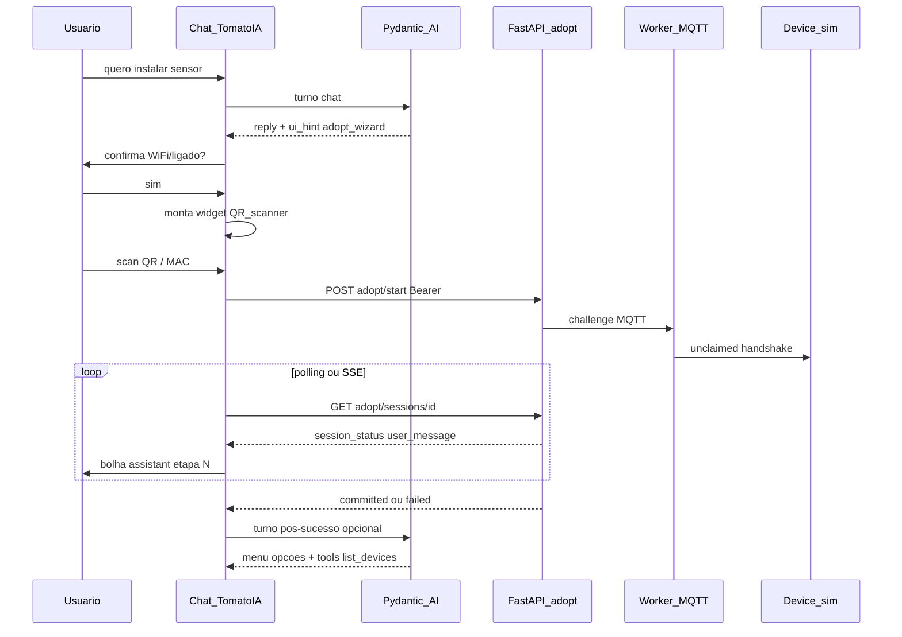

# Task 009 — Adoção guiada dentro do chat (TomatoIA + UI embarcada)

> **Status:** Em execução (009a: intent + wizard MAC dev + polling integrado ao chat)  
> **Fase:** Pós-contrato v1.2-dev ([008](008-device-adoption-handshake-refinement.md)); **paralela** ao backend adoção + **antes/ junto** com UI rica  
> **Depende de:** [008](008-device-adoption-handshake-refinement.md) (API sessão + MQTT), [007](007-tomatoia-chat-guardrails.md) (TomatoIA), [006](006-user-auth-chat-mcp.md) (6c opcional pós-sucesso)  
> **Contrato:** [`docs/contracts/device-adoption.md`](../docs/contracts/device-adoption.md) §4.5 (`user_message`), RF-ADOPT-03

## Objetivo de produto

Experiência desejada (exemplo):

1. Usuário: *“Adquiri um sensor de temperatura e quero instalar.”*
2. TomatoIA confirma pré-requisitos (**ligado**, **Wi‑Fi no device** — orientação; provisionamento Wi‑Fi é firmware §7.1).
3. **No próprio chat**, abre **janela para escanear QR** (ou MAC dev v1.2-dev).
4. Assistente pede **aguarde** e **atualiza a cada etapa** da adoção até **sucesso** ou **erro** (texto seguro, sem IDs/secrets).
5. Ao concluir, TomatoIA **enumera próximos passos**: ver informações, gráficos, comandos (actuator), listar devices — usando **MCP/tools** quando [6c](006-user-auth-chat-mcp.md) existir; senão copy orientativa.

**Isto é compatível** com “adoção não é tool MCP de handshake”: o **chat conduz a conversa e a UI**; o **backend** executa sessão + MQTT; o **LLM não** publica no broker nem faz commit sem o fluxo normal.

---

## Arquitetura — três camadas



| Camada | Responsabilidade | **Não** faz |
|--------|------------------|-------------|
| **TomatoIA (LLM)** | Diálogo, confirmações, explicar etapas, menu pós-adoção | QR decode, MQTT, commit Firestore |
| **Frontend chat** | Widgets: confirmação, **scanner QR**, polling/SSE, bolhas de progresso | Lógica de handshake (só chama API) |
| **Backend `adopt/*` + worker** | Sessão, handshake UC-A, `user_message`, commit | Renderizar câmera |

---

## Fluxo UX (passos)

| # | Estado UI | Mensagem assistant (fonte) | Ação sistema |
|---|-----------|----------------------------|--------------|
| 1 | `idle` | LLM: reconhece intenção instalar/adotar | — |
| 2 | `precheck` | LLM: pergunta Wi‑Fi + energia | Botões **Sim / Ainda não** (UI) |
| 3 | `scan` | LLM: “Escaneie o QR na moldura abaixo” | `<AdoptQrScanner />` → `mac` ou token |
| 4 | `adopting` | Texto fixo + updates | `POST adopt/start`; poll `GET .../sessions/{id}` a cada 1–2 s |
| 5a | `success` | LLM + dados sessão | `session_status=committed`; opcional `device_name` |
| 5b | `error` | **`user_message`** do backend (RF-TOM-08) | `failed` / `expired`; widget fecha |
| 6 | `post_menu` | LLM ou template | Chips: listar, telemetria, gráfico, comando — tools 6c |

Mapeamento `session_status` → copy amigável (PT, pode ser template frontend; erros **só** `user_message`):

| `session_status` | Copy exemplo (sem secrets) |
|------------------|----------------------------|
| `started` | Iniciando pareamento… |
| `device_verified` | Dispositivo reconhecido, validando… |
| `config_sent` | Enviando configuração ao dispositivo… |
| `awaiting_device_ack` | Aguardando confirmação do sensor… |
| `committed` | Pronto! Seu sensor foi adicionado. |
| `failed` / `expired` | Usar **`user_message`** |

---

## Modelo de mensagens no frontend (proposta)

Estender UI além de `{ role, text }`:

```typescript
type ChatMessage =
  | { kind: 'text'; role: 'user' | 'assistant'; text: string }
  | { kind: 'adopt_widget'; phase: 'precheck' | 'scan' | 'progress'; sessionId?: string }
```

- **Compound component** no chat ([`vercel-composition-patterns`](../.agents/skills/vercel-composition-patterns/SKILL.md)): `ChatThread` + `AdoptWizard` context, sem proliferar props booleanas no `ChatScreen` monolítico.
- Progresso **não** precisa passar pelo LLM a cada poll (evita custo/latência) — bolhas **sistema** com template; LLM entra no início, erro e pós-sucesso.

### Opcional backend (fase 2)

- `GET /devices/adopt/sessions/{id}/stream` (SSE) em vez de polling — mesmos campos JSON.
- Intent no chat: estender `ChatTurnResult` com `suggested_ui: none | start_adopt_wizard` — **somente hint**; execução continua na UI.

---

## Requisitos (RF-UX-ADOPT-*)

| ID | Requisito |
|----|-----------|
| RF-UX-ADOPT-01 | Intenção “instalar/adicionar sensor/device” **in-scope** TomatoIA (RF-TOM-02). |
| RF-UX-ADOPT-02 | Pré-check **ligado + Wi‑Fi** via UI (botões); LLM pode repetir em texto. |
| RF-UX-ADOPT-03 | Scanner QR **dentro** do painel de chat (não tool LLM). |
| RF-UX-ADOPT-04 | Durante adoção, UI mostra progresso alinhado a `session_status` / `user_message`. |
| RF-UX-ADOPT-05 | Erro: exibir **apenas** `user_message`; nunca `session_id`, MAC, tokens. |
| RF-UX-ADOPT-06 | Sucesso: mensagem de conclusão + **menu** de ações (texto; tools quando 6c). |
| RF-UX-ADOPT-07 | Handshake/commit **inalterado** — mesma API/MQTT da [008](008-device-adoption-handshake-refinement.md); **sem** tool MCP de adoção. |

---

## Ordem de implementação sugerida

1. **008 backend** — `adopt/start`, `GET session`, worker `unclaimed`, simulador.
2. **009a frontend** — rota ou modo chat + widget scan (MAC dev) + polling + templates progresso.
3. **009b** — QR câmera (`html5-qrcode` ou API nativa); deep link QR-C quando UC-B existir.
4. **009c agente** — instructions + opcional `suggested_ui`; pós-sucesso integrar `list_devices` (6c).

---

## Fora de escopo

- LLM decodificar QR ou invocar MQTT.
- Tool MCP `register_device` / `complete_adoption`.
- Substituir página dedicada “Adotar” — o wizard **pode** ser só no chat ou compartilhar componente com rota `/adopt`.

---

## Verificação

1. Frase “comprei sensor temp, quero instalar” → pré-check → scan → progresso → committed (simulador).
2. Timeout → `user_message` na bolha; sem vazamento técnico.
3. Após sucesso, menu oferece listar / telemetria (tool ou placeholder).
4. Chat off-topic inalterado (007).

---

## Histórico

| Data | Alteração |
|------|-----------|
| 2026-10-12 | Task criada — UX adoção guiada no chat (produto) |
| 2026-10-12 | 009a: `AdoptWizardPanel`, API client adopt, `ChatScreen` intent, CSS; QR câmera (009b) pendente |
