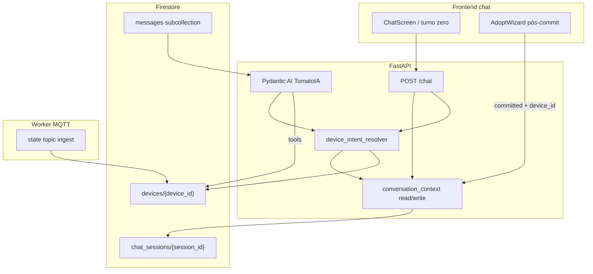
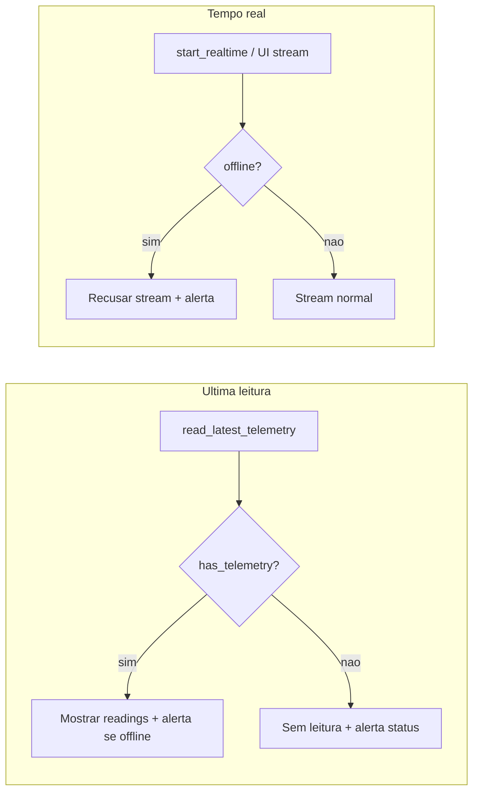

# Task 011 — Contexto de sessão de chat, política conversacional e resolver de device

> **Status:** **MVP conversacional entregue** (ondas **1** e **2** implementadas). **Sem onda 3 obrigatória** — retomar depois para opcionais, docs e fechamento formal (ver § *Encerramento MVP e retomada*).  
> **Fase:** MVP conversacional TomatoIA — complementa tools IoT existentes (`read_latest_telemetry`, tempo real UI)  
> **Depende de:** [007](007-tomatoia-chat-guardrails.md) (escopo TomatoIA), [009](009-adoption-guided-chat-ux.md) (pós-adoção / turno zero UX), [006](006-user-auth-chat-mcp.md) (tools no agente), contrato [`mcp-read-latest-telemetry`](../docs/contracts/mcp-read-latest-telemetry.md)  
> **Relacionada:** [008](008-device-adoption-handshake-refinement.md) (commit → foco), worker [004](004-mqtt-worker.md) (ingestão `state` → `last_reported_state`)

## Objetivo

Reduzir ambiguidade e pedidos impossíveis no chat (**“me mostre a última leitura”** sem device, atuador sem telemetria, vários sensores) mediante:

1. **Política conversacional normativa** (regras de inferência, clarificação vs confirmação, pós-adoção).
2. **Contexto de sessão** persistido (foco de device, snapshot enxuto de devices, espelho de último comando / state resumido).
3. **Resolver determinístico** em `services/` (decisão de qual device e qual ação; LLM redige, não adivinha).
4. **Extensão contratual** em `devices` para `last_command*` e `last_reported_state` (fonte de verdade; snapshot espelha).

**Não** substituir MCP/RAG: telemetria ao vivo continua via tools; RAG (fase 2) permanece didático.

---

## Problema (produto)

| Situação | Falha atual típica |
|----------|-------------------|
| Vários sensores, frase vaga | Tool errada, pergunta genérica ou invenção |
| 1 sensor + atuadores, “última leitura” | Assume sensor ou confunde com relé |
| Atuador | Chamar telemetria inexistente |
| Pós-adoção | Usuário leigo sem menu de próxima ação |
| Comando vs leitura | “Confirmação” desnecessária em leitura; falta clarificação |

---

## Arquitetura alvo

### Fluxo por turno (conceitual)

1. Carregar `conversation_context` + histórico in-scope (007).
2. Classificar intenção conversacional (leitura, tempo real, comando, listar, adoção orientação, off-topic).
3. **Resolver** candidatos (`list_devices` lógica ou snapshot + match nome + foco).
4. Resultado do resolver: `execute` | `clarify` | `instruct` | `off_topic`.
5. Agente/tools executam só quando `execute`; mensagens `clarify`/`instruct` usam templates + opções UI.
6. Atualizar foco e snapshot se o turno fixar ou mudar device.

| Camada | Responsabilidade | **Não** faz |
|--------|------------------|-------------|
| **Resolver (`services/`)** | Regras G1–G10, match nome, foco, impossibilidade por `device_type` | Gerar prosa longa |
| **TomatoIA** | Redação PT, chamar tools quando resolver = execute | Escolher device sem resolver |
| **Firestore `devices`** | `last_command*`, `last_reported_state` (verdade) | Snapshot de sessão |
| **Firestore `chat_sessions` doc** | `conversation_context` (foco + snapshot espelho) | Histórico de mensagens |
| **Worker** | Atualizar `last_reported_state` a partir de `.../state` | Decidir clarificação no chat |

---

## Decisões fechadas (debate produto — 2026-10-15)

| # | Decisão |
|---|---------|
| D1 | **Ambiguidade de leitura:** clarificar quando o resolver **não** reduzir a **um** sensor elegível; **nunca** “confirmação” estilo comando para leitura/tempo real. |
| D2 | **1 sensor, 0 atuadores**, intenção telemetria clara → executar sem perguntar qual device; citar nome na resposta. |
| D3 | **≥2 sensores:** match de nome na frase → foco de sessão → senão clarificar (lista). |
| D4 | **1 sensor + ≥1 atuador**, pedido tipo “última leitura” → **esclarecer intenção** (sensor vs atuador), regra **G2** — não assumir sensor em silêncio. |
| D5 | **Foco de sessão:** device recém-adotado vira foco automático; permanece até o usuário **falar de outro** (sem TTL em minutos). |
| D6 | **Pós-adoção (turno zero):** mensagem proativa perguntando **próxima ação** (última leitura, tempo real, renomear, etc.); tempo real **somente** se adotado for `sensor`. |
| D7 | **Atuador:** não tratar “última leitura” como sinônimo silencioso de state; **instruir** ações adequadas (state, comando). |
| D8 | **Snapshot de sessão:** **sem** payloads de telemetria; **com** espelho de `last_command` / `last_command_at` (atuador) e `last_reported_state` resumido. |
| D9 | **Persistência MVP:** contexto em **Firestore** doc `chat_sessions/{session_id}`; **sem Redis** até multi-réplica ou métrica justificar (ver § Armazenamento). |
| D10 | **Último comando (MVP):** fonte de verdade = plataforma (`publish_command`); **opcional** `last_reported_state` no `device` via ingestão MQTT `state` (worker). |
| D11 | **Última leitura + sensor offline:** entregar **última telemetria persistida** (se existir) **e** alerta explícito de status (`operation_status`, `last_seen_at`); deixar claro que o valor **não é ao vivo**. |
| D12 | **Tempo real + sensor offline:** **não** iniciar stream / bubble ao vivo **nem** apresentar leitura como “agora”; **somente** alerta de status + orientação (ex.: aguardar online, ver última leitura histórica). |

---

## Presença e offline (MVP)

### Definição operacional

| Sinal | Fonte | Uso no chat |
|-------|--------|-------------|
| `operation_status` | Documento `devices` (worker ingere `.../status`, LWT → `offline`) | **Primário** para online/offline |
| `last_seen_at` | Atualizado em telemetria/status | Copy do alerta (“visto por último em …”) |
| Subcoleção `telemetry` | Firestore | Última leitura **histórica** (independente de online agora) |

**Offline (MVP):** `operation_status == "offline"`. Se campo ausente (device nunca publicou status), tratar como **desconhecido** — copy honesta; não assumir online.

*(Fase posterior: “stale” por idade de `last_seen_at` mesmo com `online` — fora do MVP desta task.)*

### Comportamento por intenção

| Intenção | Sensor offline | Sensor online sem telemetria |
|----------|----------------|------------------------------|
| **Última leitura** | Valores de `read_latest_telemetry` se `has_telemetry`; senão só alerta | Alerta “ainda sem leituras” + status |
| **Tempo real** | **Sem** stream; alerta status (D12) | Stream; empty state até primeiro MQTT |

**Copy (TomatoIA):** distinguir **“última leitura registrada”** vs **“leitura ao vivo”**; nunca rotular dado stale como “agora”.

---

## Ondas de entrega (prioridade)

| Onda | Entregáveis | Bloqueio |
|------|-------------|----------|
| **1 — agora** | 011-a ✅, 011-b ✅, 011-c ✅, 011-e/f/g/k/j ✅ | Nenhum contrato “aberto” obrigatório; presença via `devices` / `DeviceSummary` / snapshot |
| **2 — depois** | 011-d/m/n/h/i ✅; evento HTTP formal 009↔chat, `focus_changed` UI (opcional) | — |

Implementação **pode** iniciar onda 1 assim que 011-b estiver aprovada, sem esperar 011-m/011-d.

---

## Contratos — status

| Artefato | Status | Notas |
|----------|--------|-------|
| [`docs/chat-conversational-policy.md`](../docs/chat-conversational-policy.md) | **Criado** (011-a v1) | Gatilhos G1–G12, foco, clarificação vs confirmação, presença, templates T1–T6 + T-INTENT-MIXED + T-POST-ADOPT. |
| [`docs/contracts/chat-session-context.md`](../docs/contracts/chat-session-context.md) | **Criado** (011-b v1) | Schema `conversation_context`, refresh, eventos lógicos, §9 não-bloqueio. |
| [`docs/glossary.md`](../docs/glossary.md) | **Atualizado** (011-c parcial) | Foco, snapshot, `operation_status`, link policy. |
| [`docs/contracts/device-adoption.md`](../docs/contracts/device-adoption.md) §2.1 `devices` | **011-d ✅** | `last_command*`, `last_reported_state`, presença |
| [`mcp-read-latest-telemetry`](../docs/contracts/mcp-read-latest-telemetry.md) | **011-m ✅** | `connectivity` + presença na saída |
| [`realtime-websocket`](../docs/contracts/realtime-websocket.md) | **011-n ✅** | WS 4409 se offline; chip pós-adoção desabilitado |
| `publish_command` (MCP + service) | **011-h ✅** | Tool MCP + `actuator_command_service` |
| Worker ingestão `.../state` → `last_reported_state` | **011-i ✅** | `summarize_state_payload` cap 2 KiB |
| Evento API/UI `adoption_committed` → chat context | **Onda 1** (011-j) | `POST /api/v1/chat/post-adoption` + chips no `ChatScreen`; evento HTTP formal opcional (onda 2). |
| UI `focus_changed` (clique lista devices) | **Onda 2** | MVP: foco via menção no chat (011-f). |
| Redis / Valkey | **Fora escopo MVP** | Documentar critério de adoção futura em policy ou requirements. |
| RAG embeddings | **Fora escopo desta task** | Didático fase 2; não resolver ambiguidade de device. |
| Fine-tune / GPU | **Fora escopo** | — |

---

## Política conversacional — tabela de gatilhos (rascunho normativo)

Referência para `docs/chat-conversational-policy.md`:

| ID | Gatilho | Ação |
|----|---------|------|
| G1 | Leitura/telemetria, 1 sensor, 0 atuadores | Executar; citar nome |
| G2 | Leitura/telemetria, 1 sensor, ≥1 atuador | Esclarecer intenção (sensor vs atuador) |
| G3 | Leitura, ≥2 sensores, sem match nome, foco não desempata | Clarificar lista sensores |
| G4 | Match nome → exatamente 1 device | Executar conforme tipo/capacidade |
| G5 | Match nome → 0 ou ≥2 | Clarificar |
| G6 | Foco válido + pedido compatível com device focado | Usar foco se resolver = 1 |
| G7 | Alvo atuador sem telemetria, pedido leitura | Instruir (state, comando) |
| G8 | Turno zero pós-adoção, `sensor` | Oferecer leitura + tempo real |
| G9 | Turno zero pós-adoção, `actuator` | Estado/comando; sem tempo real |
| G10 | Comando / destrutivo | Confirmação (fora de leitura) — alinhar task futura `publish_command` |
| G11 | Última leitura, device resolvido, `operation_status` offline | Tool `read_latest_telemetry`; resposta assistant = readings (se houver) + **alerta offline** + timestamp da leitura (D11) |
| G12 | Tempo real, device resolvido, offline | **Não** `start_realtime_telemetry` / não montar bubble live; alerta status + sugerir última leitura (D12) |

---

## Armazenamento de contexto (MVP)

### Documento `users/{user_id}/chat_sessions/{session_id}`

Campo proposto: **`conversation_context`** (versionado).

| Campo (EN) | Descrição |
|------------|-----------|
| `schema_version` | int, ex. `1` |
| `session_focus_device_id` | UUID ou null |
| `focus_reason` | `adoption` \| `user_mention` \| `ui` \| null |
| `device_snapshot` | lista cap **20** (configurável), ordenada por adoção recente |
| `device_count`, `sensor_count`, `actuator_count` | agregados espelhados |

**Entrada por item em `device_snapshot` (mínimo):**

| Campo | Obrigatório |
|-------|-------------|
| `device_id`, `display_name`, `device_type` | sim |
| `adopted_at` ou equivalente | sim (ordenação) |
| `last_seen_at`, `operation_status` | opcional (se já em `devices`) |
| `last_command`, `last_command_at` | atuador (espelho) |
| `last_reported_state` | resumo JSON pequeno (espelho) |

**Excluído explicitamente:** amostras de telemetria, payloads MQTT integrais, histórico de chat (permanece em `messages/`).

### Refresh

- Após commit de adoção (set foco + refresh).
- Após tools que alterem inventário ou comando (`list_devices`, `publish_command` bem-sucedido).
- Opcional: TTL curto de refresh agregado (ex. 60 s) — **foco** não expira por tempo (D5).

### Redis

| PoC/MVP | Adiar até: múltiplas réplicas API, latência/custo Firestore relevante, ou TTL massivo de sessões |
|---------|-----------------------------------------------------------------------------------------------------|
| Se adotado depois | Híbrido: Firestore canônico + cache Redis; **nunca** só Redis para foco |

---

## Extensão `devices` (fonte de verdade)

| Campo | Atualizado por | Uso no chat |
|-------|----------------|-------------|
| `last_command` | API `publish_command` (MVP plataforma) | Copy + snapshot |
| `last_command_at` | idem | idem |
| `last_reported_state` | Worker em mensagem `.../state` (resumo) | Atuador / G2 / G7 |

**Pendência:** schema exato de `last_command` vs `command_spec`; tamanho máximo de `last_reported_state`; política se state contradizer último comando enviado (precedência documentada).

---

## Requisitos (RF-CHAT-CTX-*)

| ID | Requisito |
|----|-----------|
| RF-CHAT-CTX-01 | Toda decisão “qual device?” para leitura/tempo real passa pelo **resolver** determinístico antes de tool de telemetria. |
| RF-CHAT-CTX-02 | Implementar gatilhos **G1–G9** conforme policy; G10 quando `publish_command` existir. |
| RF-CHAT-CTX-03 | Persistir e ler `conversation_context` no doc `chat_sessions/{session_id}` (Admin SDK). |
| RF-CHAT-CTX-04 | Pós-adoção: set `session_focus_device_id` + turno zero conforme D6/G8/G9. |
| RF-CHAT-CTX-05 | Snapshot cap configurável (default 20); telemetria **proibida** no snapshot. |
| RF-CHAT-CTX-06 | System prompt do agente **resume** policy; detalhe vive em `docs/chat-conversational-policy.md`. |
| RF-CHAT-CTX-07 | Logs estruturados: eventos resolver (`clarify`, `execute`, `instruct`) sem payload sensível — [`logging.md`](../docs/logging.md). |
| RF-CHAT-CTX-08 | Integração 009: sucesso adoção dispara atualização de contexto (não depender só do LLM inferir). |
| RF-CHAT-CTX-09 | Última leitura com sensor offline: exibir última telemetria persistida quando existir, **sempre** com alerta de offline e data da amostra (D11, G11). |
| RF-CHAT-CTX-10 | Pedido tempo real com sensor offline: recusar stream; **nenhuma** leitura apresentada como ao vivo (D12, G12). |

---

## Entregáveis e ordem sugerida

| Fase | ID | Entregável |
|------|-----|------------|
| Spec | **011-a** | `docs/chat-conversational-policy.md` |
| Spec | **011-b** | `docs/contracts/chat-session-context.md` |
| Spec | **011-c** | Atualização `docs/glossary.md` |
| Spec | **011-d** | Amend §2.1 `device-adoption.md` ou contrato `devices` dedicado para `last_*` fields |
| Backend | **011-e** | `services/conversation_context.py` (load/save/refresh snapshot) |
| Backend | **011-f** | `services/device_intent_resolver.py` + testes unitários (tabela G*) |
| Backend | **011-g** | Hook pós-turno / pré-tool em `chat_turn` + deps |
| Backend | **011-h** | `publish_command` mínimo OU mock service só para persistir `last_command*` (se 011 bloqueada) |
| Worker | **011-i** | Atualizar `last_reported_state` na ingestão `state` |
| Frontend | **011-j** | Turno zero pós-adoção (chips/ações); opcional evento foco UI |
| Agente | **011-k** | Instructions alinhadas à policy; structured hints `clarify_options` se necessário no `ChatTurnResult` |
| Spec | **011-m** | Amend `mcp-read-latest-telemetry` — campos presença + semântica offline |
| Backend/UI | **011-n** | Guard offline em `start_realtime_telemetry` + frontend (não abrir `LiveTelemetryChatBubble` se offline) |

**Ordem onda 1:** 011-a → 011-b → 011-f (testes) → 011-e → 011-g → 011-k → 011-j.  
**Ordem onda 2:** 011-d → 011-m → 011-n → 011-h → 011-i.

**Onda 3:** **não planejada** como bloco obrigatório. O escopo core (resolver, contexto, pós-adoção, presença, MCP `publish_command`, worker `state`, etc.) está nas ondas 1–2.

---

## Encerramento MVP e retomada

Registro para retomar a task em outro momento: **não há uma “onda 3” obrigatória**. As ondas **1** e **2** (resolver, contexto, pós-adoção, presença, MCP `publish_command`, worker `state`, etc.) estão **implementadas**. O que resta é **opcional** ou **fechamento de produto/docs** — dá para tratar a **011 como MVP conversacional fechado** e só pegar os itens abaixo quando fizer sentido.

### Opcionais / fechamento (esta task)

| Item | Natureza |
|------|----------|
| **`focus_changed` UI** | Clicar na lista de devices e setar foco (`focus_reason=ui`); hoje o foco vem de adoção ou menção no chat. |
| **Evento HTTP formal 009 ↔ chat** | Substituir ou complementar `POST /chat/post-adoption` por contrato de evento único (nice-to-have). |
| **Pendências § abaixo** | Decisões de spec (schema fino `last_command` / `last_reported_state`, turno zero persistido vs template, precedência state vs comando na copy) — mais **documentação/alinhamento** que nova onda. |
| **Hardening recente** | Atalhos do resolver (MAC/IP/tópicos MQTT), multi-provedor LLM (OpenAI), limites de turno (`CHAT_AGENT_REQUEST_LIMIT`) — **registrar** em [`docs/chat-conversational-policy.md`](../docs/chat-conversational-policy.md) / esta task e, quando estável, **marcar status 011 como concluída** no [`task/README.md`](README.md). |

### Outras frentes do projeto (não são ondas da 011)

| Task | O que falta (alto nível) |
|------|---------------------------|
| [006](006-user-auth-chat-mcp.md) | MCP/tools no chat (ex.: `update_device`, histórico…) |
| [007](007-tomatoia-chat-guardrails.md) | Verificação manual dos guardrails TomatoIA |
| [008](008-device-adoption-handshake-refinement.md) | Refino handshake adoção no backend |
| [009](009-adoption-guided-chat-ux.md) | QR câmera, polish UX adoção |
| [010](010-embedded-esp32c3-micropython.md) | Firmware ESP32-C3 / MicroPython |
| [005](005-structured-logging.md) | Logging estruturado (planejamento) |

**Fora do MVP** (requirements / 011): Redis, RAG, gráficos/histórico telemetria, rename produto, etc.

**Priorização sugerida na retomada:** fechar **011** (status + doc dos atalhos do resolver) **ou** **009/008** (adoção E2E) — **não** uma terceira onda grande de contexto de chat.

---

## Pendências a fechar (docs / alinhamento — não bloqueiam MVP)

1. **Schema JSON** final de `last_command` e `last_reported_state` (limites bytes, campos obrigatórios).
2. **Gatilho turno zero:** mensagem **sistema** persistida vs turno LLM vs SSE pós-commit (custo/latência).
3. **Detecção de intenção:** só heurísticas + resolver vs campo no `ChatTurnResult` (`intent: read_telemetry | realtime | …`).
4. **Cap snapshot** default 20 — env `CHAT_DEVICE_SNAPSHOT_CAP`?
5. **Precedência** state MQTT vs `last_command` plataforma na copy da TomatoIA.
6. **Alinhamento 009 RF-UX-ADOPT-06** com G8/G9 (menu pós-sucesso → mesma policy que turno zero).
7. **Turno zero / chips “tempo real”:** desabilitar ou interceptar chip se snapshot/`devices` indicar offline (G12).
8. ~~**Template PT** único para alerta offline~~ — **fechado** em [`docs/chat-conversational-policy.md`](../docs/chat-conversational-policy.md) §8 (T1–T6).

---

## Fora de escopo (esta task)

- Redis/Valkey em docker-compose.
- RAG / embeddings para desambiguação.
- Fine-tuning ou classificador ML dedicado.
- Pydantic Graph completo (opcional fase 2 se regras > ~15 gatilhos).
- Substituir Firestore por SQLite para contexto.

---

## Matriz de versões

| Componente | Versão / nota |
|------------|----------------|
| Python | 3.13+ (projeto) |
| Firestore | Schema doc session + fields device (sem migração automática — backfill opcional) |
| Redis | **N/A** MVP |
| Docker | Sem imagem nova nesta task |

---

## Verificação

1. Usuário com **1 sensor**: “última leitura” → tool correta sem pergunta; nome do sensor na resposta.
2. **2 sensores**, frase vaga → clarificação com 2 opções; sem tool até escolha.
3. **1 sensor + 1 atuador**, “última leitura” → pergunta sensor vs atuador (G2).
4. Pós-adoção sensor → turno zero oferece leitura + tempo real; atuador **não** oferece tempo real.
5. Foco pós-adoção → pedido compatível usa foco; após mencionar outro device, foco muda.
6. `conversation_context` persiste entre turnos (reload sessão).
7. Após `publish_command` (quando existir), snapshot/device refletem `last_command_at`.
8. Worker `state` atualiza `last_reported_state`; snapshot refresh reflete resumo.
9. Off-topic 007 inalterado; logs sem telemetria no snapshot.
10. Sensor **offline** com telemetria antiga: “última leitura” mostra valores + alerta + data da amostra (G11).
11. Sensor **offline**, pedido tempo real: sem bubble/stream; só alerta (G12).
12. Sensor offline **sem** telemetria: última leitura = alerta status, sem inventar valores.

---

## Histórico

| Data | Alteração |
|------|-----------|
| 2026-10-15 | Task criada — consolida debate política conversacional, contexto Firestore, resolver, contratos pendentes |
| 2026-10-15 | D11–D12, G11–G12, RF-CHAT-CTX-09/10 — presença offline: última leitura histórica + alerta; tempo real bloqueado |
| 2026-10-15 | 011-a: `docs/chat-conversational-policy.md` v1; glossário; templates PT fixos; desconhecido se `operation_status` ausente |
| 2026-10-15 | 011-b: `docs/contracts/chat-session-context.md` v1; ondas 1/2; contratos abertos marcados não impeditivos |
| 2026-10-16 | Onda 1 código: `conversation_context`, `device_intent_resolver`, `resolver_turn`, hook `chat_turn`, templates, testes resolver |
| 2026-10-16 | Onda 1 fechada: atuador NL + `post_adoption_turn`, `POST /chat/post-adoption`, frontend chips pós-adoção; pytest 37 OK |
| 2026-10-16 | Onda 2: contrato devices, read_latest presença, WS 4409, MCP `publish_command`, worker `last_reported_state`, chips offline |
| 2026-10-16 | § *Encerramento MVP e retomada*: sem onda 3 obrigatória; opcionais (`focus_changed`, evento 009), hardening resolver/LLM; mapa de outras tasks |
